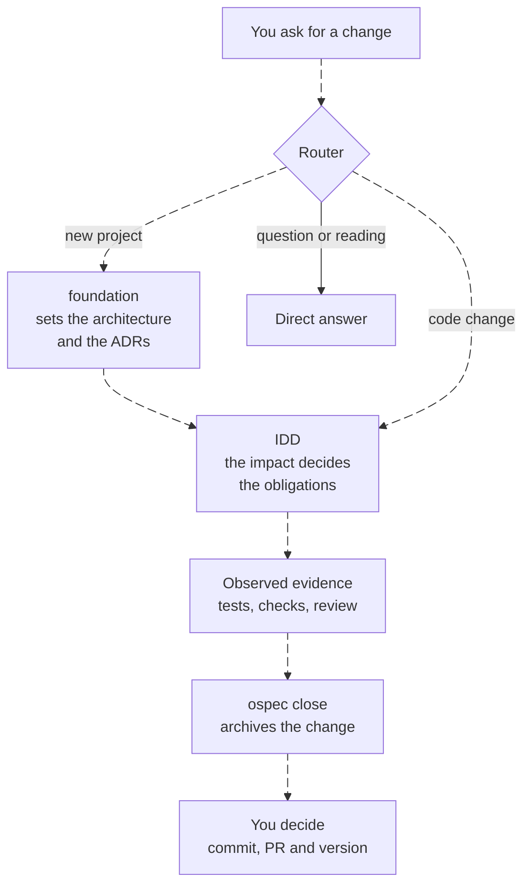

# Quick guide: how ospec-workflow works

> **In short:** `ospec-workflow` is a harness for AI coding assistants (Claude Code, Copilot, Cursor and four more). You ask for a change in your own words, as always. The difference is that the assistant cannot call it done on its own say-so: the `ospec` CLI decides which tests and reviews the change owes from its impact, and closes it only when it sees that evidence run on the current code. This is **IDD** (impact-driven development), the default flow. SDD, spec-driven development, is an optional mode.

This is the English version of the [handbook quickstart](../../handbook/quickstart.md). The rest of the handbook is in Spanish.

---

## The idea in one diagram

1. **The router.** The installer adds short instructions that the assistant always reads. They send every code change to IDD, answer questions directly and enter SDD only when you ask for it.
2. **Foundation, for a new project.** Before the first change, the `foundation` skill asks about goals, constraints and quality, and records each architecture decision as an ADR. IDD enforces those ADRs on every change.
3. **IDD.** The agent records what you ask for and how it is checked, asks you at once what the request leaves open, and declares which files it will touch. The **obligations** come from there: a bug owes a test that reproduces it, a migration owes a rollback plan, an authentication change owes a security review.
4. **The evidence.** Only what the CLI sees run counts. Saying "the tests pass" satisfies nothing.
5. **The close.** `ospec close` archives the change when nothing is pending and, if you configure it, writes its line in the CHANGELOG and proposes the version.
6. **You decide.** Commits, branches, pull requests and versions are still your decision.

---

## What you do and what the agent does

| You | The agent | The `ospec` CLI |
| --- | --- | --- |
| Ask for the change in your own words. | Records the intent and the acceptance criterion. | Keeps the state in `idd/<change>/state.yaml`. |
| Answer the open questions, all in one batch. | Lists what neither the request nor the code settles. | Opens the `open-facts` gate and lets nothing move without your answer. |
| Approve the project checks the first time. | Proposes the test command. | Runs no check you have not approved. |
| Answer when the change departs from an ADR or is about to delete data. | Stops and asks you. | Opens the matching gate. |
| Commit, open a PR and cut a version whenever you want. | Writes the code and the tests and runs the commands. | Derives the obligations, observes the evidence and closes. |

The agent stops only at nine *gates*: abandoning a change, ambiguous intent, a bug that becomes a feature, open facts, an ADR amended or contradicted, an irreversible operation, the trust review limit, changed checks and a moved change base. Only an explicit answer from you resolves them.

---

## What you gain

- **Nothing is taken as done without proof.** A change does not close without the real output of its tests, green, on the current code.
- **Proportional ceremony.** A typo only passes the checks; a schema migration also needs its migration test and its rollback plan.
- **The architecture is respected.** The ADRs that foundation records are not forgotten documents: every change declares its impact on them and their checks run.
- **The state lives in the repository.** Everything stays in `idd/`, not in the chat. If you close the window, you lose nothing.
- **One harness for 7 tools:** Claude Code, VS Code, GitHub Copilot, OpenCode, Codex, Cursor and Antigravity.
- **Protection in every tool:** secrets and destructive commands are blocked before they run.

---

## Where to read next

- [README](../../README.md): the full English guide, with the installation per tool, the IDD signals and obligations, the optional SDD mode, model routing and the guarantees.
- [English overview](README.md): IDD in one paragraph, the core guarantees and the Claude Code install.
- The handbook, in Spanish: on the [website](https://ospec-workflow.mretamozo.com) or in [`handbook/`](../../handbook/). Start with [a change from start to finish](https://ospec-workflow.mretamozo.com/empezar/primer-cambio/) and [the cycle of a change](https://ospec-workflow.mretamozo.com/idd/flujo-idd/).
- License: MIT with the Commons Clause, as the [README](../../README.md#license) explains.

---

## Files you will see in your project

| File | What it is for | Mode |
| --- | --- | --- |
| `idd/config.yaml` | IDD configuration: `checks` (without them no change closes), `strict_tdd`, `team`, `delivery`, `impact` and `contracts`. `mode: sdd` turns IDD off. | IDD |
| `idd/<change>/` and `idd/archive/` | The state of each change (`state.yaml`, `change.md`) and the closed changes. Only the CLI writes the state. | IDD |
| `docs/architecture/decisions/` | The ADRs that foundation records and that every change must respect. | Both |
| `.ospec/` | Local harness data: the turn count, the session traces and the caches. | Both |
| `openspec/` | Configuration, specs and changes of the SDD mode. IDD neither reads nor writes it. | SDD |

The `ospec` CLI has these commands: `status`, `next`, `record`, `signals`, `check`, `run`, `review`, `close`, `abandon`, `doctor`, `router`, `team`, `snapshot` and `foundation`. The agent usually runs them, not you.
