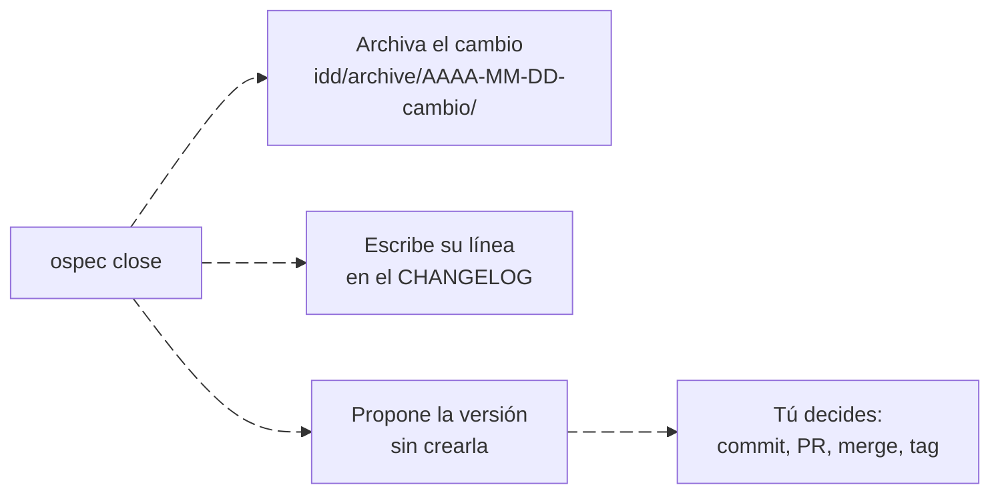
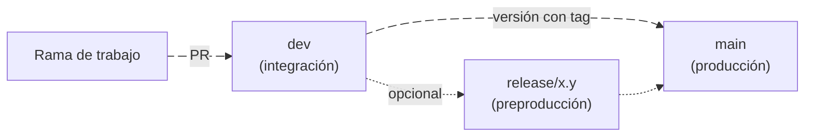

---
sidebar:
  order: 6
---

# Entrega: ramas, changelog y versiones

> **En pocas palabras:** ospec no hace commits, no crea ramas y no publica versiones: eso sigue siendo decisión tuya. Lo que sí hace, si lo declaras en `delivery:` de `idd/config.yaml`, es escribir al cerrar la línea del cambio en tu CHANGELOG, proponerte la versión siguiente y recordar al agente cómo integra tu proyecto (una PR cada vez o varias en paralelo, rama de desarrollo o no). Además puede exportar el avance del proyecto como un snapshot para un panel o un cliente.

---

## Qué pasa al cerrar



Con esta configuración:

```yaml
delivery:
  changelog: CHANGELOG.md
  release: per-change
```

`ospec close`, después de archivar el cambio:

1. **Añade su línea al CHANGELOG** en formato [Keep a Changelog], bajo `## [Unreleased]`, en la sección que le toca por su tipo: `feature` → `Added`, `bug` → `Fixed`, `refactor` y `docs` → `Changed`. La línea es `- <resumen> (<id-del-cambio>)`. Si el alcance creció a mitad del cambio y el resumen se quedó corto, `ospec record changelog --change <id> --line "<texto>"` declara la línea que se publica en su lugar, tantas veces como haga falta mientras el cambio esté abierto, y `--clear` vuelve al resumen. El intent y su aceptación no cambian.

   **Un ajuste después de cerrar.** Si pides un retoque de un cambio ya cerrado antes de publicar su versión, el retoque es un cambio nuevo, con su ceremonia entera, pero no tiene por qué ocupar una línea en el CHANGELOG: `ospec record completes --change <id> --of <id del cambio cerrado>` lo declara como seguimiento, y al cerrar no añade entrada. Vale mientras la entrada del cambio original siga bajo `## [Unreleased]`; si ya salió en una versión, el CLI lo rechaza y `--clear` hace que el seguimiento escriba la suya. Si el seguimiento declara además una línea con `ospec record changelog`, esa línea sustituye el texto de la entrada original. Un seguimiento completa un solo cambio, y no se encadenan: el seguimiento de un seguimiento nombra al cambio original. Si falta la sección o el fichero, los crea. Cerrar otra vez no duplica la línea.
2. **Propone la versión** (`release: per-change`): un minor si `[Unreleased]` tiene `Added` y un patch si no, con su tag y las notas de `[Unreleased]`. Nunca propone un major: el agente te pregunta si el cambio rompe la compatibilidad. **El CLI no toca versiones, tags ni releases**: el agente solo las crea con tu OK.

Un ejemplo real está en [Un cambio de principio a fin](/handbook/empezar/primer-cambio.md#5-los-checks-y-el-cierre).

[Keep a Changelog]: https://keepachangelog.com/es-ES/1.1.0/

---

## Las claves de `delivery`

| Clave | Valores | Qué decide |
| --- | --- | --- |
| `branching` | `serial`, `parallel` | `serial`: una sola PR en curso cada vez. `parallel`: varias ramas a la vez, integrando la rama principal antes de cada merge. Sin declarar, lo decide el perfil de equipo; sin perfil, se recomienda `serial`. |
| `changelog` | Una ruta relativa, o `none` | Dónde escribe `ospec close` la línea de cada cambio. Sin declarar, no escribe nada y `ospec next` lo sugiere (`changelog-undeclared`). |
| `release` | `per-change`, `batched`, `none` | `per-change`: propone una versión por cambio. `batched`: las versiones se cortan cuando tú decides, agrupando cambios. `none`: sin versiones. |
| `integration_branch` | Un nombre de rama | La rama de desarrollo donde se integra cada cambio, si no es la principal (por ejemplo `dev`). |
| `production_branch` | Un nombre de rama | La rama de producción, si no es la rama por defecto del repositorio. Necesita `integration_branch`. |
| `language` | Una etiqueta de idioma: `es`, `en`, `fr`, `pt-BR` | El idioma en que se escribe el proyecto. Sin declarar, `ospec next` lo sugiere (`language-undeclared`). Ver [El idioma del proyecto](#el-idioma-del-proyecto). |

Mientras falte una clave importante, `ospec next` lo sugiere sin bloquear (por ejemplo, `branching-undeclared` con la razón para usar `serial`). El agente te propone el valor y solo lo escribe con tu aprobación. `ospec team` muestra los valores efectivos y de dónde salen.

**ospec no lee git.** Las reglas de ramas que devuelven `ospec next` y `ospec close` son una guía para el agente, no una comprobación.

### Con una rama de desarrollo

```yaml
delivery:
  branching: serial
  integration_branch: dev
  production_branch: main
  changelog: CHANGELOG.md
  release: batched
```



- Las ramas de trabajo salen de `dev` y sus PR van a `dev`. La línea del CHANGELOG llega a `[Unreleased]` de `dev` con el merge.
- `main` solo recibe merges de `dev` o de una `release/x.y`, y cada uno es una versión con su tag.
- `release/x.y` es opcional: sale de `dev`, solo recibe arreglos, puede llevar versiones `x.y.z-rc.N`, se fusiona en `main` y de vuelta en `dev`, y después se borra.
- La versión se propone al pasar a producción, no en cada merge a `dev`. Por eso `release: per-change` se rechaza con una rama de integración.

### El idioma del proyecto

```yaml
delivery:
  language: es
```

Con `language` declarado, el agente escribe en ese idioma los mensajes de commit, los títulos y cuerpos de las PR, las entradas del CHANGELOG, la documentación y los comentarios de código. Da igual en qué idioma le hables: un equipo francés declara `fr` y un proyecto abierto en inglés declara `en`.

- **Qué conserva su idioma.** Una respuesta en un hilo usa el idioma del hilo. El texto que se añade a un fichero o a un árbol de documentación ya escrito en otro idioma sigue en ese: un fichero nunca mezcla dos.
- **Cómo se escriben la documentación y los comentarios.** Concisos y funcionales: lo que hace falta para usar o cambiar el código. No nombran la herramienta que los escribió ni los motivos que se dieron en la conversación.
- **El valor.** Una etiqueta de idioma, con escritura y región opcionales (`zh-Hant-TW`, `es-419`). Se acepta en mayúsculas o minúsculas y se guarda en su forma canónica. Un nombre como `Spanish` termina con `config-invalid`.
- **Dónde lo ve el agente.** `ospec next` devuelve la etiqueta en cada paso de un cambio abierto, y las reglas completas al declarar el plan y al cerrar. `ospec team` las muestra siempre.
- **Sin declarar.** Nada lo decide por ti. El agente te propone el idioma de los asuntos de los últimos commits, o el tuyo si el proyecto no tiene historial, y lo escribe solo con tu aprobación. Mientras tanto escribe en ese idioma.

Es una guía para el agente, no una comprobación: ospec no lee el texto que se escribe.

---

## Cambios en varios repositorios

`ospec` trabaja sobre un único repositorio. Un cambio que atraviesa varios es **un cambio IDD por repositorio**, cada uno cerrado con su propia evidencia.

- Mantén compatible un contrato compartido hasta que todos sus consumidores migren: primero amplía el proveedor, después migra los consumidores y elimina la forma antigua al final.
- En un monorepo cuyos servicios tienen sus manifiestos por debajo de la raíz, declara en `impact:` el `stack` y las rutas de contrato, datos y seguridad de cada servicio.

El modo SDD tiene además un atlas que coordina cambios entre repositorios: [Federación multi-repositorio](/handbook/sdd/federacion.md).

---

## El snapshot de avance

`ospec snapshot` exporta bajo demanda el avance del proyecto como JSON, para publicarlo en un panel o enseñárselo a un cliente. Ningún paso de IDD, ningún hook y ningún check lo ejecutan: publicarlo, por ejemplo desde tu CI, es cosa tuya.

```bash
ospec snapshot --out avance.json                       # v1: fases y estado
ospec snapshot --schema-version 4 --out avance.json    # v4: todo lo anterior y la documentación para el cliente
```

- **Las fases** salen de `docs/roadmap.md` (u otro fichero con `--roadmap`): cada fila de tabla cuya primera celda empieza por `<ID>. <título>`, como `P1b.1. Revocación de acceso`. Un cambio IDD o SDD pertenece a la fase si su id empieza por el de la fase sin puntos (`p1b1-revocacion`). La fase está `in-progress` con un cambio abierto, `done` si solo tiene cambios archivados y `pending` si no tiene ninguno.
- **v2** añade los tramos del roadmap (encabezados `##`) y los textos para el cliente de `docs/progress.md` (u otro fichero con `--progress`).
- **v3** añade la etapa de entrega de cada fase terminada: en pruebas, o en producción con su versión y su fecha, leídas del CHANGELOG.
- **v4** añade la documentación para el cliente (problema, objetivos, alcance, entregables) y las decisiones de los ADR aceptados o sustituidos.

Un roadmap ausente o inválido termina con código 1 y un mensaje con el fichero y la línea, sin escribir nada. Los esquemas están en [`schemas/progress-snapshot/`](https://github.com/snakeblack/ospec-workflow/tree/main/schemas/progress-snapshot).

---

## Fuentes

- [Contrato IDD](https://github.com/snakeblack/ospec-workflow/blob/main/openspec/specs/idd/spec.md): REQ-idd-023 (perfil de equipo y ramas), REQ-idd-025 (CHANGELOG y versión al cerrar) y REQ-idd-026 (snapshot).
- [Documentación técnica](https://github.com/snakeblack/ospec-workflow/blob/main/docs/README.md): el formato completo del fichero de avance.
