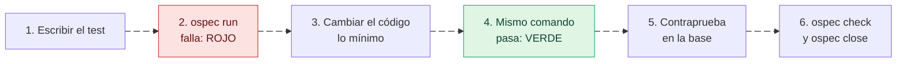
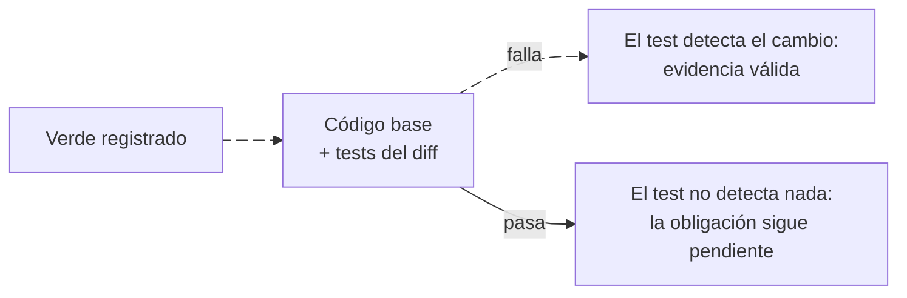

---
sidebar:
  order: 4
---

# Evidencia y tests

> **En pocas palabras:** en IDD, **la evidencia solo cuenta si el CLI `ospec` la ve ejecutarse** sobre el árbol actual. Decir «los tests pasan» no satisface ninguna obligación. Un test de reproducción tiene que fallar antes del arreglo y pasar después, y además el CLI comprueba que falla con el código de antes del cambio: así demuestra que el test detecta el problema.

---

## Evidencia observada, no declarada

| Obligación | Qué la satisface | Comando que la registra |
| --- | --- | --- |
| `checks-pass` | Todos los checks de `idd/config.yaml` en verde sobre el mismo árbol | `ospec check` |
| `boundary-tests` | Un test que añade el diff y un check en verde que reporta más de cero tests y falla en la base con los tests del diff | `ospec check` |
| `repro-test` | Un test de reproducción que falla antes del arreglo, pasa después y falla en la base | `ospec run --obligation repro-test --command "<test>"` |
| `tdd-red-green` | El mismo par rojo-verde, por unidad de trabajo | `ospec run --obligation tdd-red-green --command "<test>" --unit <nombre>` |
| `migration-compat-and-test` | Un plan de compatibilidad o de vuelta atrás y un test de migración en verde | `ospec run --obligation migration-compat-and-test --command "<test>" --plan "<plan>"` |
| `contract-spec-and-test` | El documento de contrato y su test tocados, con los checks en verde | `ospec check` |
| `trust-review` | Una revisión independiente aprobada | `ospec review` ([Revisión en IDD](/handbook/idd/revision.md)) |
| `adr-impact-declaration` | El impacto declarado sobre cada ADR y sus fitness checks en verde | `ospec record impact` y `ospec check` ([Foundation](/handbook/idd/foundation.md)) |

Reglas que se aplican siempre:

- **`ospec record` no acepta evidencia.** Solo `run`, `check` y `review` la registran, porque son los que observan la ejecución.
- **Un comando que no arranca, o que termina por una señal, no cuenta como pasado.**
- **Cero tests no cuenta.** Una salida como `tests 0`, «could not find» o «no tests ran» no satisface nada.
- **La evidencia pertenece a un árbol.** Si cambias un fichero después de un check en verde, `checks-pass` vuelve a pendiente y `ospec close` rechaza el cierre con `evidence-stale` hasta el siguiente `ospec check`. Cambiar el nombre, el comando o el orden de un check también invalida la evidencia anterior.

---

## Rojo y verde

- **`repro-test`** (bugs): el test de reproducción se ejecuta con `ospec run` antes del arreglo y debe fallar; después del arreglo, el mismo comando debe pasar. El verde tiene que correr sobre un árbol distinto del rojo.
- **`tdd-red-green`** (Strict TDD): el mismo par, por unidad de trabajo. Los dos runs comparten comando y unidad.

### La contraprueba

Un test que pasa siempre también «pasa después del arreglo». Para descartarlo, cuando el verde llega el CLI monta en un directorio temporal **el código de antes del cambio con los tests nuevos encima** y ejecuta el mismo comando:

Además corre un control, la base sin los tests nuevos: si falla igual, el fallo no venía del test. En el [ejemplo del recorrido](/handbook/empezar/primer-cambio.md) se ven las dos ejecuciones: `exit 1` con el test nuevo y `exit 0` sin él.

Detalle técnico de la contraprueba

- **Cuándo corre:** al registrar el verde de una pareja rojo-verde, y antes de dar por cumplida `boundary-tests`.
- **Qué monta:** un worktree temporal de la base del cambio con los tests del diff encima, más lo que haya bajo `testdata/`, `__snapshots__/`, `fixtures/` o `__fixtures__/`. Enlaza las dependencias ignoradas (`node_modules`, `.venv`, `venv`, `vendor` y similares), pero no `dist`, `build` ni `target`, que son el producto del candidato.
- **Qué es un test:** un fichero bajo `test/`, `tests/` o `__tests__/`, bajo el `spec/` de la raíz, o con nombre de test: `*.test.*` y `*.spec.*` en JS y TS, los sufijos `_test` y `_spec`, `test_*.py`, `tests.py`, `tests.rs`, `*Test.java`, `*Tests.java` y `*Tests.cs`. Cuenta si tiene extensión de código o es SQL (pgTAP, pg_prove, dbt), y si el diff le añade una línea de código: un comentario, un fixture o un fichero golden no cuentan. Un `.sql` fuera de los tests, como una migración, no es test ni código de producto.
- **Tests de base de datos:** la contraprueba comparte la base de datos local con el árbol de trabajo y la deja en el estado de la base del cambio. Usa un comando hermético que la reconstruya, como `supabase db reset && supabase test db`.
- **El control:** si la contraprueba falla, el mismo comando corre sobre la base sola. La contraprueba solo vale si el control pasó, o falló de otra forma (otro código de salida u otra salida).
- **Rojo no concluyente:** si en la base sola fallan también los checks declarados, al directorio temporal le falta algo que los tests necesitan (un build, una dependencia). Entonces no bloquea, pero la evidencia lleva `counterproof_skipped` y `run`, `check` y `close` lo avisan.
- **Cuándo se omite, con aviso:** sin commit base, cuando la base no se puede montar, con tests inline de Rust, o cuando el diff solo cambia tests y documentación. Si después el diff cambia código de producto, `check` reabre la pareja.
- **Qué documentación es producto:** un documento que el proyecto declara en `contracts.documents`, o en una lista propia de `impact` de la que sale una señal, no cuenta como documentación: su test tiene que fallar en la base. `idd/config.yaml` también es producto, así que un arreglo que vive solo en él cierra su pareja con contraprueba.
- **Límites:** 10 minutos de timeout, que cuentan como fallo. El resultado se reutiliza mientras no cambien la base, el comando y los tests.

---

## Strict TDD

- Con `strict_tdd: true`, cada unidad de trabajo exige un par rojo-verde, salvo en cambios `docs` y `refactor`: un rojo describe comportamiento nuevo, y un refactor conserva el que ya prueban los tests existentes.
- Sin declarar, decide el perfil de equipo: `solo` → no, `small` y `multi-team` → sí, y `experience: junior` → siempre sí. Sin perfil, no. `ospec team` muestra el valor efectivo.
- Un refactor no escribe tests nuevos: antes de la primera edición se ejecuta `ospec check`, para que quede registrado qué comportamiento ya estaba probado.
- `ospec doctor` avisa (`strict-tdd-hook`) si el hook de pre-commit y `strict_tdd` no coinciden.

---

## Qué testear

Se testea lo que costaría si se rompiera: reglas de negocio, validaciones, transformaciones no triviales, algoritmos y contratos, con sus caminos de error, de borde y de regresión. Un accesor simple o un cableado sin lógica no necesitan test propio. Ningún porcentaje de cobertura sustituye esta elección.

- Un test debe fallar cuando el comportamiento es incorrecto: comprueba resultados observables, no llamadas internas. En el rojo, hay que comprobar que falla por la razón esperada.
- Los tests unitarios son deterministas y sin red: los dobles sustituyen bases de datos, APIs externas e infraestructura, y el tiempo y el azar se inyectan. Las pruebas de integración van aparte.

---

## Verificación en modo SDD (opcional)

En SDD la verificación es otra: la tabla de evidencias de `apply-progress.md`, el ciclo TDD de `sdd-apply` y el agente `sdd-verify`. Está en [Verificación en SDD](/handbook/sdd/verificacion-sdd.md).
