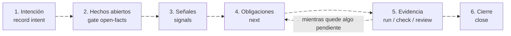

---
sidebar:
  order: 3
---

# El ciclo de un cambio

> **En pocas palabras:** cada cambio IDD recorre seis pasos: intención, hechos abiertos, señales, obligaciones, evidencia y cierre. El impacto del cambio decide qué pruebas y revisiones exige, y el CLI `ospec` solo lo da por terminado cuando ve ejecutarse esa evidencia sobre el árbol actual. No hay fases ni documentos que escribir antes. Esta página es la referencia; el ejemplo comentado está en [Un cambio de principio a fin](/handbook/empezar/primer-cambio.md).

---

## Los seis pasos



Los comandos los ejecuta el agente. Todos los que actúan sobre un cambio llevan `--change <id>`, con un id en kebab-case, y aceptan `--json`. Cada uno termina diciendo el siguiente paso.

1. **Intención.** Qué se pide y cómo se comprueba que está hecho:
   `ospec record intent --change <id> --kind <bug|feature|refactor|docs> --summary "<qué>" --acceptance "<resultado observable>"`, con un `--open-fact "<pregunta>"` por cada hecho abierto, o `--no-open-facts --basis "<qué lo fija>"` si no hay ninguno. Si la petición no permite fijar una aceptación, `--ambiguous --request "<petición>"` abre el gate `ambiguous-intent`.
2. **Hechos abiertos.** Son los comportamientos que ni la petición ni el código fijan: valores por defecto, entradas inválidas, error frente a silencio, quién puede hacerlo. Se preguntan todos juntos antes de editar nada. En una `feature`, el agente debe cubrir las categorías `inputs`, `uniqueness`, `persistence`, `copy`, `url-state`, `accessibility` y `errors`, cada una con una pregunta, una referencia `ruta:línea` o una cita de tu petición, y al menos una tiene que ser una pregunta: siempre ves el plan antes de que se construya.
3. **Señales.** El agente declara los ficheros que espera tocar: `ospec signals --change <id> --path <fichero>`, un `--path` por fichero. Puede añadir `--work-units`, `--decision`, `--operation`, `--adr`, `--quality` o `--security`, que declara a mano una frontera de seguridad que ni las rutas ni el contenido delatan. Después, `ospec check` recalcula las señales desde el diff real y puede añadir obligaciones. Si el plan exageró una señal, `ospec record retract` la corrige antes de que el diff la confirme.
4. **Obligaciones.** `ospec next --change <id>` dice el siguiente paso: qué gate resolver, qué obligación trabajar o `close`. Cada señal activa su obligación (tabla siguiente).
5. **Evidencia.** Se registra solo con comandos que observan la ejecución:
   - `ospec run --obligation <repro-test|tdd-red-green|migration-compat-and-test> --command "<test>"`, para reproducciones, pares rojo-verde y migraciones;
   - `ospec check`, que ejecuta los `checks:` del proyecto y los fitness checks de los ADR;
   - `ospec review start|record|correct|validate`, para la [revisión de confianza](/handbook/idd/revision.md).
6. **Cierre.** `ospec close --change <id>` funciona solo cuando no queda ninguna obligación pendiente ni ningún gate abierto. Archiva el cambio en `idd/archive/` y, si está configurado, escribe el CHANGELOG y propone la versión ([Entrega](/handbook/idd/entrega.md)).

`ospec status` lista los cambios y `ospec doctor` revisa el proyecto y la instalación sin escribir nada.

---

## Señales y obligaciones

| Señal | Se activa cuando | Obligación | Qué la satisface |
| --- | --- | --- | --- |
| `always` | Todo cambio con intención resuelta | `checks-pass` | Una ejecución en verde de cada check del proyecto sobre el árbol actual |
| `strict-tdd` | `strict_tdd: true` (salvo cambios `docs` y `refactor`) | `tdd-red-green` | Un test que falla antes del código y pasa después, por unidad de trabajo |
| `bug-fix` | Intención `bug` | `repro-test` | Un test de reproducción que falla antes del arreglo y pasa después |
| `untested-product` | Intención `feature` o `bug`, y el diff toca código de producto sin añadir código a ningún test | `boundary-tests` | Un test que añade el diff y un check en verde que reporta más de cero tests |
| `multi-unit-or-decision` | Más de una unidad de trabajo o una decisión declarada | `living-doc` | `idd/<cambio>/change.md` con el plan y las decisiones, al cerrar |
| `public-contract` | El cambio toca un contrato público: rutas de API, OpenAPI, proto o GraphQL, o lo que publica un `package.json` no privado | `contract-spec-and-test` | El documento de contrato y su test, ambos tocados, con los checks en verde |
| `persistent-data` | El cambio toca datos persistentes: migraciones, SQL, esquemas, o código de producto que escribe en disco o en `localStorage` | `migration-compat-and-test` | Un plan de compatibilidad o de vuelta atrás (`--plan`) y un test de migración en verde |
| `security-boundary` | El cambio toca una frontera de seguridad: autenticación, permisos, secretos o credenciales, o añade a código de producto un sink de seguridad (`eval`, SQL concatenado, un comando de shell compuesto, TLS sin verificar, deserialización insegura…) | `trust-review` | Una [revisión de confianza](/handbook/idd/revision.md) independiente, aprobada para el código actual |
| `adr-or-quality-attribute` | El cambio declara un ADR o un escenario de calidad, o toca un componente ligado a ellos | `adr-impact-declaration` | El impacto declarado sobre cada uno y sus fitness checks en verde ([Foundation](/handbook/idd/foundation.md)) |

Los patrones de ruta se adaptan al stack que detecta en la raíz (Node, JVM, .NET, Python, Go) y se amplían con `impact:` en `idd/config.yaml`. La documentación (`**/*.md`, `docs/**`) no activa ninguna señal de impacto.

Los sinks de seguridad salen de un catálogo por lenguaje (`scripts/lib/idd-sinks.js`, adaptado del de gentle-ai) y solo cuentan en las líneas que el diff añade a código de producto: un comentario, un test o la documentación no los activan. Cuando solo el contenido deriva `persistent-data`, `public-contract` o `security-boundary`, la señal se retira únicamente con tu respuesta (`ospec record retract … --answer "<tus palabras>" --source user`), atada a las líneas que viste: una línea nueva o una ruta la devuelven. `public-contract` que deriva una ruta (un patrón de `impact` o un fichero que publica el `package.json`) también se retira con tu respuesta cuando ninguna de esas rutas es un documento de contrato, atada a los cambios que viste en cada una: otro cambio en esa ruta o una ruta de contrato nueva la devuelven. Un sink que aparece después de aprobar la revisión de confianza la deja desfasada.

Una señal que aparece en el diff se añade en el momento, con su obligación pendiente. Una obligación solo deja de estar pendiente con evidencia, o con una retirada explícita (`ospec record withdraw`) cuando ya ninguna señal activa la deriva.

### La ceremonia, en ejemplos

| Cambio | Señales | Obligaciones |
| --- | --- | --- |
| Errata en la documentación | `always` | Solo `checks-pass` |
| Refactor interno sin contrato, datos ni seguridad | `always` | Solo `checks-pass` |
| Arreglo de un bug de validación, aunque sea de una línea | `always`, `bug-fix` | `checks-pass` y `repro-test` |
| Cambio de autenticación | `always`, `security-boundary` | `checks-pass` y `trust-review` |
| Nueva columna con su migración | `always`, `persistent-data` | `checks-pass` y `migration-compat-and-test` |

### Lo declarado no puede bajar la ceremonia

- `ospec check` y `ospec close` rechazan un cambio `docs` que toca código de producto, o un `refactor` que borra una línea de un contrato (`kind-mismatch`), hasta que la intención se registra con el kind que corresponde.
- `boundary-tests` solo cuenta código que el diff añade a un test: ni un comentario ni un fixture.
- La configuración tampoco baja la ceremonia sin que lo veas: un cambio en los checks o en `strict_tdd`, `impact` o `contracts` espera tu respuesta en el gate `checks-changed`.

---

## Los seis gates

El agente se detiene en estos gates y en ningún otro sitio. Cada gate abierto se pregunta antes del trabajo que decide.

| Gate | Se abre cuando |
| --- | --- |
| `ambiguous-intent` | La petición no permite fijar un criterio de aceptación. |
| `kind-change` | Un cambio `bug` pasa a `feature`, lo que retira `repro-test`. Si dices que no, el agente resuelve el gate con tu respuesta y vuelve a `bug`. Pasar de `feature` a `bug` no pregunta, porque añade la reproducción. |
| `open-facts` | Hay comportamientos abiertos sin respuesta. Se preguntan todos a la vez. |
| `adr-amend-or-contradict` | El cambio enmienda, sustituye o contradice un ADR. |
| `irreversible-operation` | Va a ocurrir una operación destructiva o irreversible: borrar una tabla o datos, truncar, reescribir historia publicada. La respuesta aprueba solo las operaciones por las que se preguntó. |
| `review-limit` | Se agotaron las revisiones de confianza del cambio; tu respuesta autoriza una más. |
| `checks-changed` | Los checks o los ajustes de ceremonia de `idd/config.yaml` difieren de los de la base del cambio, también la primera vez que se declaran. |

### Quién responde

Solo una respuesta explícita tuya resuelve un gate. El agente la registra con tus palabras:

```sh
ospec record gate --change <id> --gate <gate> --resolve --answer "<tus palabras>" --source user
```

`--source` vale `user`, o `user-unverified` si la respuesta le llegó reenviada. El CLI no puede comprobar quién respondió, pero pone una valla: el hook de fin de turno cuenta los turnos en `.ospec/turns`, y una respuesta registrada como `user` sin que haya terminado ningún turno desde que se abrió el gate queda como `user-unverified`, con un aviso en `record` y en `close`. En un `git worktree`, el CLI suma la cuenta del worktree y la del repositorio principal, donde cuenta una sesión que sigue en el proyecto. No bloquea, pero deja constancia. Por eso el agente abre el gate, pregunta terminando su turno y registra la respuesta en el turno siguiente. El primer gate de un repositorio se abre antes de que exista `.ospec/turns` y cuenta desde 0: su respuesta queda `user` en cuanto ha terminado un turno.

---

## La configuración: `idd/config.yaml`

El fichero es opcional, pero sin al menos un check ningún cambio puede cerrar. Sus claves son `mode`, `strict_tdd`, `team`, `delivery`, `checks`, `impact` y `contracts`. Una clave desconocida o repetida se rechaza con `config-invalid`.

```yaml
checks:                 # lo que ejecuta ospec check, en orden
  test: npm test
  lint: npm run lint
team:                   # decide los valores por defecto (ver abajo)
  size: small
  experience: mixed
strict_tdd: true        # gana al perfil de equipo
delivery:               # cómo llega cada cambio (ver Entrega)
  branching: serial
  changelog: CHANGELOG.md
  release: per-change
impact:                 # amplía los patrones de las señales
  public_contract:
    - src/api/**
  persistent_data:
    - db/migrations/**
  security_boundary:
    - src/auth/**
  exclude:
    - scripts/dev/**
contracts:
  documents:
    - api/openapi.yaml
```

| Clave | Qué decide |
| --- | --- |
| `checks` | Los comandos que prueban un cambio, como `nombre: comando`, o acotados a sus rutas con `run` y `paths` (ver abajo). Sin ellos no cierra ningún cambio. |
| `strict_tdd` | Si cada unidad de trabajo exige un par rojo-verde. Sin declarar, lo decide `team` y, sin perfil, vale `false`. |
| `team` | El perfil de equipo y sus valores por defecto. |
| `delivery` | Ramas, CHANGELOG y versiones. Ver [Entrega](/handbook/idd/entrega.md). |
| `impact` | Las rutas de `public_contract`, `persistent_data` y `security_boundary`, además de `stack` (sustituye a los stacks detectados), `defaults: false` (quita los patrones base), `exclude` y `build_scripts` (los scripts de herramienta del proyecto, cuyas escrituras no activan `persistent-data`; sus rutas siguen contando para las demás señales). |
| `contracts` | Dónde viven los documentos de contrato (`documents`). |
| `mode` | `sdd` apaga IDD en el proyecto. |

### La primera vez: los checks

Si no hay checks, `ospec next` devuelve el paso `configure-checks` con un comando candidato sacado de tu `package.json` o de tu documentación de tests. El agente lo escribe, conservando las demás claves, y lanza `ospec check`, que **no ejecuta nada todavía**: abre `checks-changed` con los checks exactos y el agente te pregunta. Con tu sí, el siguiente `ospec check` los ejecuta; con un no, el agente restaura el fichero. Ningún comando escrito en `idd/config.yaml` corre antes de tu aprobación.

### Un check lento, acotado a sus rutas

Un check que solo hace falta cuando cambian ciertas rutas, como una suite de extremo a extremo, puede declararlas:

```yaml
checks:
  test: npm test
  e2e:
    run: npm run test:e2e
    paths: ["src/**", "tests/e2e/**"]
```

`ospec check` no lo ejecuta mientras el diff del cambio contra su base no toque ninguna de esas rutas, lo registra en la evidencia de `checks-pass` con el motivo y `close` lo lista. Las rutas usan la misma sintaxis glob que `impact`. Un check que el cambio añade o cambia corre una vez aunque el diff no toque sus rutas, y cambiar las rutas abre `checks-changed`, como cambiar un comando. Al menos un check tiene que quedar sin rutas: si todos las declaran, la configuración se rechaza con `config-invalid`.

### Perfil de equipo

```yaml
team:
  size: small        # solo | small | multi-team
  experience: mixed  # junior | mixed | senior (opcional)
```

| `size` | Estrategia de entrega | Ramas | Versiones | Strict TDD | Trazabilidad |
| --- | --- | --- | --- | --- | --- |
| `solo` | `single-pr` | `serial` | `per-change` | `false` | `advisory` |
| `small` | `ask-on-risk` | `parallel` | `batched` | `true` | `advisory` |
| `multi-team` | `auto-chain` | `parallel` | `batched` | `true` | `required` |

`experience: junior` activa siempre Strict TDD. Una clave explícita, como `strict_tdd` o `delivery.branching`, gana siempre al perfil. La revisión de confianza sigue ligada a `security-boundary` con cualquier perfil. `ospec team` muestra el perfil y sus valores sin escribir nada.

---

## Proyectos nuevos: foundation

Un proyecto sin código todavía, o una petición de definir la arquitectura de un sistema, empieza con la skill `foundation`. Mientras el proyecto no tenga código ni nada bajo `docs/product/` o `docs/architecture/`, `ospec next` y `ospec record intent` la sugieren sin bloquear. Registra la documentación de producto, un ADR por decisión estructural y, con tu aprobación, la configuración de IDD.

IDD trabaja después con el impacto de cada cambio sobre esos ADR: el cambio declara los que toca, su impacto sobre cada uno (`none`, `conforms`, `amends`, `supersedes`, `contradicts`) y `ospec check` ejecuta los checks de sus fitness functions. Un cambio que se aparta de un ADR se detiene en `adr-amend-or-contradict`. Un impacto declarado de menos se puede subir antes de cerrar (de `none` a `conforms`, o de cualquiera de los dos a `amends`, `supersedes` o `contradicts`); nunca bajar. Si la subida llega cuando ya respondiste el gate, el gate se abre otra vez. Detalle: [Foundation: las decisiones que IDD hace cumplir](/handbook/idd/foundation.md).

---

## ¿Y SDD?

SDD (desarrollo guiado por especificación con OpenSpec) es un modo **opcional**. Se instala con `--with-sdd` y entra solo con un comando `/sdd-*` o una petición explícita. Sus artefactos viven en `openspec/`, separados de `idd/`. Ver [Qué es SDD y cuándo entra](/handbook/sdd/modo-sdd.md).

---

## Fuentes

- [Contrato IDD](https://github.com/Snakeblack/ospec-workflow/blob/main/openspec/specs/idd/spec.md): señales, obligaciones, gates y el CLI.
- [Skill `idd`](https://github.com/Snakeblack/ospec-workflow/blob/main/skills/idd/SKILL.md): el protocolo que sigue el agente.
- [CLI `ospec`](https://github.com/Snakeblack/ospec-workflow/blob/main/scripts/ospec.js): los comandos y sus opciones.
