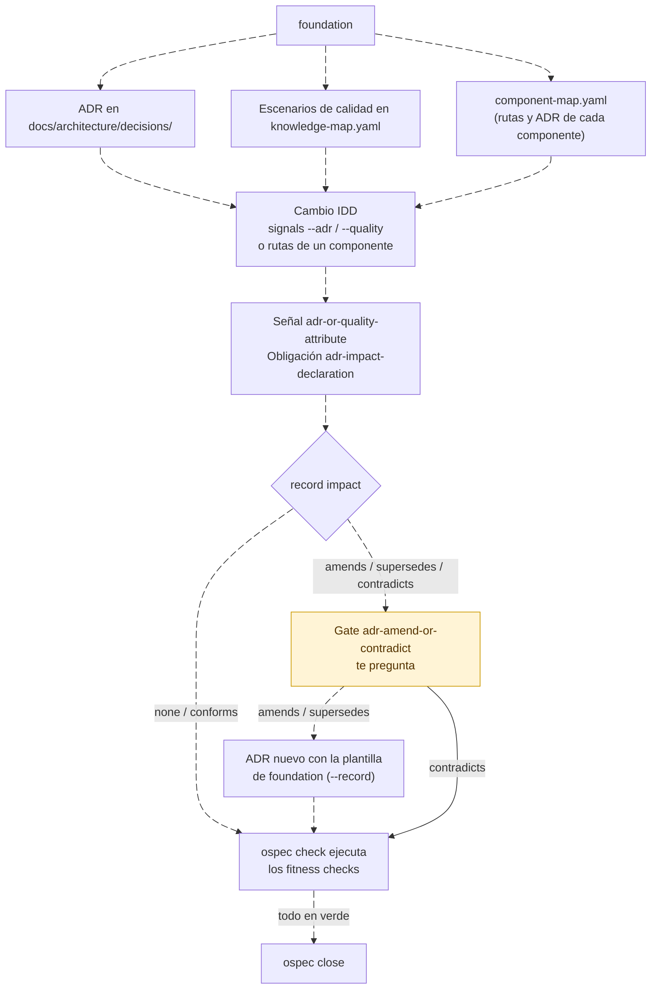

---
sidebar:
  order: 2
---

# Foundation: las decisiones que IDD hace cumplir

> **En pocas palabras:** `foundation` es la skill que fija la arquitectura antes del primer cambio. Hace de arquitecto: descubre objetivos, restricciones y atributos de calidad, y registra cada decisión estructural como un ADR. IDD trabaja después con el impacto de cada cambio sobre esos ADR. Un cambio que los cumple sigue adelante, uno que se aparta de ellos se detiene para preguntarte, y los checks que cada ADR declara se ejecutan en todos los cambios que lo tocan. Sin foundation, IDD solo ve ficheros. Con foundation, también ve decisiones.

---

## Cuándo entra

| Situación | Qué pasa |
| --- | --- |
| Proyecto nuevo, sin código todavía | El router la carga antes del primer cambio. En IDD, `ospec next` y `ospec record intent` la sugieren mientras el proyecto no tenga código ni nada bajo `docs/product/` o `docs/architecture/`. La sugerencia no bloquea: si la rechazas, el cambio sigue igual. |
| Petición de definir la arquitectura de un sistema | La skill entra directamente, en cualquier modo. |
| Proyecto con código pero sin decisiones registradas | Entra cuando pides definirlas. Antes de preguntar, infiere la arquitectura que ya tiene el código (ver [Proyectos con código](#proyectos-con-código-brownfield)). |
| Cambio posterior pequeño | Lee las secciones que le afectan y escribe solo el delta. Nunca regenera todo foundation. |

`foundation` es independiente del modo: se instala siempre y sirve igual para IDD que para SDD. En SDD, la ruta `foundation` del orquestador delega en el agente `foundation`, que nunca te pregunta directamente: devuelve cada ronda al orquestador.

**Nunca escribe código de aplicación**, ni manifiestos, ni dependencias, ni CI, ni scaffolds. Decide y registra. El primer slice se construye después como un cambio normal: IDD por defecto, SDD si lo pides.

---

## Cómo trabaja

### Rondas de preguntas

El motor de rondas está en el CLI: `ospec foundation next` decide qué preguntar y `ospec foundation record` guarda cada respuesta en `docs/architecture/knowledge-map.yaml`.

1. La primera vez se elige un perfil: `ospec foundation next --profile <perfil>`. Los perfiles son `prototype`, `internal-tool`, `product`, `regulated`, `public-library` y `embedded`. El perfil decide qué huecos son obligatorios.
2. Cada ronda trae **cuatro preguntas como máximo**, todas del mismo tema (negocio, funcional, equipo, calidad, arquitectura, tecnología, operación o entrega). Primero van los huecos que desbloquean más decisiones pendientes, y los obligatorios del perfil pesan el doble.
3. Cada pregunta llega con una **respuesta recomendada** y la opción «no lo sé». «No lo sé» se guarda como `assumed`, con su fuente y lo que haría revisarla.
4. Cada respuesta confirmada se escribe en disco antes de la ronda siguiente. **El estado son los documentos, nunca la conversación.**
5. Termina cuando `foundation next` devuelve una ronda vacía, o antes, cuando todo lo que bloquea el primer slice está confirmado, asumido o aplazado con un responsable.

Cada hueco del mapa de conocimiento tiene uno de estos estados:

| Estado | Significa |
| --- | --- |
| `unknown` | Nadie lo sabe todavía. No es lo mismo que `n/a`. |
| `confirmed` | Confirmado, con su fuente. |
| `assumed` | Supuesto, con su fuente y el hecho que lo cambiaría. |
| `n/a` | No aplica, con el motivo. |
| `deferred` | Aplazado, con un responsable. |

### Piensa como un arquitecto

- **Empieza por el problema**, los usuarios y las restricciones, no por la tecnología.
- **Los atributos de calidad deciden la arquitectura.** Elige los tres a cinco que más importan y escribe cada uno como un escenario: origen, estímulo, entorno, artefacto, respuesta y, solo si tú la das o la confirmas, una medida. Nunca inventa un SLA ni un presupuesto.
- **La estructura más simple que los cumple.** Un equipo con un único desplegable empieza como monolito modular. Solo se separan servicios por un motivo con nombre (despliegue o escalado independiente, una frontera de equipo, aislamiento de fallos o regulatorio), y ese motivo queda registrado.
- **Decide ahora solo lo que bloquea el primer slice o es caro de revertir**: fronteras del sistema, a quién pertenece cada dato, estilo de integración, fronteras de confianza y evolución de contratos. El resto se aplaza con un responsable y su último momento responsable.

---

## Qué deja en disco

| Fichero | Contenido |
| --- | --- |
| `docs/product/brief.md` | Problema, usuarios, objetivos, medidas de éxito y lo que no se hará. |
| `docs/product/functional-scope.md` | Actores, recorridos, primer slice y exclusiones. |
| `docs/product/glossary.md` | Términos del dominio. |
| `docs/architecture/technical-baseline.md` | Contexto y fronteras, componentes y propiedad de los datos, integraciones, escenarios de calidad, restricciones, estrategia de tests por riesgo y registro de tecnología. |
| `docs/architecture/decisions/NNNN-<título>.md` | **Un ADR por decisión estructural.** |
| `docs/architecture/knowledge-map.yaml` | El mapa de conocimiento: cada hueco con su estado, su fuente y las decisiones que alimenta, y los escenarios de calidad. |
| `docs/architecture/component-map.yaml` | Solo en proyectos con código: componentes, fronteras, dependencias y divergencias recuperadas del código. |
| `docs/roadmap.md` | El primer slice como walking skeleton, después los hitos, y las decisiones aplazadas con su último momento responsable. |
| `idd/config.yaml` | La configuración de IDD, solo con tu aprobación (ver [La configuración que hereda IDD](#la-configuración-que-hereda-idd)). |

Antes de escribir, lee cada fichero y lo actualiza: nunca descarta lo que escribiste tú.

---

## El ADR

Un ADR (Architecture Decision Record) registra una decisión estructural, por qué se tomó y cómo detectar que se incumple. Foundation los escribe con esta plantilla:

```markdown
# 0002. Integración síncrona entre pedidos y facturación

- Status: accepted
- Date: 2026-11-02

## Context and drivers
Las fuerzas en juego y los escenarios o restricciones a los que sirve,
citados por id: `scenario:pedido-consistente`.

## Options considered
1. Llamada síncrona: lo que da y lo que cuesta.
2. Mensajería asíncrona: lo que da y lo que cuesta.

## Decision
La elección estructural, sin nombrar productos ni librerías.

## Consequences
Qué se vuelve más fácil, qué más difícil y qué queda prohibido.

## Fitness function
El check que detecta una violación.
- Check: `node --test test/architecture/billing-boundary.test.js`

## Review trigger
El hecho que reabriría esta decisión.
```

Las reglas que comprueba el lint de decisiones:

- **Cita al menos un driver** entre comillas invertidas: `scenario:<id>`, `constraint:<id>` o `assumption:<id>`.
- **Considera al menos dos opciones.**
- **La decisión no nombra tecnología.** Los productos y librerías van al registro de tecnología del baseline, cada uno ligado al ADR que implementa y con una fuente fechada.
- **La fitness function** dice cómo detectar una violación. Si un comando puede detectarla, va en una línea `- Check:`. Si solo puede comprobarla una persona, la prosa queda como un punto de revisión manual.
- **Estados:** `inferred` (deducido del código, con su `Evidence`), `proposed`, `accepted` y `superseded by NNNN`.
- **Un ADR aceptado nunca se reescribe.** Para cambiarlo se escribe uno nuevo que lo enmienda o lo sustituye.
- **Una decisión de desarrollo no es un ADR.** Se queda en el documento vivo del cambio (`idd/<cambio>/change.md`). Registrarla como ADR es un aviso del lint.

---

## Cómo usa IDD los ADR

Esta es la razón de ser de foundation dentro de IDD. Las señales de impacto que deciden la ceremonia de un cambio no salen solo de los ficheros que toca: también salen de **las decisiones de arquitectura que toca**.



### 1. El cambio declara los ADR que toca

En la fase de señales, el agente nombra los ADR y escenarios de calidad sobre los que influye el cambio:

```bash
ospec signals --change pedidos-async --path src/orders/notify.js --adr 0002 --quality pedido-consistente
```

- `--adr` toma el id de cuatro cifras de un ADR de `docs/architecture/decisions/`, y `--quality`, el id de un escenario de `knowledge-map.yaml`. Una referencia que no existe en disco se rechaza.
- Cualquiera de las dos activa la señal `adr-or-quality-attribute`, que añade la obligación `adr-impact-declaration`.
- Si `component-map.yaml` asigna rutas y ADR a cada componente, **el CLI añade solo** los ADR y escenarios vigentes de los componentes que el cambio toca, primero desde el plan (`ospec signals`) y después desde el diff real (`ospec check`). El agente solo declara los demás.
- `ospec next` devuelve esas referencias en `references`, cada una con su estado. Solo las `current` son reglas que el cambio debe seguir. Cada referencia `stale` (un ADR sustituido o con una `Evidence` que ya no existe) o `absent` (no hay ADR con ese id) sale como aviso en `warnings`, y nunca se toma por cierta.
- Un cambio que toca un contrato público, datos persistentes o una frontera de seguridad sin declarar ningún ADR recibe la sugerencia `adr-promotion`: proponerte un ADR. No bloquea ni cambia el siguiente paso.

### 2. El cambio declara su impacto sobre cada uno

```bash
ospec record impact --change pedidos-async --adr 0002 --impact amends --reason "la notificación pasa a ser asíncrona"
```

| Impacto | Significa | Qué ocurre |
| --- | --- | --- |
| `none` | El cambio toca el código, pero no la decisión. | Nada más. Corren los fitness checks. |
| `conforms` | El cambio cumple la decisión. | Corren los fitness checks. Si pasan, la obligación queda satisfecha sin preguntar. |
| `amends` | El cambio modifica la decisión. | Abre el gate `adr-amend-or-contradict`. Con tu sí, hace falta un ADR nuevo. |
| `supersedes` | El cambio sustituye la decisión. | Abre el gate. Con tu sí, hace falta un ADR nuevo que la sustituya. |
| `contradicts` | El cambio va contra la decisión. | Abre el gate. Solo tu respuesta lo resuelve. |

Cada impacto se declara una sola vez: otro valor u otro motivo para la misma referencia se rechaza. El agente declara todos los impactos antes de preguntarte, porque el gate se responde una sola vez.

### 3. Los fitness checks se ejecutan en `ospec check`

Mientras `adr-impact-declaration` está activa, `ospec check` ejecuta, después de los checks del proyecto, cada línea `- Check:` de los ADR del cambio y cada `fitness.checks` de sus escenarios de calidad.

- **Se leen del commit base del cambio, no del árbol de trabajo.** Un cambio no puede debilitar ni borrar el check que lo vigila: aunque borre la línea `- Check:`, se ejecuta la de la base.
- **Un fallo bloquea el cierre** y nombra el ADR o el escenario, el comando y el código de salida. La salida es arreglar el código, nunca el check.
- **Un punto manual no bloquea** (solo la evidencia observada satisface una obligación). `next` y `check` lo listan en `fitness.manual`. El agente lo verifica y deja constancia con `ospec record fitness --change <id> --adr <id> --evidence "<qué comprobó>"`.
- Un ADR que el cambio enmienda, sustituye o contradice, una vez resuelto el gate, ya no aporta sus checks: la decisión que vale es la nueva.

### 4. Cuando el cambio se aparta de un ADR

1. El gate `adr-amend-or-contradict` te pregunta, con el motivo de cada impacto. El agente no construye nada de lo que decide el gate hasta que respondes.
2. Si apruebas una enmienda o una sustitución, el agente escribe **un ADR nuevo con la plantilla de foundation**, que cita el id del ADR que cambia. El ADR aceptado no se toca.
3. Lo adjunta: `ospec record impact --change <id> --adr 0002 --record docs/architecture/decisions/0007-notificacion-asincrona.md`.
4. `ospec check` satisface la obligación cuando todos los impactos están declarados, respondiste el gate de cada uno, y cada ADR nuevo existe, pasa el lint de decisiones, no es el mismo ADR que cambia y cita su id.

### 5. Al cerrar, queda el conocimiento

`ospec close` devuelve `records`: el conocimiento del cambio que un agente puede guardar en una memoria entre sesiones. Cada impacto que se aparta de su referencia (`amends`, `supersedes`, `contradicts`) es un record, y también cada ADR nuevo adjuntado con `--record`. Un impacto `none` o `conforms` no genera record, porque ya lo guarda el `state.yaml` archivado.

---

## La configuración que hereda IDD

Al terminar, foundation te propone la configuración con la que el primer cambio derivará las obligaciones correctas. Solo escribe `idd/config.yaml` si la apruebas, y conserva las claves que ya tenga:

```yaml
checks:
  test: npm test
  lint: npm run lint
team:
  size: small
  experience: mixed
contracts:
  documents:
    - api/openapi.yaml
impact:
  public_contract:
    - src/api/**
  persistent_data:
    - db/migrations/**
  security_boundary:
    - src/auth/**
delivery:
  branching: parallel
  changelog: CHANGELOG.md
  release: batched
```

| Clave | Para qué sirve en IDD |
| --- | --- |
| `checks:` | Los comandos que prueban un cambio. Sin ellos ningún cambio cierra. Se ejecutan una vez que existe el scaffold. |
| `team:` | El perfil de equipo de la ronda de equipo. `ospec team` deriva de él la entrega, la revisión, Strict TDD y la mentoría. `strict_tdd:` solo se añade si tu listón de tests se aparta de ese valor por defecto. |
| `impact:` | Las rutas de contratos públicos, datos persistentes y fronteras de seguridad de la estructura elegida, más `stack:` si los servicios tienen sus manifiestos por debajo de la raíz. Activan `public-contract`, `persistent-data` y `security-boundary`. |
| `contracts.documents:` | Dónde viven los documentos de contrato (OpenAPI, proto, esquemas). |
| `delivery:` | Cómo llegan los cambios al repositorio: `branching`, `changelog`, `release` y, si integras aparte de producción, `integration_branch` (ver [Entrega](/handbook/idd/entrega.md)). Se pregunta después de escribir las claves anteriores: foundation ejecuta `ospec team`, que lee ese perfil, y te presenta cada valor con su origen, sus motivos y las alternativas. Solo con estos valores declarados `ospec close` escribe el CHANGELOG y propone la versión. La estrategia de entrega (`single-pr`, `ask-on-risk` o `auto-chain`) sale del tamaño del equipo: para cambiarla se cambia `team.size`. Si `delivery:` ya estaba declarado, conserva sus valores salvo que tú los cambies. |

Como cualquier cambio de checks o de ajustes de ceremonia, el primer `ospec check` abre el gate `checks-changed` y no ejecuta nada hasta que apruebas esos valores.

### El remoto y el commit de la fundación

Al final, foundation deja el repositorio listo para el primer cambio. Cada paso es una propuesta, y **sin tu sí no ejecuta ningún `git init`, `git commit`, push ni creación del remoto**:

1. **Sin repositorio git**, te ofrece crearlo con `git init -b main`.
2. **Sin remoto** (`git remote -v` vacío), te pregunta si lo creas y dónde (por ejemplo `gh repo create --private` si el código es cerrado) o si trabajas sin PRs. Sin PRs, `delivery:` se declara igual y los commits van a la rama por defecto.
3. **El commit**: te propone un único commit en formato Conventional Commits, como `docs: add architecture foundation`, con los ficheros de la fundación (`docs/`, `idd/config.yaml` y `openspec/` si existe). En un repositorio sin commits propone además el nombre de la rama (`main`): el primer cambio IDD necesita ese commit base para su contraprueba. Si ya hay historial, propone el commit, o una rama y una PR según la entrega que aprobaste.

En SDD, el agente `foundation` no tiene shell: devuelve la pregunta de `delivery:`, la del remoto y la oferta de commit en `open_questions`, y el orquestador te las pregunta y las ejecuta.

---

## Proyectos con código (brownfield)

Cuando el proyecto ya tiene código, foundation infiere su arquitectura antes de preguntar, y tú la confirmas o la corriges:

- Escribe `docs/architecture/component-map.yaml` con los componentes, sus fronteras, las dependencias entre ellos y las divergencias entre el código y la documentación. Cada afirmación cita una evidencia `ruta:línea` que existe en el repositorio. Lo que no puede señalar se queda como pregunta.
- Da a cada componente sus rutas (`paths`, como globs) y, en `knowledge`, los ids de los ADR, escenarios de calidad, términos del glosario y restricciones que lo gobiernan. **Es lo que permite a IDD entregar a cada cambio solo el conocimiento de los componentes que toca.**
- Propone cada decisión estructural que el código ya encarna como un ADR `inferred` con su `Evidence`. Te pregunta por cada uno: si lo confirmas o lo corriges, pasa a `accepted` y conserva su evidencia. Si lo rechazas, no se escribe y queda como divergencia.
- Guarda las pistas de calidad que encuentra en el código (timeouts, reintentos, cachés, trazas de auditoría) como huecos `assumed`, con su `ruta:línea` y lo que haría revisarlos.

---

## Fuentes

- [Skill `foundation`](https://github.com/Snakeblack/ospec-workflow/blob/main/skills/foundation/SKILL.md): el protocolo que sigue el agente.
- [Detalles de foundation](https://github.com/Snakeblack/ospec-workflow/blob/main/skills/foundation/references/foundation-details.md): las plantillas de ADR, del registro de tecnología y del baseline.
- [Contrato IDD](https://github.com/Snakeblack/ospec-workflow/blob/main/openspec/specs/idd/spec.md): REQ-idd-020 (declaración del impacto de arquitectura), REQ-idd-021 (conocimiento por referencia), REQ-idd-022 (fitness functions en `check`) y REQ-idd-024 (records al cerrar).
- [Contrato del mapa de conocimiento](https://github.com/Snakeblack/ospec-workflow/blob/main/openspec/specs/knowledge-map/spec.md), [de los registros de decisión](https://github.com/Snakeblack/ospec-workflow/blob/main/openspec/specs/decision-records/spec.md) y [del mapa de componentes](https://github.com/Snakeblack/ospec-workflow/blob/main/openspec/specs/component-map/spec.md).
- [Skill `idd`, conocimiento de arquitectura](https://github.com/Snakeblack/ospec-workflow/blob/main/skills/idd/references/architecture.md): cómo declara el agente las referencias y sus impactos.
