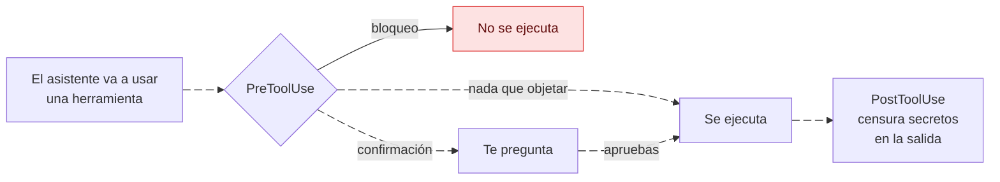

---
sidebar:
  order: 2
---

# Guardrails: secretos, comandos y presupuesto

> **En pocas palabras:** antes de que el asistente use una herramienta, el hook `PreToolUse` comprueba qué va a hacer. Unas acciones se **bloquean** siempre (borrar la raíz del disco, forzar un push, escribir el estado de IDD a mano, leer una clave privada) y otras te **piden confirmación** (instalar dependencias, `git reset --hard`, leer un `.env`). Después, `PostToolUse` censura los secretos de la salida antes de que el modelo la vea.

---

## Bloqueo o confirmación

- **Bloqueo:** la herramienta no se ejecuta, aunque estés en modo `bypassPermissions`.
- **Confirmación:** la herramienta te pregunta y solo sigue si apruebas. Con `bypassPermissions`, las confirmaciones pasan a ser avisos y la acción continúa.

---

## Comandos

| Se bloquea siempre | Pide confirmación |
| --- | --- |
| Borrar recursivamente la raíz del sistema o de una unidad (`rm -rf /`) | Borrados recursivos (`rm -rf`, `rmdir /s`) |
| Forzar un push (`git push --force`, `-f` o `+rama`) | `git push --force-with-lease` |
| Descargar y ejecutar en la shell (`curl … \| sh`, también en PowerShell) | Descargar un fichero y después ejecutar una shell |
| Formatear un sistema de ficheros o un disco | Instalar dependencias (`npm install`, `pnpm add`, …) |
| Escribir datos en bruto en un dispositivo | `git reset --hard` y `git clean` |
| Un commit con atribución a una IA (trailer o línea «generated with») | `docker compose down` |
| | Cambios recursivos de permisos o propietario |
| | Reiniciar o apagar la máquina |

## Ficheros del CLI

El estado de IDD lo escribe **solo** el CLI `ospec`. El hook bloquea que el asistente edite con sus herramientas de escritura `idd/<cambio>/state.yaml`, el archivo de un cambio cerrado, los recibos de revisión y la cuenta de turnos de `.ospec/turns`. La única forma de avanzar un cambio es con los comandos de `ospec`.

---

## AgentShield: secretos

Revisa los ficheros que el asistente lee o escribe, el texto que escribe y los ficheros que lee un comando de shell (`cat`, `grep`, `cp`…).

- **Por nombre de fichero:** las claves privadas SSH, los `*.key`, `.npmrc` y el `.git/config` del repositorio **se bloquean**; `.env*`, `secrets.json` y `credentials` **piden confirmación**.
- **Por contenido**, en ficheros de menos de 1 MB y en el texto escrito: tokens conocidos (GitHub, AWS, OpenAI, Anthropic, Google, Slack, Stripe, npm, GitLab, Hugging Face, SendGrid), cabeceras de clave privada, JWT y asignaciones como `password = "..."`. Piden confirmación.
- **Marcadores de censura:** escribir un `[REDACTED:…]` sobre un fichero que todavía guarda el secreto real se bloquea, para no destruirlo por error.
- **En la salida** (`PostToolUse`): los secretos se censuran antes de que el modelo vea la respuesta, con un modo más estricto al leer ficheros sensibles.

Se desactiva con `DISABLE_AGENT_SHIELD=true`. Los bloqueos de comandos y de ficheros del CLI no dependen de esa variable.

---

## Token Budget Advisor: lecturas grandes

Estima los tokens de los ficheros que una herramienta va a leer, por su tamaño en disco, y pide confirmación si son demasiados. Nunca bloquea, y no mide las respuestas del modelo.

- **Por petición:** más de **50.000 tokens** estimados (unos 200 KB de código) piden confirmación.
- **Acumulado:** solo con un cambio SDD activo. Por encima de **150.000 tokens** en el cambio, cada herramienta pide confirmación y recomienda compactar. En IDD no se acumula nada.
- Se desactiva con `DISABLE_TOKEN_ADVISOR=true`.

---

## Git Collaboration Guard: commits

Antes de un `git commit`, pide confirmación si estás en la rama principal o si hay cambios sin confirmar. Solo actúa sobre `git commit`; el push forzado lo bloquea la tabla de comandos. Se desactiva con `DISABLE_GIT_COLLABORATION_GUARD=true`.
