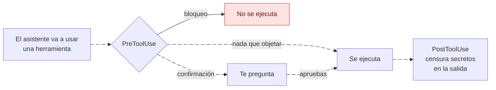

---
sidebar:
  order: 2
---

# Guardrails: secretos, comandos y presupuesto

> **En pocas palabras:** antes de que el asistente use una herramienta, el hook `PreToolUse` comprueba qué va a hacer. Unas acciones se **bloquean** siempre (borrar la raíz del disco, forzar un push, escribir el estado de IDD a mano, leer una clave privada) y otras te **piden confirmación** (instalar dependencias, `git reset --hard`, leer un `.env`). Después, `PostToolUse` censura los secretos de la salida antes de que el modelo la vea.

---

## Bloqueo o confirmación

- **Bloqueo:** la herramienta no se ejecuta, aunque estés en modo `bypassPermissions`.
- **Confirmación:** la herramienta te pregunta y solo sigue si apruebas. Con `bypassPermissions`, las confirmaciones pasan a ser avisos y la acción continúa.

---

## Comandos

| Se bloquea siempre | Pide confirmación |
| --- | --- |
| Borrar recursivamente la raíz del sistema o de una unidad (`rm -rf /`) | Borrados recursivos (`rm -rf`, `rmdir /s`) |
| Forzar un push (`git push --force`, `-f` o `+rama`) | `git push --force-with-lease` |
| Descargar y ejecutar en la shell (`curl … \| sh`, también en PowerShell) | Descargar un fichero y después ejecutar una shell |
| Formatear un sistema de ficheros o un disco | Instalar dependencias (`npm install`, `pnpm add`, …) |
| Escribir datos en bruto en un dispositivo | `git reset --hard` y `git clean` |
| Un commit con atribución a una IA (trailer o línea «generated with») | `docker compose down` |
| | Cambios recursivos de permisos o propietario |
| | Reiniciar o apagar la máquina |

## Ficheros del CLI

El estado de IDD lo escribe **solo** el CLI `ospec`. El hook bloquea que el asistente edite con sus herramientas de escritura `idd/<cambio>/state.yaml`, el archivo de un cambio cerrado, los recibos de revisión y la cuenta de turnos de `.ospec/turns`. La única forma de avanzar un cambio es con los comandos de `ospec`.

---

## AgentShield: secretos

Revisa los ficheros que el asistente lee o escribe, el texto que escribe y los ficheros que nombra un comando de shell.

- **Por nombre de fichero:** las claves privadas SSH, los `*.key`, `.npmrc` y el `.git/config` del repositorio **se bloquean**; `.env*`, `secrets.json` y `credentials` **piden confirmación**.
  - Bajo un directorio `.ssh` todo fichero cuenta como clave, se llame como se llame (`aws-prod.pem`, `deploy_key`, `github`). Solo pasan `config`, `known_hosts`, `known_hosts.old`, `authorized_keys`, `authorized_keys2`, `environment`, `rc`, `allowed_signers`, `revoked_keys` y los `*.pub`.
  - Un directorio no es una clave por su nombre: `rg TODO id_service/` o una búsqueda sobre `id_service` pasan. Un fichero `id_deploy` se sigue bloqueando.
- **En un comando de shell:**
  - Un fichero bloqueado por nombre se bloquea por cualquier vía que lo lea: `cat`, `tac`, `sort`, `python3 -c`, `node -pe`, `bash -c`, `sudo cat`, `sudo -u root cat`, `timeout 30 cat`, `env -S 'cat …'`, `echo $(cat …)`, `(cd ~ && cat …)`, `{ cat …; }`, `diff <(cat …)`, `< fichero`, con `$HOME` en la ruta o con un comodín (`id_*`, `~/.ssh/*`, `~/.ssh/*.pem`). También con el patrón de `grep` o `sed` en una opción o vacío (`grep -e. .npmrc`, `sed '' fichero`) y con la ruta en un literal de plantilla de `node -e`.
  - Una clave SSH (bajo `.ssh/`, o con un nombre de OpenSSH como `id_rsa` o `id_ed25519`) se bloquea además como argumento de cualquier otro comando: `openssl rsa -in ~/.ssh/id_ed25519`, `dd if=…`, `curl -F file=@…`. Buscar su ruta también se bloquea (`rg '.ssh/id_rsa' docs/`); busca el nombre a secas (`rg id_rsa docs/`). Pasan los que la usan sin imprimirla: `ssh -i`, `ssh-add`, `ssh-keygen`, `ssh-copy-id`, `ansible-playbook --private-key`, `scp -i`, `chmod`, `chown`, `ls`, `stat`, `test`, `rm`, `touch`, `echo`, `printf`, `find`, `mkdir`, `rmdir` y `cd`.
  - Leer el directorio `.ssh` entero también se bloquea: `grep -r … ~/.ssh`, `tar czf … ~/.ssh`. Listarlo o cambiar sus permisos (`ls ~/.ssh`, `chmod 700 ~/.ssh`), no. Para copiar un fichero público a `.ssh/`, nombra el destino: `cp deploy.pub ~/.ssh/deploy.pub`.
  - Una clave TLS o un `.npmrc` pasan como argumento de un comando que no los imprime: `curl --key client.key`, `openssl req -key server.key`, `kubectl create secret tls --key=tls.key`, `npm publish --userconfig ~/.npmrc`.
  - Una palabra que solo parece una clave no cuenta: `rg id_token src/`, `git checkout feature/id_check`, `jq .data.key` o `d['id_token']` en un `python -c` pasan. Fuera de `cat` y los demás lectores, un nombre que empieza por `id_` es una clave si es un nombre de OpenSSH con su directorio o existe como fichero; un directorio `id_service/` no cuenta.
  - Un fichero que pide confirmación la pide con los comandos que imprimen su contenido: `cat`, `head`, `tail`, `grep`, `sed`, `awk`, `sort`, `nl`, `tac`, `rev`, `cut`, `rg`, `jq`, `cp` y otros, también dentro de `bash -c`, detrás de `sudo`, en una sustitución `$(…)` o en el código de `python -c`, `node -e` y similares.
- **Por contenido**, en ficheros de menos de 1 MB y en el texto escrito: tokens conocidos (GitHub, AWS, OpenAI, Anthropic, Google, Slack, Stripe, npm, GitLab, Hugging Face, SendGrid), cabeceras de clave privada, JWT y asignaciones entre comillas a un nombre sensible (`password`, `dbPassword`, `api_key`, `accessToken`). Piden confirmación.
  - El nombre decide: una contraseña cuenta con cualquier valor de 6 caracteres o más; un token o una clave con calificador (`api_key`, `jwtKey`), solo si el valor tiene forma de secreto; un `key` a secas o con otro prefijo (`azure_openai_key`), solo con un token opaco de 16 caracteres o más. El `key` de un elemento de JSX, una clave de traducción, un `storage_key` con un identificador o un `cache_key` con un hash no cuentan.
  - En la salida, un `key` con un prefijo que no califica no se censura: suele guardar un hash o un identificador. El commit sí lo bloquea si el valor es opaco, se escriba como se escriba: `azure_openai_key = "…"`, `"azure_openai_key": "…"` en un JSON, `AZURE_OPENAI_KEY=…` o `AZURE_OPENAI_KEY: …`.
- **Marcadores de censura:** escribir un `[REDACTED:…]` sobre un fichero que todavía guarda el secreto real se bloquea, para no destruirlo por error.
- **En la salida** (`PostToolUse`): los secretos se censuran antes de que el modelo vea la respuesta, venga de una herramienta de lectura o de un comando de shell.
  - Un fichero de configuración se lee entero y solo se censuran sus secretos. En un `appsettings.json`, el nivel de log y el servidor de la base de datos se ven; la contraseña de la cadena de conexión (`Password=…`, `AccountKey=…`), un `ApiKey` y un `Key` aleatorio, no.
  - En un fichero de configuración se censura además lo que en código sería una expresión: `password: valor` o `db_pass = valor` sin comillas, una contraseña solo de letras (`"Password": "valor"`) y un `api_key: …` en minúsculas con forma de secreto. Una referencia (`${DB_PASSWORD}`), un placeholder (`changeme`), `id-token: write` o el nombre de un secreto (`existingSecret: redis-auth`) se ven.
    - Son de configuración los `.yml`, `.yaml`, `.ini`, `.properties`, `.toml`, `.conf` y `.cfg`, y los JSON `appsettings*.json`, `local.settings.json`, `config.json`, `config.<entorno>.json` y `settings.json`.
    - Las traducciones quedan fuera, porque guardan etiquetas: lo que hay bajo `locale(s)/`, `i18n/`, `l10n/`, `lang(s)/` o `translation(s)/`, y los `messages_es.properties`.
  - Al leer un fichero sensible por nombre (`.env*`, `credentials`, `secrets.json`), también con `cat` o `sort`, la censura es más estricta: cualquier valor opaco, sea cual sea su clave.

### Qué bloquea el commit

El hook `pre-commit` revisa las líneas que el commit añade y lo cancela si una tiene algo que el escáner marca o que la censura censuraría; en un fichero de configuración, también `password: valor` sin comillas. El mensaje da el fichero, la línea y el tipo, nunca el valor.

Si la línea es un ejemplo y no un secreto (un fixture, la URL de una base de datos local), añádele `ospec:allow-secret` en un comentario. El commit pasa, el hook dice cuántas líneas saltó y la excepción queda a la vista en el diff.

### Qué no cubren

Los guards frenan la fuga accidental. No paran a un proceso que quiera leer:

- No interpretan el shell: `source .env`, un script que abre el fichero, `xargs`, `find -exec`, una variable que guarda la ruta, un `eval`, un `cd` previo (`cd ~/.ssh && cat work`) o el cuerpo de un heredoc no se ven. Tampoco un comando que no es lector e imprime una clave que no es SSH, como `openssl rsa -in server.key -text`, ni uno que copia el directorio `.ssh` entero, como `rsync -a ~/.ssh/ backup/`.
- Una contraseña solo de letras en código o en un JSON que no es de configuración queda sin censurar en la salida, para no censurar etiquetas como `"password": "Contraseña"`. El commit sí la bloquea cuando el nombre va sin comillas.
- Fuera de `.ssh/`, solo cuentan como clave privada los nombres `id_*` y `*.key`. Una clave con otro nombre (`certs/deploy.pem`) no se bloquea por nombre: su lectura pide confirmación si el contenido lleva una cabecera de clave privada, y solo con un comando que la lee.
- El modo de fichero de configuración necesita que la llamada nombre el fichero: una búsqueda sobre un directorio (`grep -rn password config/`) se censura como código. Y solo censura la salida y bloquea el commit: en los hosts que no reescriben la salida, leer ese fichero no pide confirmación por una contraseña sin comillas.
- Un nombre en minúsculas con un valor sin comillas en un fichero que no es de configuración ni sensible por nombre (un `.md`, un script) no se censura: ahí esa forma es una expresión o un tipo.
- Un secreto sin palabra clave ni formato conocido (una cadena aleatoria suelta, un valor en base64) no se reconoce. Tampoco una clave de proveedor corta o solo de letras bajo un nombre sin calificador (`vendor_key`), ni un valor bajo un `cache_key`, `sort_key` o `public_key`. Una clave de proveedor bajo un nombre sin calificador se bloquea en el commit si su valor es opaco, pero se ve en la salida.
- VS Code, GitHub Copilot, Cursor y Antigravity no pueden reescribir la salida: ahí solo queda la confirmación de lectura.

Se desactiva con `DISABLE_AGENT_SHIELD=true`. Los bloqueos de comandos y de ficheros del CLI no dependen de esa variable.

---

## Token Budget Advisor: lecturas grandes

Estima los tokens de los ficheros que una herramienta va a leer, por su tamaño en disco, y pide confirmación si son demasiados. Nunca bloquea, y no mide las respuestas del modelo.

- **Por petición:** más de **50.000 tokens** estimados (unos 200 KB de código) piden confirmación.
- **Acumulado:** solo con un cambio SDD activo. Por encima de **150.000 tokens** en el cambio, cada herramienta pide confirmación y recomienda compactar. En IDD no se acumula nada.
- Se desactiva con `DISABLE_TOKEN_ADVISOR=true`.

---

## Git Collaboration Guard: commits

Antes de un `git commit`, pide confirmación si estás en la rama principal o si hay cambios sin confirmar. Solo actúa sobre `git commit`; el push forzado lo bloquea la tabla de comandos. Se desactiva con `DISABLE_GIT_COLLABORATION_GUARD=true`.
