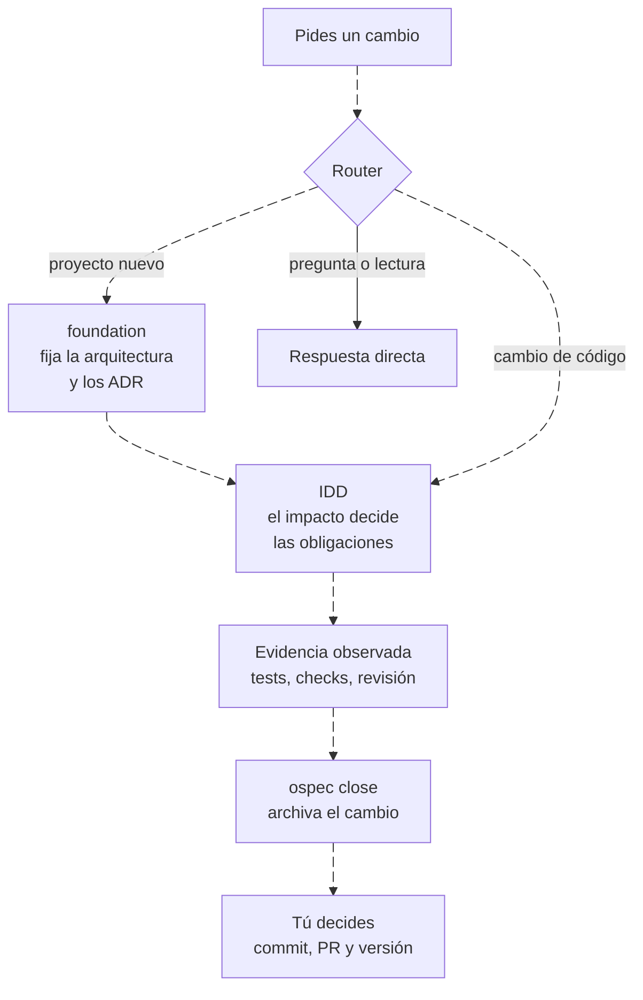

# Guía rápida: cómo funciona ospec-workflow

> **En pocas palabras:** `ospec-workflow` es un harness para asistentes de IA que programan (Claude Code, Copilot, Cursor y cuatro más). Le pides un cambio con tus palabras, como siempre. La diferencia es que el asistente no puede darlo por terminado porque sí: el CLI `ospec` decide qué pruebas y revisiones exige ese cambio según su impacto, y solo lo cierra cuando ve ejecutarse esa evidencia sobre el código actual. A esto se le llama **IDD** (desarrollo guiado por impacto) y es el flujo por defecto. SDD, el desarrollo guiado por especificación, es un modo opcional.

---

## La idea en un diagrama

1. **El router.** El instalador añade unas instrucciones cortas que el asistente lee siempre. Mandan cada cambio de código a IDD, dejan directas las preguntas y entran en SDD solo si lo pides.
2. **Foundation, si el proyecto es nuevo.** Antes del primer cambio, la skill `foundation` te pregunta por objetivos, restricciones y calidad, y registra cada decisión de arquitectura como un ADR. IDD hace cumplir esos ADR en cada cambio.
3. **IDD.** El agente registra qué pides y cómo se comprueba, te pregunta de una vez lo que la petición deja abierto y declara qué ficheros va a tocar. De ahí salen las **obligaciones**: un bug exige un test que lo reproduzca, una migración exige un plan de vuelta atrás, un cambio de autenticación exige una revisión de seguridad.
4. **La evidencia.** Solo cuenta lo que el CLI ve ejecutarse. Decir «los tests pasan» no satisface nada.
5. **El cierre.** `ospec close` archiva el cambio cuando no queda nada pendiente y, si lo configuras, escribe su línea en el CHANGELOG y te propone la versión.
6. **Tú decides.** Commits, ramas, PRs y versiones siguen siendo decisión tuya.

---

## Qué haces tú y qué hace el agente

| Tú | El agente | El CLI `ospec` |
| --- | --- | --- |
| Pides el cambio con tus palabras. | Registra la intención y el criterio de aceptación. | Guarda el estado en `idd/<cambio>/state.yaml`. |
| Respondes las preguntas abiertas, todas en un lote. | Enumera lo que ni la petición ni el código fijan. | Abre el gate `open-facts` y no deja avanzar sin tu respuesta. |
| Apruebas los checks del proyecto la primera vez. | Propone el comando de tests. | No ejecuta un check que no hayas aprobado. |
| Respondes cuando el cambio se aparta de un ADR o va a borrar datos. | Para y te pregunta. | Abre el gate correspondiente. |
| Haces commit, PR y versión cuando quieras. | Escribe el código y los tests y ejecuta los comandos. | Deriva las obligaciones, observa la evidencia y cierra. |

El agente solo se detiene en seis *gates*: intención ambigua, hechos abiertos, ADR enmendado o contradicho, operación irreversible, límite de revisiones de confianza y checks cambiados. Solo una respuesta explícita tuya los resuelve.

---

## Qué ganas

- **Nada se da por hecho sin pruebas.** Un cambio no se cierra sin la salida real de sus tests en verde sobre el código actual.
- **Ceremonia proporcional.** Una errata solo pasa los checks; una migración de esquema necesita además su test de migración y su plan de vuelta atrás.
- **La arquitectura se respeta.** Los ADR que registra foundation no son documentos olvidados: cada cambio declara su impacto sobre ellos y sus checks se ejecutan.
- **El estado vive en el repositorio.** Todo queda en `idd/`, no en el chat. Si cierras la ventana, no pierdes nada.
- **Un mismo harness para 7 herramientas:** Claude Code, VS Code, GitHub Copilot, OpenCode, Codex, Cursor y Antigravity.
- **Protecciones en cada herramienta:** bloqueo de secretos y de comandos destructivos antes de que se ejecuten.

---

## Cómo leer esta web

Las secciones siguen el orden en que te vas a encontrar las cosas.

### 1. Empezar
- [Instalación](/handbook/empezar/instalacion.md) — Cómo instalar el harness en tu herramienta y qué necesita tu proyecto.
- [Un cambio de principio a fin](/handbook/empezar/primer-cambio.md) — Un ejemplo real: qué pides, qué te pregunta, qué ves al cerrar.

### 2. Cómo funciona IDD
- [El router: qué flujo sigue cada petición](/handbook/idd/router.md) — IDD, trabajo directo o SDD.
- [Foundation: las decisiones que IDD hace cumplir](/handbook/idd/foundation.md) — La arquitectura antes del primer cambio y cómo IDD trabaja con el impacto de cada cambio sobre los ADR.
- [El ciclo de un cambio](/handbook/idd/flujo-idd.md) — Intención, hechos abiertos, señales, obligaciones, evidencia y cierre, con la configuración de `idd/config.yaml`.
- [Evidencia y tests](/handbook/idd/evidencia.md) — Qué evidencia cuenta, el rojo-verde, la contraprueba y Strict TDD.
- [Revisión en IDD](/handbook/idd/revision.md) — Qué se revisa, cuándo y qué no.
- [Entrega: ramas, changelog y versiones](/handbook/idd/entrega.md) — Qué hace `ospec close` al cerrar, cómo se declara la entrega y el snapshot de avance.
- [El estado en disco](/handbook/idd/estado.md) — Qué guarda `idd/` y cómo se recupera un cambio en otra sesión.

### 3. Protección
- [Hooks del ciclo de vida](/handbook/proteccion/hooks.md) — Qué se ejecuta al abrir la sesión, antes y después de cada herramienta y al terminar el turno.
- [Guardrails: secretos, comandos y presupuesto](/handbook/proteccion/guardrails.md) — Qué se bloquea y qué te pide confirmación.
- [Reglas de comportamiento](/handbook/proteccion/reglas.md) — Las reglas que el asistente sigue siempre.

### 4. Agentes, skills y modelos
- [Catálogo de agentes y skills](/handbook/agentes/catalogo.md) — La skill `idd`, los revisores y el resto de skills.
- [Ruteo de modelos](/handbook/agentes/modelos.md) — Qué modelo usa cada agente.

### 5. Modo SDD (opcional)
Solo aplica si instalaste el paquete con `--with-sdd` y pides un cambio SDD de forma explícita.
- [Qué es SDD y cuándo entra](/handbook/sdd/modo-sdd.md) — Cómo no confundirlo con IDD.
- [Ciclo y rutas](/handbook/sdd/ciclo-y-rutas.md) — Las siete fases, las rutas y los gates del orquestador.
- [Agentes de fase](/handbook/sdd/agentes-de-fase.md) — El orquestador y los agentes `sdd-*`.
- [Persistencia en OpenSpec](/handbook/sdd/persistencia-openspec.md) — `openspec/changes/` y los artefactos de cada cambio.
- [Verificación en SDD](/handbook/sdd/verificacion-sdd.md) — `sdd-verify`, `apply-progress` y el TDD de SDD.
- [Federación multi-repositorio](/handbook/sdd/federacion.md) — El atlas que coordina cambios SDD entre repositorios.

### 6. Cómo está hecho
Para quien desarrolla o extiende ospec-workflow; no hace falta para usarlo.
- [Arquitectura multi-target](/handbook/interno/arquitectura.md) — Un árbol fuente único compilado para 7 herramientas.
- [El generador](/handbook/interno/generador.md) — Cómo se transforma cada agente y skill.
- [Hooks en Go](/handbook/interno/hooks-go.md) — El binario `ospec-hooks` y su paridad con Node.js.
- [Lint de contratos](/handbook/interno/lint-contratos.md) — Las comprobaciones que mantienen el repositorio coherente.

### 7. Historia
Diseños anteriores, ya archivados. No describen el estado actual.
- [Evolución del harness](/handbook/historia/evolucion.md) — El programa del kernel determinista.
- [Roadmap K1–K12](/handbook/historia/roadmap.md) — Las etapas de aquel programa.
- [El kernel K1–K12](/handbook/historia/kernel.md) — Authority Store, permits y budgets, retirados.

### 8. Licencia
- [Licencia](/handbook/legal/license.md) — MIT con Commons Clause: uso, modificación y redistribución libres; no se puede vender el software ni servicios de pago sobre él sin permiso.

---

## Ficheros que verás en tu proyecto

| Fichero | Para qué sirve | Modo |
| --- | --- | --- |
| `idd/config.yaml` | Configuración de IDD: `checks` (sin ellos ningún cambio cierra), `strict_tdd`, `team`, `delivery`, `impact` y `contracts`. `mode: sdd` apaga IDD. | IDD |
| `idd/<cambio>/` e `idd/archive/` | El estado de cada cambio (`state.yaml`, `change.md`) y los cambios cerrados. Solo el CLI escribe el estado. | IDD |
| `docs/architecture/decisions/` | Los ADR que registra foundation y que cada cambio debe respetar. | Ambos |
| `.ospec/` | Datos locales del harness: la cuenta de turnos, las trazas de sesión y las cachés. | Ambos |
| `openspec/` | Configuración, specs y cambios del modo SDD. IDD no lo lee ni lo escribe. | SDD |

El CLI `ospec` tiene estos comandos: `status`, `next`, `record`, `signals`, `check`, `run`, `review`, `close`, `doctor`, `team`, `snapshot` y `foundation`. Normalmente los ejecuta el agente, no tú.
