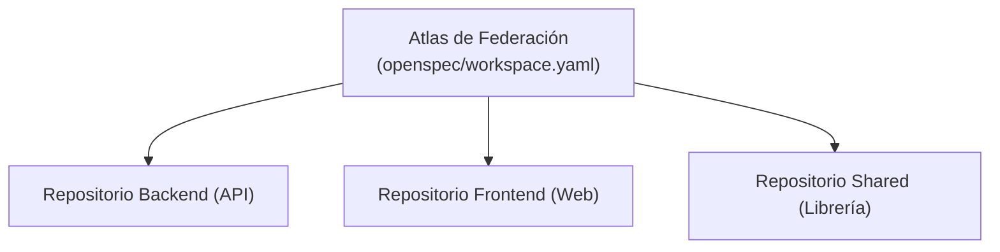

---
sidebar:
  order: 6
---

# Federación multi-repositorio

> **En pocas palabras:** En organizaciones grandes, un cambio de software suele involucrar varios repositorios a la vez (por ejemplo, el backend, el frontend y la librería de componentes). En IDD, el flujo por defecto, cada repositorio tiene **su propio cambio**, cerrado con su propia evidencia. La **Federación de Workspaces** pertenece al **modo SDD (opcional)**: coordina esos repositorios con un atlas para que el ciclo SDD aplique y verifique cambios cruzados de forma unificada y segura.

---

## Cambios entre repositorios en IDD

En IDD, un cambio que atraviesa varios repositorios es un cambio por repositorio, cada uno con su propia evidencia. Está en [Entrega: cambios en varios repositorios](/handbook/idd/entrega.md#cambios-en-varios-repositorios).

---

## Modo SDD (opcional): atlas de federación

> Esta sección describe el **modo SDD (opcional)**, que se instala con `--with-sdd`. Ver [el modo SDD](/handbook/sdd/modo-sdd.md).

### Cómo Funciona el Atlas de Federación

1. **Marcador de Miembro:** Cada repositorio participante contiene un archivo marcador (`openspec/federation.member.yaml`) que define su rol e identidad.
2. **Atlas Central:** El orquestador federado (`sdd-workspace`) lee los marcadores y genera un mapa coordinado de dependencias.
3. **Análisis de Impacto:** Antes de aplicar un cambio, evalúa si una modificación en un repositorio afectará a los contratos o APIs de los repositorios hermanos.
