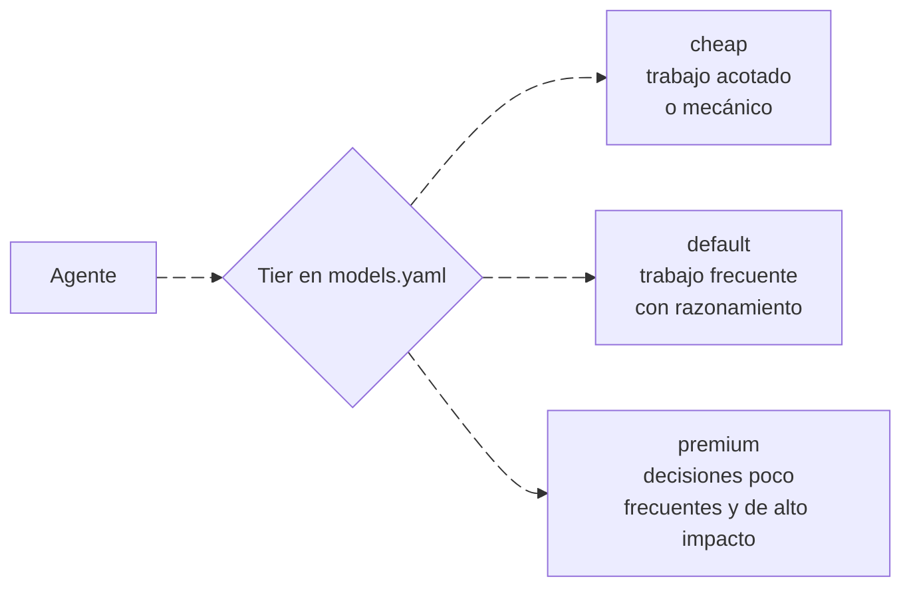

---
sidebar:
  order: 2
---

# Ruteo de modelos

> **En pocas palabras:** cada agente de ospec pertenece a un tier (`cheap`, `default` o `premium`) según cuánto razonamiento necesita. ospec no trae nombres de modelo, salvo los alias de Claude: en el resto de herramientas eres tú quien asigna un modelo a cada tier, y un tier sin modelo usa el de tu sesión. En IDD casi todo lo hace el asistente principal con el modelo que tú elijas; los tiers solo afectan a los revisores y, en SDD, a los agentes de fase.

---

## Los tres tiers



| Tier | Agentes | Claude | Otras herramientas |
| --- | --- | --- | --- |
| `cheap` | En SDD: `sdd-init`, `sdd-explore`, `sdd-tasks`, `sdd-archive`, `sdd-onboard`, `sdd-document` | `haiku` | El modelo que asignes, o el de la sesión |
| `default` | `review-trust`, `review-correction`, `review-runtime`, `review-evolution`, `review-efficiency`; en SDD, el orquestador, `sdd-spec`, `sdd-clarify`, `sdd-apply`, `sdd-reconcile` y `sdd-baseline` | `sonnet` | El modelo que asignes, o el de la sesión |
| `premium` | `review-change`; en SDD, `sdd-propose`, `sdd-design`, `sdd-verify`, `sdd-workspace` y el agente `foundation` | `opus` | El modelo que asignes, o el de la sesión |

En Codex, cada tier lleva además su esfuerzo de razonamiento (`high` en `premium` y `default`, `low` en `cheap`).

### En IDD

IDD no tiene agentes de fase. El asistente principal, con el modelo de tu sesión, lleva el cambio y también ejecuta la skill `foundation`. Solo los revisores que delega usan su tier: `review-trust` y `review-correction`, ambos `default`.

---

## Asignar modelos

En Codex, OpenCode, Cursor, VS Code y GitHub Copilot asignas el modelo de cada tier al instalar, con el nombre que use tu herramienta:

```bash
npm run setup:codex -- --model premium=<modelo> --model default=<modelo> --model cheap=<modelo>
```

O con el instalador guiado (`npm run setup:tui`), que te pide el modelo de cada tier en pantalla. La asignación se guarda en tu configuración de usuario (`~/.config/ospec/models.yaml`, o `%APPDATA%\ospec\models.yaml` en Windows) y también puede sustituir un alias de Claude. Un tier sin modelo no fija ninguno, así que el agente hereda el modelo de la sesión.

La disponibilidad de cada modelo y la autenticación dependen de tu herramienta, no de ospec.

---

## Fuentes

- [`models.yaml`](https://github.com/snakeblack/ospec-workflow/blob/main/models.yaml): el tier de cada agente y lo que lleva cada tier.
- [Ruteo de modelos en detalle](https://github.com/snakeblack/ospec-workflow/blob/main/docs/model-routing.md): el formato por herramienta.
