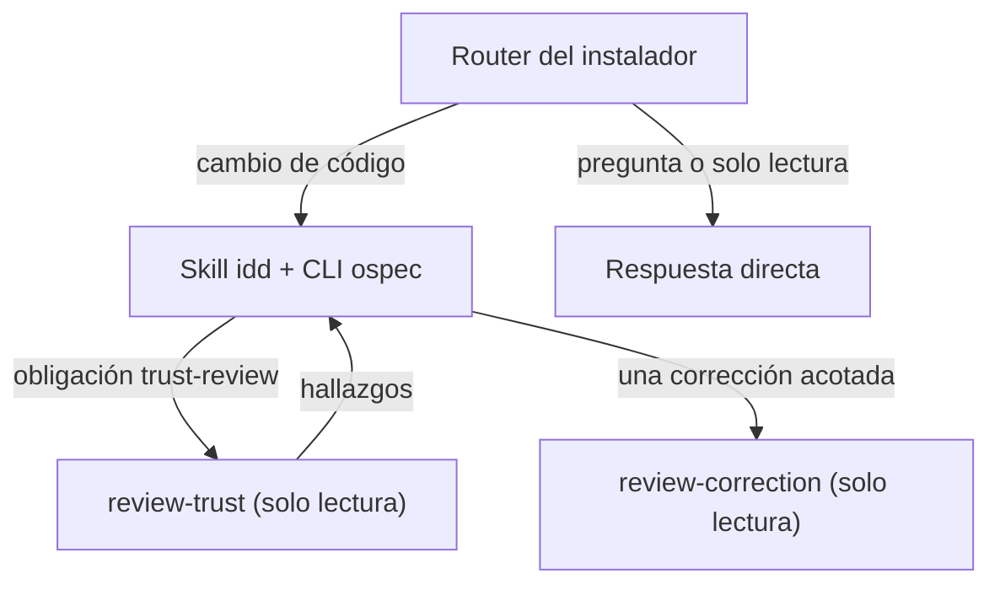

# Agentes y Habilidades (Skills)

> **En pocas palabras:** Un **agente** es un rol con herramientas y responsabilidad acotadas: en IDD el asistente principal cambia el código, y los revisores `review-*` solo leen y aportan evidencia. Una **skill** es el manual paso a paso que le indica cómo hacer una tarea concreta. El flujo por defecto es IDD; los agentes de fase de SDD son un paquete opcional.

---

## Agente y skill: qué es cada cosa

| Pieza | Dónde vive | Qué define |
|---|---|---|
| **Agente** | `agents/<nombre>.agent.md` | Su rol, las herramientas que puede usar (`read`, `search`, `edit`, `execute`) y si el usuario lo invoca directamente (`user-invocable`). |
| **Skill** | `skills/<nombre>/SKILL.md` | El procedimiento: qué hacer, en qué orden y con qué criterios. Su `description` incluye los disparadores que la activan. |

Un agente sin `edit` no puede tocar ficheros. Los revisores `review-*` tienen solo `read` y `search`, así que su trabajo termina en un informe.

---

## Flujo por defecto: IDD

En IDD no hay agentes de fase. El instalador añade un router a las instrucciones del asistente: cada cambio de código entra en la skill `idd`, y las preguntas o el trabajo de solo lectura van directos. La skill `idd` y el CLI `ospec` deciden qué obligaciones faltan y cuándo el cambio está hecho. Los revisores aportan evidencia; no deciden el cierre.

La revisión de confianza solo aparece cuando el cambio cruza una frontera de seguridad, según sus señales. El ciclo es:

1. `ospec review start` abre la revisión y devuelve la petición.
2. `review-trust` devuelve sus hallazgos, que el asistente pasa sin modificar a `ospec review record` y después corrige lo bloqueante.
3. `ospec review correct` pide la validación: `review-correction` comprueba la corrección contra los hallazgos congelados, sin buscar problemas nuevos.
4. `ospec review validate` registra el resultado.

Un cambio admite como máximo 3 revisiones de confianza. Cuando se agotan, `ospec check` abre la puerta `review-limit` (una de las seis puertas de IDD): solo la respuesta explícita de la persona autoriza una revisión más. Una nueva revisión exige código cambiado.

---

## Catálogo de revisores (solo lectura)

| Agente | Lo usa | Qué revisa |
|---|---|---|
| `review-trust` | IDD (obligación `trust-review`) y la puerta de calidad de SDD | Fronteras de autenticación, credenciales, secretos y riesgos de permisos. |
| `review-correction` | IDD y la puerta de calidad de SDD | Valida los hallazgos inmutables de un linaje de revisión. |
| `review-runtime` | La puerta de calidad de SDD | Riesgos de red, errores, reintentos, concurrencia y fallos parciales. |
| `review-evolution` | La puerta de calidad de SDD | Complejidad estructural, mantenibilidad y deriva de contratos. |
| `review-efficiency` | La puerta de calidad de SDD | Rutas sensibles al rendimiento, siempre con evidencia. |
| `review-change` | La puerta de calidad de SDD | Clasificación residual cuando la puerta no puede asignar el cambio a un dominio. |

Los revisores no se invocan directamente (`user-invocable: false`). Las lentes de la v1 (`review-risk`, `review-readability`, `review-reliability`, `review-resilience`) se retiraron en la v2.91.0; los linajes `schema_version: 1` antiguos siguen legibles durante una versión menor y después migran a v2.

---

## Las habilidades (*skills*)

Cada grupo indica en qué instalaciones aparece.

### Instaladas en cualquier modo

| Grupo | Skills | Para qué |
|---|---|---|
| Flujo IDD | `idd` | Lleva cada cambio de código a través del CLI `ospec`. |
| Arquitectura | `foundation` | Fija la arquitectura de un proyecto nuevo antes del primer cambio; IDD construye sobre sus decisiones. |
| Ramas y entrega | `branch-pr`, `chained-pr`, `work-unit-commits` | Procedimientos para PR, PR encadenados y commits por unidad de revisión. Las ramas, commits y PR siguen siendo decisión del usuario. |
| Diseño y calidad | `api-design`, `accessibility`, `design-system`, `hexagonal-architecture`, `cognitive-doc-design`, `cncf-landscape` | Guías de diseño y revisión de dominio. |
| Revisión | `review-trust`, `review-correction`, `review-change`, `review-runtime`, `review-evolution`, `review-efficiency` | Las skills de los revisores de la tabla anterior. |
| Herramientas | `caveman`, `skill-creator`, `skill-registry` | Estilo de respuesta, creación de skills y el registro de skills. |
| Stacks | `stack-angular`, `stack-dotnet`, `stack-go`, `stack-java`, `stack-kafka`, `stack-kotlin`, `stack-postgres`, `stack-python`, `stack-react`, `stack-springboot`, `stack-sqlserver`, `stack-starlight`, `stack-vite` | Buenas prácticas por tecnología. |
| Soporte | `skills/_shared/` | Ficheros compartidos de resolución de skills, presupuesto de tokens y protocolos de fase. Se instalan siempre porque IDD los usa, aunque la mayoría describen protocolos de SDD. |

### Solo con `--with-sdd`

Las skills `skills/sdd-*` (procedimiento de cada fase SDD) y los comandos `/sdd-*`. Se explican en [Agentes de fase SDD](/openwiki/sdd/agentes-de-fase.md).

### Solo con `--with-extras`

`issue-creation`, `comment-writer`, `gh-release-notes`, `judgment-day`, `caveman-compress` y `stack-webmcp`. Son de colaboración y nicho; ninguna instalación por defecto las incluye.

---

## Registro de skills en caché

Para no releer cada `SKILL.md` en cada sesión, el hook `SessionStart` (igual en IDD y en SDD) calcula una huella de las skills y reutiliza o regenera `.ospec/cache/skill-registry.cache.json`; informa de si la caché se `reused` o `generated`. El registro indexa las skills de `skills/` salvo `sdd-*`, `_shared` y `skill-registry`, y extrae de cada una hasta 15 reglas compactas de sus secciones de reglas. La skill `skill-registry` crea o actualiza el registro bajo demanda, por ejemplo tras instalar o quitar skills.

---

## Modo SDD (opcional)

El orquestador `sdd-orchestrator` y los agentes de fase `sdd-*` solo existen en el modo SDD. Se instalan con `--with-sdd` y se activan con un comando `/sdd-*` o una petición explícita. Se documentan en [Agentes de fase SDD](/openwiki/sdd/agentes-de-fase.md).
