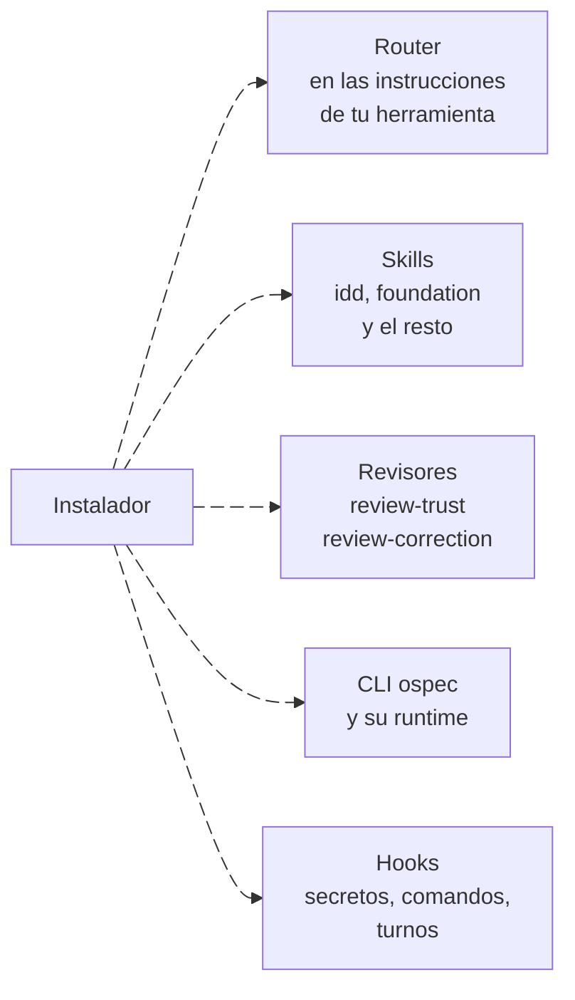

---
sidebar:
  order: 1
---

# Instalación

> **En pocas palabras:** se instala una vez en tu herramienta (Claude Code, VS Code, Copilot, OpenCode, Codex, Cursor o Antigravity) y funciona en cualquier proyecto que sea un repositorio git. No copias nada a tu proyecto: el instalador añade el router a las instrucciones de tu herramienta, las skills, los revisores y el CLI `ospec`. La primera vez que pidas un cambio, el agente te propondrá el comando de tests del proyecto.

---

## Claude Code, sin clonar nada

Es la vía más corta. Instala la build publicada en la rama `release`:

```bash
claude plugin marketplace add https://github.com/snakeblack/ospec-workflow.git#release
claude plugin install ospec-workflow@ospec-tools
```

Esta build trae IDD sin el paquete SDD. Para SDD, instala desde una copia del repositorio (siguiente apartado) con `--with-sdd`.

---

## Cualquier herramienta, desde una copia del repositorio

Necesitas Node.js 22 o superior. Clona `ospec-workflow` y, **desde la raíz de esa copia**, ejecuta el instalador de tu herramienta:

```bash
git clone https://github.com/snakeblack/ospec-workflow.git
cd ospec-workflow
npm run setup:claude      # o el de tu herramienta, ver la tabla
```

| Herramienta | Comando | Dónde instala |
| --- | --- | --- |
| Claude Code | `npm run setup:claude` | Plugin persistente, registrado con el CLI `claude`. |
| VS Code | `npm run setup:vscode` | Compila `dist/vscode` y lo añade a `chat.pluginLocations`. |
| GitHub Copilot CLI | `npm run setup:copilot` | Global, en `~/.copilot/`. Para un solo proyecto: `npm run install:copilot -- ../mi-proyecto`. |
| OpenCode | `npm run setup:opencode` | Global, en `~/.config/opencode/`. Para un solo proyecto: `npm run install:opencode -- ../mi-proyecto`. |
| Codex CLI | `npm run setup:codex` | Global, en `~/.codex/`, sin tocar las claves de tu `config.toml`. |
| Cursor | `npm run setup:cursor` | Global, en `~/.cursor/`, respetando tu `hooks.json`. |
| Antigravity | `npm run setup:antigravity` | Global, en `~/.gemini/config/`, con un manifiesto transaccional. |
| Instalador guiado | `npm run setup:tui` | Elige la herramienta y el modelo de cada tier en pantalla. Necesita también Go 1.26 o superior. |

Volver a ejecutar un instalador es seguro: deja el mismo resultado y quita lo que la nueva build ya no trae.

### Opciones de cualquier instalador

| Opción | Qué hace |
| --- | --- |
| `--with-sdd` | Añade el modo SDD: el orquestador, los agentes `sdd-*` y los comandos `/sdd-*`. Una reinstalación sin la opción lo conserva y lo avisa; `--no-sdd` lo quita. |
| `--with-extras` | Añade skills de nicho (`issue-creation`, `comment-writer`, `gh-release-notes`, `judgment-day`, `caveman-compress`, `stack-webmcp`). |
| `--no-router` | No instala el router, o lo quita. Sin router, IDD solo entra si lo invocas. |
| `--no-engram` | No configura la memoria entre sesiones de [Engram](https://github.com/Gentleman-Programming/engram), que se configura sola si el binario `engram` está en el `PATH`. |

Con npm, las opciones van detrás de `--`: `npm run setup:claude -- --with-sdd`.

---

## Qué se instala



- **El router.** Unas instrucciones cortas que tu herramienta carga en cada petición. En Claude Code y Codex es un bloque con marcadores dentro de `~/.claude/CLAUDE.md` o `AGENTS.md`, junto a tu propio texto.
- **Las skills.** `idd` lleva cada cambio; `foundation` fija la arquitectura de un proyecto nuevo. Además hay skills de diseño, de entrega y de stacks.
- **Los revisores.** Agentes de solo lectura que aportan evidencia, como la revisión de seguridad.
- **El CLI `ospec`.** Viaja con la instalación y el agente lo ejecuta por su ruta instalada. No tienes que añadirlo a tu proyecto ni ejecutarlo tú.
- **Los hooks.** Bloquean secretos y comandos destructivos, cuentan los turnos y dejan la traza de la sesión. Ver [Hooks del ciclo de vida](/openwiki/proteccion/hooks.md).

---

## Qué necesita tu proyecto

1. **Ser un repositorio git** cuya raíz no sea tu `$HOME` ni `/`. Fuera de un repositorio, el agente trabaja directo, sin IDD. Para un proyecto nuevo basta con `git init -b main`.
2. **Un comando de tests** en `idd/config.yaml`. No hace falta prepararlo: en el primer cambio, el agente te propone uno (lo saca de tu `package.json` o de tu documentación de tests) y no se ejecuta hasta que lo apruebas.

```yaml
checks:
  test: npm test
```

3. **Si el proyecto es nuevo**, el agente te ofrecerá antes [foundation](/openwiki/idd/foundation.md) para fijar la arquitectura. Puedes rechazarlo.

`ospec doctor` revisa la instalación y el proyecto sin escribir nada: avisa, entre otras cosas, de un cambio abierto sin checks o de entradas duplicadas en VS Code (`ospec doctor --target vscode`).

Siguiente paso: [Un cambio de principio a fin](/openwiki/empezar/primer-cambio.md).
