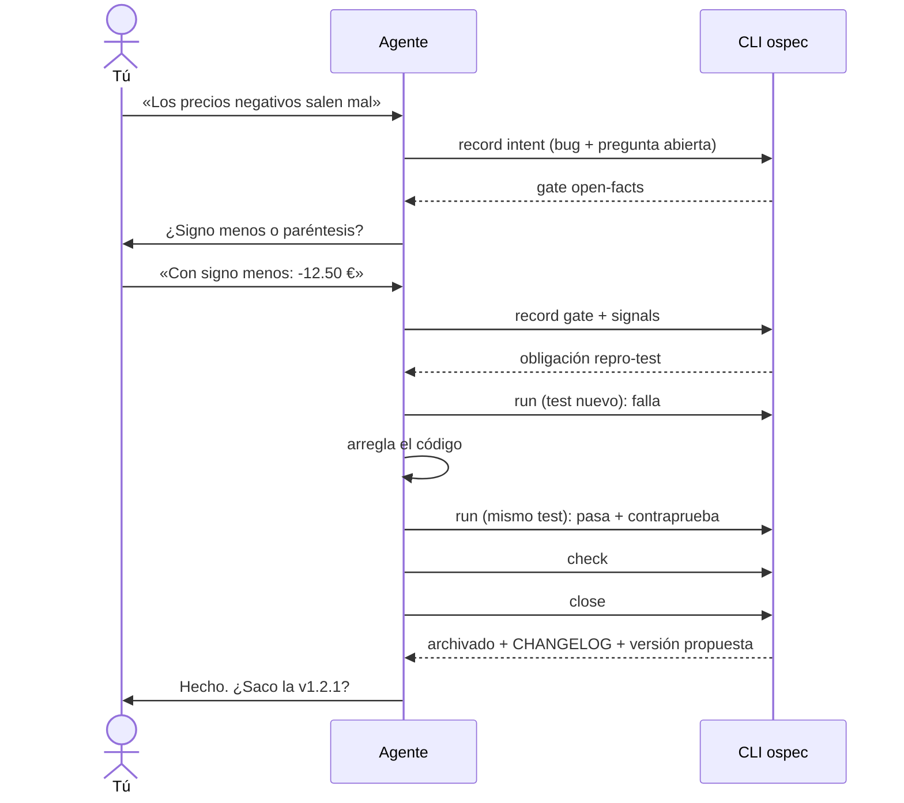

---
sidebar:
  order: 2
---

# Un cambio de principio a fin

> **En pocas palabras:** este es un cambio real, un bug, contado desde tu lado y desde el del agente. Tú escribes dos frases: la petición y una respuesta. El agente hace el resto con el CLI `ospec`, que no lo deja cerrar hasta ver un test que falla antes del arreglo y pasa después. Las salidas que verás son las que imprime el CLI.

---

## El proyecto

Una tienda con una función que formatea precios en céntimos:

```js
// src/precio.js
function formatPrice(cents) {
  const euros = Math.floor(cents / 100);
  const rest = cents % 100;
  return euros + "." + String(rest).padStart(2, "0") + " €";
}
```

`idd/config.yaml` ya declara el comando de tests y cómo se entrega cada cambio:

```yaml
checks:
  test: npm test
delivery:
  changelog: CHANGELOG.md
  release: per-change
```

---

## El recorrido



### 1. Pides el cambio

> **Tú:** Los precios negativos salen mal, `formatPrice(-1250)` debería dar `-12.50 €`.

El agente registra la intención: es un bug, qué se pide y cómo se comprueba que está hecho. Antes de tocar nada, se pregunta qué deja abierto la petición. Aquí, cómo se escribe un negativo.

```text
$ ospec record intent --change precio-negativo --kind bug \
    --summary "formatPrice muestra mal los importes negativos" \
    --acceptance "formatPrice(-1250) devuelve -12.50 €" \
    --open-fact "¿Un importe negativo se muestra con signo menos o entre paréntesis?"
recorded intent on precio-negativo
next (gate open-facts): ospec record gate --change precio-negativo --gate open-facts --resolve --answer "<the user's words>" --source user
decision: open-facts: Before the change is built, answer these behavior questions that neither the request nor the code settles.
  - ¿Un importe negativo se muestra con signo menos o entre paréntesis?
```

### 2. Respondes la pregunta

El CLI ha abierto el gate `open-facts`: el agente termina el turno y te pregunta. Si hubiera varias preguntas, llegarían todas juntas.

> **Agente:** Antes de arreglarlo: ¿un importe negativo se muestra con signo menos o entre paréntesis?
>
> **Tú:** Con signo menos: `-12.50 €`.

El agente registra tu respuesta con tus palabras y declara los ficheros que va a tocar. El CLI deriva de ahí las obligaciones: al ser un bug, exige un test de reproducción.

```text
$ ospec signals --change precio-negativo --path src/precio.js --path test/precio.test.js
plan of precio-negativo: recorded bug-fix; floor repair
next (repro-test): ospec run --change precio-negativo --obligation repro-test --command "<test>"
```

### 3. El test falla primero

El agente escribe un test que reproduce el bug y lo ejecuta **a través del CLI**, que registra el fallo:

```js
test("formatea negativos con signo menos", () => assert.equal(formatPrice(-1250), "-12.50 €"));
```

```text
$ ospec run --change precio-negativo --obligation repro-test --command "node --test test/precio.test.js"
run-2: exit 1; no evidence recorded by this run
```

### 4. El arreglo, y el mismo test pasa

Después arregla el código y vuelve a ejecutar **el mismo comando**:

```text
$ ospec run --change precio-negativo --obligation repro-test --command "node --test test/precio.test.js"
run-3: exit 0; recorded evidence ev-1
counterproof run-4: exit 1 on base b06aebb2b653
counterproof run-5: exit 0 on base b06aebb2b653 without the tests of the diff
next (checks-pass): ospec check --change precio-negativo --close
```

Las dos líneas `counterproof` son la **contraprueba**. El CLI monta el código de antes del cambio con el test nuevo encima y comprueba que ahí falla (`exit 1`), y que sin el test nuevo pasa (`exit 0`). Así demuestra que el test detecta este bug y no es un test que pasa siempre. Ver [Evidencia y tests](/openwiki/idd/evidencia.md).

### 5. Los checks y el cierre

```text
$ ospec check --change precio-negativo
ready: precio-negativo can close
ran: check test exit 0

$ ospec close --change precio-negativo
precio-negativo closed and archived in idd/archive/2026-11-02-precio-negativo
changelog: CHANGELOG.md added under [Unreleased] ### Fixed: - formatPrice muestra mal los importes negativos (precio-negativo)
release: propose v1.2.1 (patch) with the notes of [Unreleased]; ask whether it breaks compatibility (a major), and cut it only with the user's OK
```

`ospec close` solo funciona cuando no queda ninguna obligación pendiente ni ningún gate abierto. Al cerrar:

- archiva el cambio en `idd/archive/2026-11-02-precio-negativo/`;
- escribe su línea en `CHANGELOG.md`, bajo `[Unreleased]`, en la sección que le toca a un bug (`Fixed`);
- propone la versión siguiente (`v1.2.1`, un patch, porque no añade nada nuevo), pero no la crea.

### 6. Tú decides qué sigue

> **Agente:** Arreglado y cerrado: `formatPrice(-1250)` devuelve `-12.50 €`, con un test que lo cubre. El CLI propone la v1.2.1. ¿Rompe la compatibilidad, o la saco como patch? ¿Hago commit y abro la PR?

Commits, ramas, PRs y versiones siguen siendo decisión tuya. Ver [Entrega](/openwiki/idd/entrega.md).

---

## Qué habría cambiado con otro cambio

| Si el cambio… | IDD habría exigido además… |
| --- | --- |
| Fuera una errata en la documentación | Nada: solo los checks. |
| Añadiera una funcionalidad con Strict TDD activo | Un par rojo-verde por cada unidad de trabajo. |
| Tocara la autenticación | Una [revisión de seguridad](/openwiki/idd/revision.md) independiente. |
| Añadiera una migración de base de datos | Un test de migración y un plan de compatibilidad o de vuelta atrás. |
| Borrara una tabla | Tu respuesta en el gate `irreversible-operation` antes de seguir. |
| Cambiara una decisión de un ADR | Tu respuesta en el gate `adr-amend-or-contradict` y un ADR nuevo ([Foundation](/openwiki/idd/foundation.md)). |

El detalle de cada señal y su obligación está en [El ciclo de un cambio](/openwiki/idd/flujo-idd.md).
