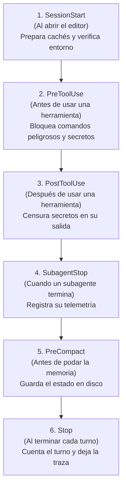

# Ciclo de Vida y Runtime de Hooks

> **En pocas palabras:** Los hooks son los **sensores y frenos automáticos** de `ospec-workflow`. Se disparan de forma transparente en momentos clave de tu sesión de trabajo (cuando inicias la herramienta, antes de que la IA ejecute un comando o al guardar un cambio) para proteger tu código, evitar fugas de secretos y mantener todo en orden.

---

## Los 6 Eventos del Ciclo de Vida

---

## ¿Qué hace cada Hook exactamente?

### 1. `SessionStart` (Inicio de Sesión)
- Se ejecuta en cuanto abres tu asistente de IA.
- Comprueba si las habilidades cambiaron y regenera la caché (`skill-registry`).
- Inyecta las variables de entorno y las capacidades del proyecto.

### 2. `PreToolUse` (Control Previo de Herramientas)
- Se ejecuta cada vez que la IA quiere escribir un archivo o ejecutar un comando en la terminal.
- **AgentShield:** Analiza los comandos para evitar que se ejecuten instrucciones destructivas (como borrar el disco o alterar credenciales).
- **Token Budget:** Estima los tokens de los ficheros que la herramienta va a leer y pide confirmación si una petición supera 50.000 tokens o si el acumulado de un cambio SDD activo supera 150.000. No bloquea.

### 3. `PostToolUse` (Censura de Salida)
- Se ejecuta después de cada herramienta, antes de que el modelo vea su salida.
- Censura los secretos de esa salida y conserva la forma de la respuesta. En lecturas de ficheros sensibles (`.env*`, credenciales, `secrets.json`) aplica un modo más estricto.
- Si no hay nada que censurar, no escribe nada.

### 4. `SubagentStop` (Cierre de Tarea de Sub-Agente)
- Se ejecuta cuando un subagente termina su labor.
- Registra su telemetría (tokens y duración) y, para los agentes `sdd-*` del modo SDD (opcional), persiste su resultado en el `state.yaml` del cambio activo.
- No bloquea: siempre deja continuar el turno.

### 5. `PreCompact` (Protección ante Podado de Contexto)
- Cuando la conversación con la IA se vuelve muy larga, los editores suelen borrar los primeros mensajes para ahorrar espacio en memoria.
- Este hook escribe un resumen de sesión de cada cambio abierto (IDD y, en el modo SDD opcional, el cambio activo) en `.ospec/session/<cambio>/session-summary.md` antes de que la memoria se borre.

### 6. `Stop` (Fin de Turno)
- Se ejecuta al terminar cada turno del agente.
- Suma uno a `.ospec/turns` en la raíz del proyecto, el primer directorio hacia arriba que tiene `.git`, aunque la sesión esté en un subdirectorio. Con esa cuenta el CLI valla las respuestas de los gates IDD (E1.49).
- Escribe la traza de la sesión en `.ospec/session/latest.md`, con el cambio abierto y el siguiente paso.
- No bloquea: si no puede contar el turno o escribir la traza, deja continuar con un aviso.
