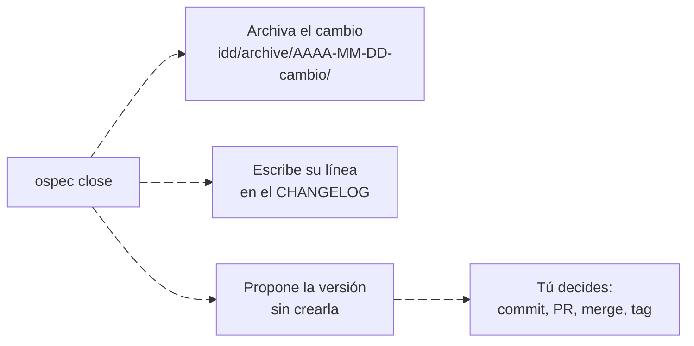
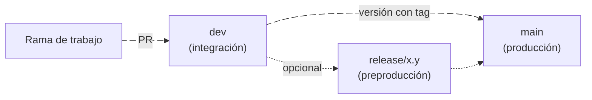

---
sidebar:
  order: 6
---

# Entrega: ramas, changelog y versiones

> **En pocas palabras:** ospec no hace commits, no crea ramas y no publica versiones: eso sigue siendo decisión tuya. Lo que sí hace, si lo declaras en `delivery:` de `idd/config.yaml`, es escribir al cerrar la línea del cambio en tu CHANGELOG, proponerte la versión siguiente y recordar al agente cómo integra tu proyecto (una PR cada vez o varias en paralelo, rama de desarrollo o no). Además puede exportar el avance del proyecto como un snapshot para un panel o un cliente.

---

## Qué pasa al cerrar



Con esta configuración:

```yaml
delivery:
  changelog: CHANGELOG.md
  release: per-change
```

`ospec close`, después de archivar el cambio:

1. **Añade su línea al CHANGELOG** en formato [Keep a Changelog], bajo `## [Unreleased]`, en la sección que le toca por su tipo: `feature` → `Added`, `bug` → `Fixed`, `refactor` y `docs` → `Changed`. La línea es `- <resumen> (<id-del-cambio>)`. Si falta la sección o el fichero, los crea. Cerrar otra vez no duplica la línea.
2. **Propone la versión** (`release: per-change`): un minor si `[Unreleased]` tiene `Added` y un patch si no, con su tag y las notas de `[Unreleased]`. Nunca propone un major: el agente te pregunta si el cambio rompe la compatibilidad. **El CLI no toca versiones, tags ni releases**: el agente solo las crea con tu OK.

Un ejemplo real está en [Un cambio de principio a fin](/openwiki/empezar/primer-cambio.md#5-los-checks-y-el-cierre).

[Keep a Changelog]: https://keepachangelog.com/es-ES/1.1.0/

---

## Las claves de `delivery`

| Clave | Valores | Qué decide |
| --- | --- | --- |
| `branching` | `serial`, `parallel` | `serial`: una sola PR en curso cada vez. `parallel`: varias ramas a la vez, integrando la rama principal antes de cada merge. Sin declarar, lo decide el perfil de equipo; sin perfil, se recomienda `serial`. |
| `changelog` | Una ruta relativa, o `none` | Dónde escribe `ospec close` la línea de cada cambio. Sin declarar, no escribe nada y `ospec next` lo sugiere (`changelog-undeclared`). |
| `release` | `per-change`, `batched`, `none` | `per-change`: propone una versión por cambio. `batched`: las versiones se cortan cuando tú decides, agrupando cambios. `none`: sin versiones. |
| `integration_branch` | Un nombre de rama | La rama de desarrollo donde se integra cada cambio, si no es la principal (por ejemplo `dev`). |
| `production_branch` | Un nombre de rama | La rama de producción, si no es la rama por defecto del repositorio. Necesita `integration_branch`. |

Mientras falte una clave importante, `ospec next` lo sugiere sin bloquear (por ejemplo, `branching-undeclared` con la razón para usar `serial`). El agente te propone el valor y solo lo escribe con tu aprobación. `ospec team` muestra los valores efectivos y de dónde salen.

**ospec no lee git.** Las reglas de ramas que devuelven `ospec next` y `ospec close` son una guía para el agente, no una comprobación.

### Con una rama de desarrollo

```yaml
delivery:
  branching: serial
  integration_branch: dev
  production_branch: main
  changelog: CHANGELOG.md
  release: batched
```



- Las ramas de trabajo salen de `dev` y sus PR van a `dev`. La línea del CHANGELOG llega a `[Unreleased]` de `dev` con el merge.
- `main` solo recibe merges de `dev` o de una `release/x.y`, y cada uno es una versión con su tag.
- `release/x.y` es opcional: sale de `dev`, solo recibe arreglos, puede llevar versiones `x.y.z-rc.N`, se fusiona en `main` y de vuelta en `dev`, y después se borra.
- La versión se propone al pasar a producción, no en cada merge a `dev`. Por eso `release: per-change` se rechaza con una rama de integración.

---

## Cambios en varios repositorios

`ospec` trabaja sobre un único repositorio. Un cambio que atraviesa varios es **un cambio IDD por repositorio**, cada uno cerrado con su propia evidencia.

- Mantén compatible un contrato compartido hasta que todos sus consumidores migren: primero amplía el proveedor, después migra los consumidores y elimina la forma antigua al final.
- En un monorepo cuyos servicios tienen sus manifiestos por debajo de la raíz, declara en `impact:` el `stack` y las rutas de contrato, datos y seguridad de cada servicio.

El modo SDD tiene además un atlas que coordina cambios entre repositorios: [Federación multi-repositorio](/openwiki/sdd/federacion.md).

---

## El snapshot de avance

`ospec snapshot` exporta bajo demanda el avance del proyecto como JSON, para publicarlo en un panel o enseñárselo a un cliente. Ningún paso de IDD, ningún hook y ningún check lo ejecutan: publicarlo, por ejemplo desde tu CI, es cosa tuya.

```bash
ospec snapshot --out avance.json                       # v1: fases y estado
ospec snapshot --schema-version 4 --out avance.json    # v4: todo lo anterior y la documentación para el cliente
```

- **Las fases** salen de `docs/roadmap.md` (u otro fichero con `--roadmap`): cada fila de tabla cuya primera celda empieza por `<ID>. <título>`, como `P1b.1. Revocación de acceso`. Un cambio IDD o SDD pertenece a la fase si su id empieza por el de la fase sin puntos (`p1b1-revocacion`). La fase está `in-progress` con un cambio abierto, `done` si solo tiene cambios archivados y `pending` si no tiene ninguno.
- **v2** añade los tramos del roadmap (encabezados `##`) y los textos para el cliente de `docs/progress.md` (u otro fichero con `--progress`).
- **v3** añade la etapa de entrega de cada fase terminada: en pruebas, o en producción con su versión y su fecha, leídas del CHANGELOG.
- **v4** añade la documentación para el cliente (problema, objetivos, alcance, entregables) y las decisiones de los ADR aceptados o sustituidos.

Un roadmap ausente o inválido termina con código 1 y un mensaje con el fichero y la línea, sin escribir nada. Los esquemas están en [`schemas/progress-snapshot/`](https://github.com/snakeblack/ospec-workflow/tree/main/schemas/progress-snapshot).

---

## Fuentes

- [Contrato IDD](https://github.com/snakeblack/ospec-workflow/blob/main/openspec/specs/idd/spec.md): REQ-idd-023 (perfil de equipo y ramas), REQ-idd-025 (CHANGELOG y versión al cerrar) y REQ-idd-026 (snapshot).
- [Documentación técnica](https://github.com/snakeblack/ospec-workflow/blob/main/docs/README.md): el formato completo del fichero de avance.
