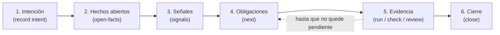

# IDD: el flujo por defecto

> **En pocas palabras:** IDD (desarrollo guiado por impacto) es como el asistente cambia código. El impacto del cambio decide qué pruebas y revisiones exige, y el CLI `ospec` solo lo da por terminado cuando ve ejecutarse la evidencia sobre el árbol actual. No hay fases ni documentos que escribir antes.

---

## Cuándo entra IDD

El instalador añade un router pequeño a las instrucciones del asistente. Decide cada petición:

| Petición | Flujo |
| --- | --- |
| Un cambio de código | **IDD**: la skill `idd` lo lleva con el CLI `ospec` hasta `ospec close`. |
| Una pregunta, una explicación o trabajo de solo lectura | Directo, sin cambio registrado. |
| Un arreglo del sistema o un script suelto fuera de un proyecto | Directo. |
| `mode: sdd` en `idd/config.yaml` | IDD apagado: trabajo directo, y SDD solo bajo petición. |

IDD necesita un **proyecto**: un work tree de git cuyo toplevel no sea `$HOME` ni `/`. Fuera de uno, `ospec record intent` y `ospec next` se detienen con `not-a-git-repo` (o `git-not-found` si falta git) e indican el siguiente paso. Para un proyecto nuevo, el repositorio se crea con `git init -b main`.

---

## El ciclo



Todos los comandos de cambio llevan `--change <id>`, con un id en kebab-case. Añade `--json` para leer la respuesta del CLI.

1. **Intención.** Registra qué se pide y cómo se comprueba que está hecho:
   `ospec record intent --change <id> --kind <bug|feature|refactor|docs> --summary "<qué>" --acceptance "<resultado observable>"`, seguido de un `--open-fact "<pregunta>"` por cada hecho abierto, o de `--no-open-facts --basis "<qué lo fija>"` cuando no hay ninguno. Si la petición es ambigua, `--ambiguous --request "<petición>"` abre el gate `ambiguous-intent`.
2. **Hechos abiertos.** Son los comportamientos que ni la petición ni el código fijan: valores por defecto, entradas inválidas, error frente a silencio, quién puede hacerlo. Se preguntan todos juntos antes de editar nada. En una `feature` hay que nombrar las categorías `inputs`, `uniqueness`, `persistence`, `copy`, `url-state`, `accessibility` y `errors`, cada una con una pregunta, una referencia `path:line` o una cita de la petición.
3. **Señales.** Declara los ficheros previstos: `ospec signals --change <id> --path <fichero>...`. Puedes añadir `--work-units`, `--decision`, `--operation`, `--adr` o `--quality`. Después, `ospec check` recalcula las señales desde el diff real y puede añadir obligaciones nuevas. Si el plan exageró una señal, `ospec record retract --change <id> --signal <id> --reason "<por qué>"` la corrige antes de que el diff la confirme.
4. **Obligaciones.** `ospec next --change <id> --json` indica el siguiente paso: qué gate resolver, qué obligación trabajar o `close`. Cada señal activa sus obligaciones (ver la tabla siguiente).
5. **Evidencia.** Se registra con el comando que observa la ejecución:
   - `ospec run --change <id> --obligation <repro-test|tdd-red-green|migration-compat-and-test> --command "<test>"`, para reproducciones, pruebas rojo-verde y migraciones.
   - `ospec check --change <id>`, que ejecuta todos los `checks:` del proyecto.
   - `ospec review start|record|correct|validate`, para la revisión de confianza.
6. **Cierre.** `ospec close --change <id>` tiene éxito solo cuando no queda ninguna obligación pendiente ni ningún gate abierto. Entonces archiva el cambio en `idd/archive/`. Ramas, commits y PRs siguen siendo decisión tuya.

Para consultar el estado: `ospec status` lista los cambios, `ospec next` dice el siguiente paso y `ospec doctor` avisa, entre otras cosas, de un cambio IDD abierto sin `checks:`.

---

## Señales y obligaciones

| Señal | Se activa cuando | Obligación | Qué la satisface |
| --- | --- | --- | --- |
| `always` | Todo cambio con intención resuelta | `checks-pass` | Una ejecución de cada check del proyecto, todas en verde, sobre el árbol actual |
| `strict-tdd` | `strict_tdd: true` (salvo cambios `docs` y `refactor`) | `tdd-red-green` | Un test que falla antes del código y pasa después, por cada unidad de trabajo |
| `bug-fix` | Intención `bug` | `repro-test` | Un test de reproducción que falla antes del arreglo y pasa después |
| `untested-product` | Intención `feature` o `bug`, y el diff toca código de producto sin ningún test | `boundary-tests` | Un check en verde que reporta más de cero tests |
| `multi-unit-or-decision` | Más de una unidad de trabajo o una decisión declarada | `living-doc` | `change.md` con sus secciones completas, al cerrar |
| `public-contract` | El cambio toca un contrato público (rutas de los patrones, o los ficheros que publica el `package.json`) | `contract-spec-and-test` | Documento de contrato y su test, ambos tocados, con los checks en verde |
| `persistent-data` | El cambio toca datos persistentes (migraciones, almacenamiento, escritura en disco) | `migration-compat-and-test` | Un plan de compatibilidad o de vuelta atrás (`--plan`) y un test de migración en verde |
| `security-boundary` | El cambio toca una frontera de seguridad | `trust-review` | Una revisión de confianza independiente, aprobada para el código actual |
| `adr-or-quality-attribute` | Declaras un ADR o un escenario de calidad que el cambio toca | `adr-impact-declaration` | Un impacto declarado por referencia (`none`, `conforms`, `amends`, `supersedes`, `contradicts`) y los fitness checks de esas referencias en verde |

Una señal que el diff activa se añade en el momento, con su obligación pendiente. Una obligación deja de estar pendiente solo con evidencia, o con una retirada explícita (`ospec record withdraw --change <id> --obligation <id> --reason "<por qué>"`) cuando ninguna señal activa la deriva.

---

## Qué cuenta como evidencia

- **Solo lo que el CLI observa.** Las ejecuciones se registran con `ospec run`, `ospec check` y `ospec review`. Decir «los tests pasan» no satisface nada, y `ospec record` no acepta evidencia: la rechaza.
- **Un comando que no arranca, o que termina por una señal, no cuenta como pasado.**
- **Cero tests no cuenta.** Un resumen como `tests 0`, «could not find» o «no tests ran» no satisface ninguna obligación.
- **La evidencia pertenece a un árbol.** Si cambias un fichero después de un `check` en verde, `checks-pass` vuelve a pendiente hasta el siguiente `ospec check` en verde. Cambiar el nombre, el comando o el orden de un check en `idd/config.yaml` invalida la evidencia anterior.
- **Rojo y verde.** Un test de reproducción o de rojo-verde necesita un fallo y, después, un éxito del mismo comando (y de la misma unidad), en árboles distintos.

---

## Los cinco gates

El agente se detiene en estos gates. Fuera de ellos, solo la aprobación de los `checks:` del proyecto (ver más abajo) lo detiene.

| Gate | Se abre cuando |
| --- | --- |
| `ambiguous-intent` | La petición no permite fijar un criterio de aceptación. |
| `open-facts` | Hay comportamientos abiertos sin respuesta. Se preguntan todos a la vez. |
| `adr-amend-or-contradict` | El cambio enmienda, sustituye o contradice un ADR. |
| `irreversible-operation` | Va a ocurrir una operación destructiva o irreversible, como borrar datos o reescribir historia. |
| `review-limit` | Se agotan las revisiones de confianza del cambio. |

Solo una respuesta explícita tuya resuelve un gate:

```sh
ospec record gate --change <id> --gate <gate> --resolve --answer "<tus palabras>" --source user
```

La aprobación de los `checks:` del proyecto no es un gate, pero también exige tu respuesta (ver más abajo).

### Revisión de confianza

La obligación `trust-review` la cumple un revisor independiente de solo lectura (`review-trust`):

1. `ospec review start --change <id>` congela el candidato y devuelve la petición para el revisor.
2. El resultado del revisor se registra con `ospec review record --change <id> --result @<fichero>`.
3. Si hay un hallazgo `BLOCKER` o `CRITICAL`, se corrige una vez: `ospec review correct --change <id>`, y el validador de solo lectura `review-correction` confirma la corrección con `ospec review validate --change <id> --result @<fichero>`.

Cada revisión admite una sola corrección. Un cambio tiene como máximo tres revisiones, más una por cada gate `review-limit` que resuelvas. Si el código revisado cambia después, la obligación vuelve a pendiente.

---

## Dónde vive el estado

| Ruta | Qué es | Quién la escribe |
| --- | --- | --- |
| `idd/<change>/state.yaml` | Estado del cambio: intención, hechos, señales, obligaciones, gates y evidencia. | Solo el CLI. No se edita a mano. |
| `idd/<change>/change.md` | Plan y decisiones vivas. Existe solo cuando el cambio activa `living-doc`. | El agente escribe la intención, el plan y las decisiones; el CLI, la sección de evidencia. |
| `idd/archive/<YYYY-MM-DD>-<change>/` | Cambios cerrados. | El CLI, en `ospec close`. |
| `idd/config.yaml` | Configuración opcional del proyecto. | Tú apruebas su contenido; el agente lo edita tras tu aprobación. |

IDD no escribe nada bajo `openspec/`.

### La configuración: `idd/config.yaml`

Sus claves son `mode`, `strict_tdd`, `team`, `checks`, `impact` y `contracts`. Una clave desconocida o repetida se rechaza con `config-invalid`.

El elemento imprescindible es `checks:`, el comando o los comandos que `ospec check` ejecuta. Sin al menos uno, ningún cambio IDD puede cerrar:

```yaml
checks:
  test: npm test
```

Cuando falta, `ospec next` devuelve el paso `configure-checks` con un comando candidato. El agente te lo propone y espera tu aprobación antes de crear o editar el fichero, conservando las claves que ya existan. El candidato sale de tu `package.json` o de la documentación de tests, pero nunca cuenta como aprobación ni como evidencia.

`strict_tdd` activa las pruebas rojo-verde. Si no lo declaras, lo decide el perfil de equipo y, sin perfil, vale `false`.

---

## Perfil de equipo

El bloque `team:` de `idd/config.yaml` ajusta los valores por defecto a tu equipo, sin volver a preguntar:

```yaml
team:
  size: small        # solo | small | multi-team
  experience: mixed  # junior | mixed | senior (opcional)
```

| `size` | Estrategia de entrega | Strict TDD | Trazabilidad |
| --- | --- | --- | --- |
| `solo` | `single-pr` | `false` | `advisory` |
| `small` | `ask-on-risk` | `true` | `advisory` |
| `multi-team` | `auto-chain` | `true` | `required` |

`experience: junior` activa siempre Strict TDD. La revisión de confianza sigue ligada a `security-boundary` con cualquier perfil, y una clave explícita, como `strict_tdd`, gana siempre al perfil. `ospec team` muestra el perfil y sus valores por defecto sin escribir nada.

---

## Proyectos nuevos: foundation

Un proyecto sin código todavía, o una petición de definir la arquitectura de un sistema, empieza con la skill `ospec-workflow:foundation`. Descubre objetivos, restricciones y atributos de calidad, y registra la documentación de producto, los ADR y la configuración de IDD. IDD construye sobre esas decisiones. `foundation` es independiente del modo: sirve igual para IDD que para SDD.

---

## ¿Y SDD?

SDD (desarrollo guiado por especificación con OpenSpec) es un modo **opcional**. Se instala con `--with-sdd` y entra solo con un comando `/sdd-*` o con una petición explícita. Nunca se ofrece ni arranca por su cuenta, y un cambio SDD en curso termina en SDD. Sus artefactos viven en `openspec/`, separados de `idd/`.

Detalle del modo: [Modo SDD (opcional)](/openwiki/sdd/modo-sdd.md).

---

## Fuentes

- [Contrato IDD](https://github.com/Snakeblack/ospec-workflow/blob/main/openspec/specs/idd/spec.md): señales, obligaciones, gates y el CLI.
- [Skill `idd`](https://github.com/Snakeblack/ospec-workflow/blob/main/skills/idd/SKILL.md): el protocolo que sigue el agente.
- [CLI `ospec`](https://github.com/Snakeblack/ospec-workflow/blob/main/scripts/ospec.js): los comandos y sus opciones.
