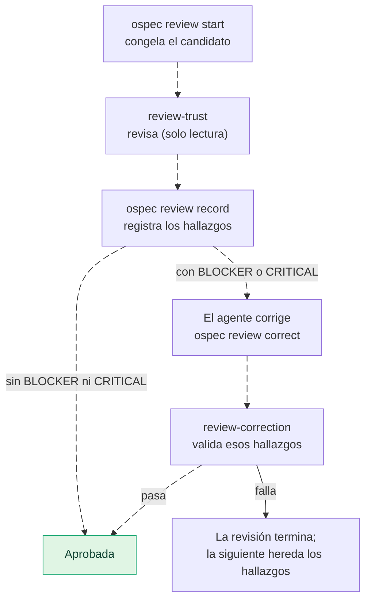

---
sidebar:
  order: 5
---

# Revisión en IDD

> **En pocas palabras:** IDD no pasa cada cambio por un revisor. Solo hay una revisión automática, la **revisión de confianza**, y aparece únicamente cuando el cambio toca una frontera de seguridad (autenticación, permisos, secretos o credenciales). La hace un agente independiente de solo lectura, admite una corrección acotada y tiene un máximo de revisiones por cambio. El resto de la calidad la garantiza la evidencia (tests, checks, contraprueba, fitness checks de los ADR), y la revisión de tu PR sigue siendo cosa tuya o de tu equipo.

---

## Qué se revisa y qué no

| Lo que hay | Cuándo | Quién |
| --- | --- | --- |
| **Revisión de confianza** (`trust-review`) | El cambio toca una frontera de seguridad (señal `security-boundary`) | `review-trust`, un agente de solo lectura |
| **Validación de la corrección** | La revisión encontró un `BLOCKER` o un `CRITICAL` y el agente lo corrigió | `review-correction`, de solo lectura |
| **Evidencia** | Siempre | El CLI: tests, checks, contraprueba y fitness checks de los ADR ([Evidencia y tests](/openwiki/idd/evidencia.md)) |
| **Revisión de la PR** | Cuando abres la PR | Tú o tu equipo; ospec no la sustituye |

**Lo que IDD no hace:** no revisa por defecto el rendimiento, la mantenibilidad ni la fiabilidad en tiempo de ejecución. Esa revisión de cuatro dimensiones (confianza, runtime, evolución y eficiencia, la «4R») es la puerta de calidad del [modo SDD](/openwiki/sdd/ciclo-y-rutas.md). Un cambio solo de documentación cierra sin revisión.

---

## Cómo funciona la revisión de confianza

1. **`ospec review start`** congela el candidato: las rutas que el diff cambia frente a la base del cambio, con un resumen de su contenido. Devuelve la petición para el revisor.
2. **`review-trust`** la revisa sin poder editar nada. Su resultado tiene que citar `ruta:línea` de **cada** ruta del candidato, y cada hallazgo grave, el lugar exacto. Un resultado que no cumple el formato se rechaza sin registrar nada.
3. **`ospec review record`** registra los hallazgos tal cual y los congela. Sin `BLOCKER` ni `CRITICAL`, la revisión queda aprobada.
4. **Si hay hallazgos graves, se permite una corrección.** `ospec review correct` solo la acepta dentro de las rutas congeladas y de un presupuesto de líneas: la mitad de las líneas cambiadas, con un máximo de 200.
5. **`review-correction`** comprueba solo esos hallazgos congelados, sin buscar problemas nuevos, y `ospec review validate` aplica su veredicto. Si la validación falla, esa revisión termina.

---

## Límites

- **Una corrección por revisión.** Una corrección que no cabe (demasiadas líneas o rutas fuera del candidato) cierra la revisión y abre la siguiente, que hereda los hallazgos bloqueantes.
- **Tres revisiones por cambio como máximo.** Cuando se agotan, `ospec check` abre el gate `review-limit`, y solo tu respuesta autoriza una más. Una revisión nueva exige que el código revisado haya cambiado.
- **Una aprobación vale para su candidato.** Si las rutas revisadas cambian después, `trust-review` vuelve a pendiente. Si vuelven al contenido aprobado, se satisface otra vez sin revisar de nuevo.

---

## ¿Cómo se sabe que revisó un agente independiente?

El agente principal pasa al CLI el resultado del revisor. El CLI comprueba lo que el resultado cita, pero no puede ver quién lo escribió, y lo registra como `attestation: relayed`. Cuando el hook `SubagentStop` de la herramienta deja un recibo del subagente `review-trust` en `.ospec/review-receipts/`, el CLI compara el resultado con ese recibo: si no coincide, lo rechaza; si coincide, lo registra como `attestation: subagent-stop`. `ospec close` muestra la atestación de cada revisión. El recibo es un indicio, no una prueba: el hook impide editarlo con las herramientas de escritura, pero un comando de shell todavía podría escribirlo.

---

## El tamaño del cambio

Un diff enorme no se puede revisar bien. El presupuesto de revisión es de **400 líneas cambiadas** (añadidas más borradas) con cualquier estrategia de entrega. El perfil de equipo decide qué hacer si se supera: `solo` usa `single-pr`, `small` pregunta según el riesgo (`ask-on-risk`) y `multi-team` encadena PRs (`auto-chain`). La skill `chained-pr` divide un cambio grande en PRs encadenadas. Ver [Entrega](/openwiki/idd/entrega.md).
