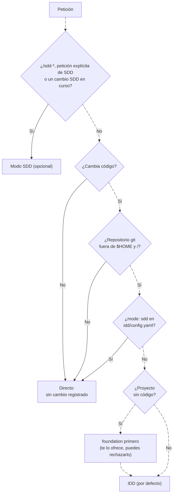

---
sidebar:
  order: 1
---

# El router: qué flujo sigue cada petición

> **En pocas palabras:** el instalador añade a tu herramienta unas instrucciones cortas, el router, que decide qué hacer con cada petición antes de tocar nada. Un cambio de código va a IDD; una pregunta o un trabajo de solo lectura se hacen directamente; SDD solo entra si lo pides. Un proyecto nuevo pasa antes por foundation.

---

## La decisión

| Petición | Flujo | Qué ocurre |
| --- | --- | --- |
| Un cambio de código | **IDD** | El router carga la skill `idd`, y el CLI `ospec` lleva el cambio hasta `ospec close`. |
| Un proyecto nuevo, o definir la arquitectura de un sistema | **foundation**, después IDD | La skill [`foundation`](/openwiki/idd/foundation.md) registra producto, ADR y configuración. IDD construye sobre ellos. |
| Una pregunta, una explicación o trabajo de solo lectura | Directo | Sin cambio registrado. |
| Un arreglo del sistema o un script suelto fuera de un repositorio | Directo | IDD necesita un proyecto. Para crear uno basta con `git init -b main`. |
| Un comando `/sdd-*` o «hazme un SDD para X» | **SDD** (opcional) | Carga el orquestador SDD. Requiere haber instalado con `--with-sdd`. |
| Un cambio SDD ya en curso | **SDD** | Termina en SDD; nunca pasa a IDD. |
| Un proyecto con `mode: sdd` en `idd/config.yaml` | Directo | IDD queda apagado; SDD solo si se pide. |

---

## Reglas del router

- **IDD necesita un proyecto:** un repositorio git cuya raíz no sea `$HOME` ni `/`. Fuera de uno, `ospec record intent` y `ospec next` se detienen con `not-a-git-repo` (o `git-not-found` si falta git) y dicen el siguiente paso.
- **Trabajo directo solo si lo pides.** Si pides explícitamente un cambio sin IDD, se hace directo. El router nunca lo ofrece por su cuenta.
- **SDD nunca arranca solo**, ni aunque `openspec/changes/` tenga un cambio activo.
- **En Claude Code** también puedes entrar en IDD de forma explícita con `/ospec-workflow:idd <petición>`.

---

## Qué pasa después

- En IDD, la ceremonia de cada cambio la deciden sus **señales de impacto**: una errata solo pasa los checks y un cambio de autenticación necesita una revisión de seguridad. Está en [El ciclo de un cambio](/openwiki/idd/flujo-idd.md).
- En SDD, la propuesta, la especificación, el diseño y las tareas se aprueban antes de programar. Está en [Qué es SDD y cuándo entra](/openwiki/sdd/modo-sdd.md).

## Fuentes

- [Router instalado](https://github.com/snakeblack/ospec-workflow/blob/main/rules/ospec-router.instructions.md)
- [Contrato IDD](https://github.com/snakeblack/ospec-workflow/blob/main/openspec/specs/idd/spec.md)
