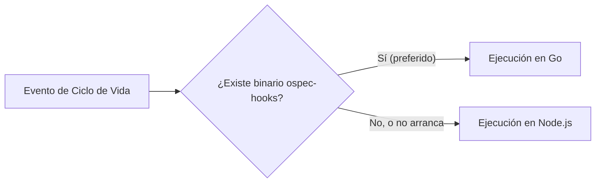

---
sidebar:
  order: 3
---

# Hooks en Go

> **Para quien desarrolla ospec-workflow.** Esta página explica cómo está construido el harness por dentro. Para usarlo no hace falta: empieza por la [Guía rápida](/openwiki/quickstart.md).

> **En pocas palabras:** los hooks se ejecutan en cada llamada a una herramienta, así que su arranque cuenta. Por eso se distribuyen como un binario precompilado en **Go** (`ospec-hooks`), que no tiene que arrancar un intérprete. Cada hook tiene también su versión en Node.js, con la misma lógica, que se usa cuando el binario no está o no arranca.

---

## ¿Por qué Go en lugar de solo Node.js?

En flujos de trabajo con asistentes de IA, un agente puede llamar a herramientas decenas de veces por minuto. Iniciar el motor de Node.js en cada llamada añade una pequeña latencia que se acumula.

Con la versión en **Go**:
- **Sin intérprete:** el binario nativo se ejecuta directamente, sin arrancar Node.js en cada llamada.
- **Paridad:** el binario en Go y los scripts en Node.js implementan la misma lógica, y un contrato de paridad (`scripts/hooks/parity-contract.test.js`) comprueba que respondan igual.
- **Fallback transparente:** Sin un binario utilizable, el lanzador ejecuta el hook Node.js equivalente. Pasa cuando el binario falta (por ejemplo, en un repositorio recién clonado), cuando el instalador lo deja fuera por ser anterior al código Go y no haber Go para recompilarlo, y cuando el sistema no puede arrancarlo (sin permiso de ejecución o de otra arquitectura). En este último caso el lanzador deja un aviso `[ospec warn]` en stderr. OpenCode es la excepción: su plugin solo ejecuta el binario, así que recibe el desfasado con un aviso.



---

## Compilación y Pruebas del Módulo Go

Para compilar el binario nativo en tu máquina:

```bash
# Compilar el ejecutable nativo de hooks
go build -o release/dist/ospec-hooks ./cmd/ospec-hooks

# Ejecutar las pruebas unitarias en Go
go test ./internal/hooks/...
```
