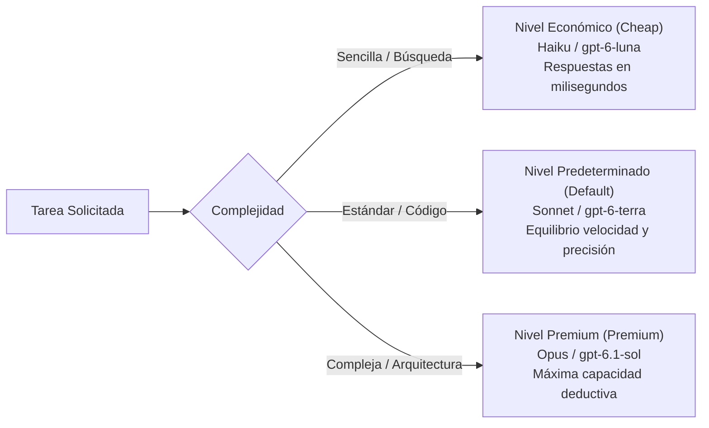

# Ruteo Inteligente de Modelos de IA

> **En pocas palabras:** Utilizar siempre el modelo de Inteligencia Artificial más grande y caro para todas las tareas es lento y derrocha dinero. El **Ruteo de Modelos** asigna de forma inteligente el modelo adecuado para cada trabajo: modelos ultrarrápidos y económicos para tareas sencillas, y modelos avanzados para diseño de arquitectura y revisión crítica.

---

## Los 3 Niveles de Modelos (*Tiers*)

---

## Matriz de Asignación por Proveedor

El archivo central `models.yaml` asigna un tier a cada agente (`agents:`) y mapea cada tier al modelo real de cada proveedor (`tiers:`). Los agentes con tier son los del modo SDD (opcional), es decir `sdd-*` y el agente `foundation`, y los revisores `review-*`. IDD, el flujo por defecto, no tiene fases propias: los agentes que usa son `review-trust` y `review-correction`, ambos con tier `default`.

| Nivel (*Tier*) | Agentes en `models.yaml` | Anthropic / Claude | OpenAI / Codex | Cursor |
|---|---|---|---|---|
| **`cheap`** | `sdd-init`, `sdd-explore`, `sdd-tasks`, `sdd-archive`, `sdd-onboard`, `sdd-document` (modo SDD): trabajo acotado o mecánico. | Claude Haiku | `gpt-6-luna` | `composer-2.5` |
| **`default`** | `sdd-orchestrator`, `sdd-spec`, `sdd-clarify`, `sdd-apply`, `sdd-reconcile`, `sdd-baseline` (modo SDD); `review-trust`, `review-correction`, `review-runtime`, `review-evolution`, `review-efficiency`: trabajo frecuente que requiere razonamiento sólido. | Claude Sonnet | `gpt-6-terra` | `grok-4.6` |
| **`premium`** | `sdd-propose`, `sdd-design`, `sdd-verify`, `sdd-workspace` y `foundation` (modo SDD); `review-change`: decisiones poco frecuentes y de alto impacto. | Claude Opus | `gpt-6.1-sol` | `gpt-6.1-sol` |

VS Code y GitHub Copilot usan `gpt-6 Sol`, `gpt-6 Terra` y `gpt-6 Luna` (copilot). OpenCode usa `zai-coding-plan/glm-5.3` para `premium` y `zai-coding-plan/glm-5.3-flash` para `default` y `cheap`.

---

## Ventajas del Ruteo Inteligente

1. **Ahorro de hasta un 70% en costes de API:** Las tareas cotidianas de inspección y lectura se delegan a modelos ultraligeros.
2. **Mayor velocidad de respuesta:** Los modelos económicos procesan consultas en una fracción de segundo, agilizando el flujo diario.
3. **Máxima calidad donde importa:** Cuando se requiere diseñar una base de datos o validar seguridad, el sistema invoca automáticamente la máxima potencia de razonamiento disponible.
