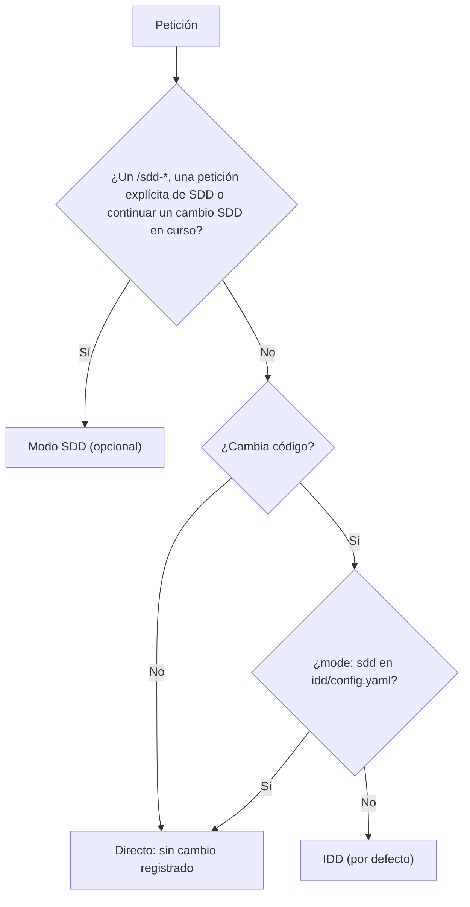

# Orquestación: del router a la ceremonia proporcional

> **En pocas palabras:** Cada petición de código entra por un router pequeño. El flujo por defecto es **IDD**: no tiene fases, sino señales de impacto que deciden qué obligaciones tiene cada cambio, y se da por terminado solo cuando el CLI `ospec` observa la evidencia. El modo **SDD** es opcional y tiene su propio orquestador; sus fases, rutas y gates están en [Ciclo y rutas SDD](/openwiki/sdd/ciclo-y-rutas.md).

---

## El router: a qué flujo va cada petición

El instalador añade un router a las instrucciones que el asistente carga siempre. Decide el flujo antes de tocar nada:

| Petición | Flujo | Qué ocurre |
|---|---|---|
| Un cambio de código | **IDD** | El router carga la skill `idd`; el CLI `ospec` lleva el cambio hasta `ospec close`. |
| Una pregunta, una explicación o trabajo de solo lectura | Directo | Sin cambio registrado y sin skill de IDD. |
| Un comando `/sdd-*` o «hazme un SDD para X» | **SDD** (opcional) | Carga `sdd-orchestrator` una vez. Requiere instalar con `--with-sdd`. |
| Un cambio SDD ya en curso | **SDD** | Termina en SDD; nunca pasa a IDD. |
| Un proyecto con `mode: sdd` en `idd/config.yaml` | Directo | IDD queda apagado; SDD solo si se pide. |

Reglas del router:

- IDD necesita un proyecto: un work tree git cuyo toplevel no sea `$HOME` ni `/`. Fuera de uno, un arreglo del sistema o un script suelto se hacen directamente.
- Si el usuario pide explícitamente un cambio sin IDD, se hace directo. El router nunca lo ofrece por su cuenta.
- Un proyecto nuevo, o una petición para definir la arquitectura de un sistema, empieza con la skill `foundation`, en cualquier modo. IDD construye después sobre las decisiones que esa skill registra.
- SDD no se ofrece ni arranca solo, ni aunque `openspec/changes/` tenga un cambio activo.

---

## Cómo IDD elige la ceremonia

IDD no tiene rutas ni fases. Una errata y una migración de esquema no necesitan el mismo proceso, y IDD lo resuelve con **señales de impacto**:

1. El agente declara los ficheros que espera tocar con `ospec signals --path`. Las señales se activan a partir de esos ficheros, de la intención registrada y de las decisiones y ADR declarados.
2. Con el diff real, `ospec check` recalcula las señales. Cada señal activa añade su obligación; un cambio gana ceremonia solo cuando su impacto la pide.
3. Cada obligación se cierra únicamente con evidencia que el CLI observa ejecutarse sobre el árbol actual. Decir «los tests pasan» no satisface nada.

| Señal | Se activa cuando | Obligación que añade |
|---|---|---|
| `always` | Todo cambio con intención registrada | `checks-pass`: `ospec check` ejecuta los checks de `idd/config.yaml` |
| `bug-fix` | La intención es un bug | `repro-test`: el test de reproducción falla antes del arreglo y pasa después |
| `strict-tdd` | `strict_tdd: true` en `idd/config.yaml`, salvo documentación y refactors | `tdd-red-green`: un par rojo → verde por unidad de trabajo |
| `untested-product` | La intención es `feature` o `bug` y el diff cambia código de producto sin tocar ningún test | `boundary-tests`: un check que pase sobre el árbol actual con más de cero tests |
| `multi-unit-or-decision` | Varias unidades de trabajo o una decisión de diseño registrada | `living-doc`: `idd/<cambio>/change.md` al día con el plan y las decisiones |
| `public-contract` | Rutas de API, OpenAPI, proto o GraphQL, o lo que publica un `package.json` no privado | `contract-spec-and-test`: el documento de contrato y su test cambian en el diff |
| `persistent-data` | Migraciones, SQL o esquemas de ORM | `migration-compat-and-test`: un test de migración con plan de compatibilidad o de vuelta atrás |
| `security-boundary` | Autenticación, seguridad, permisos, secretos o credenciales | `trust-review`: una revisión de confianza acotada y de solo lectura |
| `adr-or-quality-attribute` | El cambio declara los ADR o escenarios de calidad que toca | `adr-impact-declaration`: `none`, `conforms`, `amends`, `supersedes` o `contradicts` para cada uno |

### Ejemplos

| Cambio | Señales | Obligaciones |
|---|---|---|
| Errata en la documentación | `always` | Solo `checks-pass` |
| Refactor interno que no toca contrato, datos ni seguridad | `always` | Solo `checks-pass` |
| Arreglo de un bug de validación, aunque sea de una línea | `always`, `bug-fix` | `checks-pass` y `repro-test` |
| Cambio de autenticación | `always`, `security-boundary` | `checks-pass` y `trust-review` |

Un arreglo de una línea solo se queda en `checks-pass` si no es un bug ni toca contrato, datos o seguridad. Un bug suma `repro-test` aunque ocupe una línea, porque la intención `bug` activa `bug-fix`.

### Gates

El agente se detiene en cinco gates. Solo una respuesta explícita del usuario los resuelve:

- `ambiguous-intent`: no se puede enunciar la aceptación. Hasta resolverlo no se deriva ninguna señal.
- `open-facts`: comportamientos que ni la petición ni el código fijan. Se preguntan todos juntos antes de editar.
- `irreversible-operation`: borrado de datos, reescritura de historia publicada u otra operación destructiva.
- `adr-amend-or-contradict`: el cambio enmienda, sustituye o contradice un ADR.
- `review-limit`: se agotaron las revisiones de confianza del cambio; la respuesta autoriza una más.

### Dónde vive el estado

- `idd/<cambio>/state.yaml`: lo escribe solo el CLI.
- `idd/<cambio>/change.md`: plan y decisiones vivas, que mantiene el agente.
- `idd/config.yaml`: `checks:`, `impact:`, `team:` y `mode`. Sin al menos un comando en `checks:`, ningún cambio puede cerrar.
- `idd/archive/`: destino de cada cambio cuando `ospec close` termina bien.

El recorrido completo, paso a paso, está en [Flujo IDD](/openwiki/idd/flujo-idd.md). El contrato que lo define está en [openspec/specs/idd/spec.md](https://github.com/snakeblack/ospec-workflow/blob/main/openspec/specs/idd/spec.md).

---

## Cuando se pide SDD

Si pides SDD, el router carga `sdd-orchestrator` y la ceremonia cambia por completo: la propuesta, la especificación, el diseño y las tareas se aprueban antes de programar. Lo que es el modo y cómo se instala está en [Modo SDD](/openwiki/sdd/modo-sdd.md). Sus fases, rutas y gates están en [Ciclo y rutas SDD](/openwiki/sdd/ciclo-y-rutas.md).
