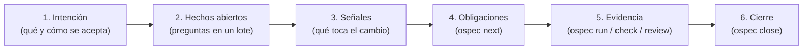

# Guía Rápida: ospec-workflow

> **En pocas palabras:** `ospec-workflow` ayuda a los asistentes de Inteligencia Artificial a cambiar código con pruebas reales en lugar de promesas. Por defecto usa **IDD** (desarrollo guiado por impacto): cada cambio cumple lo que su impacto exige, y solo está hecho cuando el CLI `ospec` lo cierra con evidencia de ejecuciones reales. El desarrollo guiado por especificación (**SDD**) sigue disponible como modo opcional. Funciona igual en 7 herramientas (como Claude Code, Cursor, Copilot o VS Code).

---

## ¿Cómo funciona el flujo de trabajo?

Pides el cambio con tus palabras y el router lo manda a [IDD](/openwiki/idd/flujo-idd.md). No hay fases ni documentos que escribir antes:

1. **Intención (`ospec record intent`):** el agente registra qué quieres y cómo se comprueba que está hecho.
2. **Hechos abiertos:** enumera los comportamientos que ni la petición ni el código fijan y te los pregunta todos juntos antes de editar.
3. **Señales (`ospec signals`):** declara los ficheros que va a tocar; el CLI deriva señales de impacto (contrato público, datos persistentes, frontera de seguridad, bug, Strict TDD).
4. **Obligaciones (`ospec next`):** cada señal añade una obligación, como un test de reproducción para un bug o una revisión de confianza para un cambio de autenticación.
5. **Evidencia:** solo cuenta lo que el CLI ve ejecutarse sobre el árbol actual. Decir «los tests pasan» no satisface nada.
6. **Cierre (`ospec close`):** con todo satisfecho, archiva el cambio en `idd/archive/`. Ramas, commits y PRs siguen siendo decisión tuya.

El agente solo se detiene en cinco *gates*: intención ambigua, hechos abiertos, ADR enmendado o contradicho, operación irreversible y límite de revisiones de confianza. Solo una respuesta explícita tuya los resuelve.

### Modo SDD opcional

Si prefieres escribir y aprobar el contrato antes del código, instala el paquete SDD con `--with-sdd` y usa un comando `/sdd-*`. SDD recorre siete fases (propuesta, especificación, diseño, tareas, aplicación con TDD, verificación y archivo) con artefactos OpenSpec. Detalle en la sección «Modo SDD (opcional)» del mapa de esta página.

---

## ¿Qué ventajas ofrece a tu equipo?

- **Cero alucinaciones sin pruebas:** La IA no puede dar un cambio por bueno si no aporta un recibo de consola real con las pruebas en verde.
- **Ceremonia proporcional:** Un arreglo de una línea solo debe pasar los checks; una migración de esquema debe además su test de migración y su plan de vuelta atrás.
- **La memoria vive en archivos:** Todo el progreso y las decisiones se guardan en `idd/` (o en `openspec/` en modo SDD) dentro de tu repositorio, no en el chat efímero. Si cierras la ventana, no pierdes nada.
- **Un solo código para 7 plataformas:** Escribes tus agentes y reglas una sola vez y el generador los distribuye a Claude Code, VS Code, GitHub Copilot, OpenCode, Codex, Cursor y Antigravity.
- **Seguridad y ahorro:** Filtra automáticamente credenciales secretas y controla el consumo de tokens para evitar gastos imprevistos.

---

## Mapa de la Documentación

Empieza por IDD, el flujo por defecto. Después, el resto de temas, organizados de menor a mayor profundidad técnica:

### 1. IDD: el flujo por defecto
- [IDD paso a paso](/openwiki/idd/flujo-idd.md) — El router, el ciclo de obligaciones con el CLI `ospec`, los gates, la evidencia que cuenta y dónde vive el estado de cada cambio.

### 2. Primeros Pasos
- [Instalación por Asistente o IDE](/openwiki/installation/target-installation.md) — Cómo instalar y sincronizar el plugin en tu herramienta favorita.

### 3. Arquitectura y Funcionamiento
- [Visión General de Arquitectura](/openwiki/architecture/overview.md) — Cómo se distribuye un árbol fuente único a 7 plataformas sin duplicar trabajo.
- [Orquestación: del router a la ceremonia proporcional](/openwiki/orchestration/routing.md) — Cómo el router elige el flujo y cómo las señales de impacto de IDD deciden la ceremonia de cada cambio. SDD, opcional, tiene su propia ruta.

### 4. Agentes y Habilidades
- [Catálogo de Agentes y Skills](/openwiki/agents-skills/agents-and-skills.md) — La skill `idd` y los revisores `review-*` de IDD. El orquestador y los agentes de fase son del modo SDD.
- [Sistema de Reglas de Comportamiento](/openwiki/rules-system/agent-rules.md) — Restricciones obligatorias para que la IA nunca cometa abusos.
- [Ruteo Inteligente de Modelos](/openwiki/model-routing/routing-profiles.md) — Usar modelos rápidos y económicos para tareas simples y avanzados para arquitectura.

### 5. Ciclo de Vida y Seguridad
- [Ciclo de Vida de los Hooks](/openwiki/hooks-runtime/lifecycle.md) — Qué ocurre al iniciar sesión, antes de usar herramientas o al hacer commit.
- [Implementación de Hooks en Go](/openwiki/hooks-runtime/go-implementation.md) — Ejecución instantánea y paridad total con Node.js.
- [Guardrails de Seguridad y Costes](/openwiki/security/guardrails.md) — Detección de secretos, control de tokens y protección de Git.
- [Validación de Contratos y Lint](/openwiki/contract-lint/validation-rules.md) — Reglas automáticas para que nadie rompa la estructura del proyecto.

### 6. Calidad, Estado y Distribución
- [Persistencia y Gestión del Estado](/openwiki/state-management/persistence.md) — El estado de IDD vive en `idd/` y solo lo escribe el CLI. El de SDD está en `openspec/` (modo opcional).
- [Testing, evidencia y Strict TDD](/openwiki/testing-quality/verification.md) — Qué evidencia cuenta en IDD y cómo funciona Strict TDD. La verificación `sdd-verify` es solo del modo SDD.
- [Generador Multi-Target](/openwiki/generator/multi-target-generator.md) — El motor que traduce el código a cada asistente de IA.
- [Federación Multi-Repositorio](/openwiki/workspace-federation/multi-repo.md) — Un cambio que cruza repositorios es un cambio IDD por cada repositorio.

### 7. Visión y Futuro (histórico)
- [Evolución del Harness](/openwiki/evolution/harness-evolution.md) — Histórico: el programa del kernel determinista con grafos de evidencia.
- [Roadmap de Hitos K1 a K12](/openwiki/evolution/roadmap.md) — Histórico: las etapas K1–K12. La dirección vigente (IDD por defecto) está en el roadmap único del repositorio.
- [El kernel K1–K12 (histórico)](/openwiki/kernel-runtime/kernel-runtime.md) — Histórico: Authority Store, permits y budgets del kernel, retirados en E1.5.

### 8. Modo SDD (opcional)
Estas páginas describen SDD. Solo aplican si instalaste el paquete con `--with-sdd` y pediste un cambio SDD de forma explícita.
- [Qué es SDD y cuándo entra](/openwiki/sdd/modo-sdd.md) — Qué es SDD, cuándo entra y cómo no confundirlo con IDD.
- [Ciclo y rutas](/openwiki/sdd/ciclo-y-rutas.md) — Las siete fases, las rutas y los gates del orquestador.
- [Agentes de fase](/openwiki/sdd/agentes-de-fase.md) — El orquestador y los agentes `sdd-*`.
- [Persistencia en OpenSpec](/openwiki/sdd/persistencia-openspec.md) — `openspec/changes/`, `state.yaml` y los artefactos de cada cambio SDD.
- [Verificación en SDD](/openwiki/sdd/verificacion-sdd.md) — `sdd-verify`, `apply-progress` y el TDD dentro de SDD.

### 9. Licencia
- [Licencia](/openwiki/legal/license.md) — MIT con Commons Clause: uso, modificación y redistribución libres; no se puede vender el software ni servicios de pago sobre él sin permiso.

---

## Archivos Clave del Repositorio

| Archivo | ¿Para qué sirve? | Modo |
| --- | --- | --- |
| `idd/config.yaml` | Configuración de IDD: `checks:` (sin ellos ningún cambio cierra), `strict_tdd`, `impact:`, `contracts:` y `team:`. `mode: sdd` apaga IDD. | IDD |
| `idd/<cambio>/` e `idd/archive/` | Estado de cada cambio IDD (`state.yaml`, `change.md`) y los cambios cerrados. El CLI escribe el estado. | IDD |
| `scripts/ospec.js` | El CLI `ospec`: `status`, `next`, `record`, `signals`, `check`, `run`, `review`, `close`, `doctor` y `team`. | IDD |
| `openspec/config.yaml` | Configuración del modo SDD: rutas, reglas, herramientas activas y `team:` de SDD. | SDD |
| `openspec/changes/` | Cambios SDD en curso, con su `state.yaml` y sus artefactos. | SDD |
| `agents/` | Revisores `review-*` que usa IDD (por ejemplo `review-trust`), y los agentes `sdd-*` con el orquestador del modo SDD. | Ambos |
| `skills/` | Guías paso a paso. `idd` es la de IDD; las `sdd-*` son de SDD. | Ambos |
| `scripts/configure/cli.js` | Generador que compila el código fuente para los 7 asistentes de IA. | Ambos |
| `scripts/hooks/` e `internal/hooks/` | Hooks de ciclo de vida en JavaScript y Go para máxima velocidad. | Ambos |
| `scripts/check.js` | Suite de pruebas y validación del repositorio (`npm test`). | Ambos |
