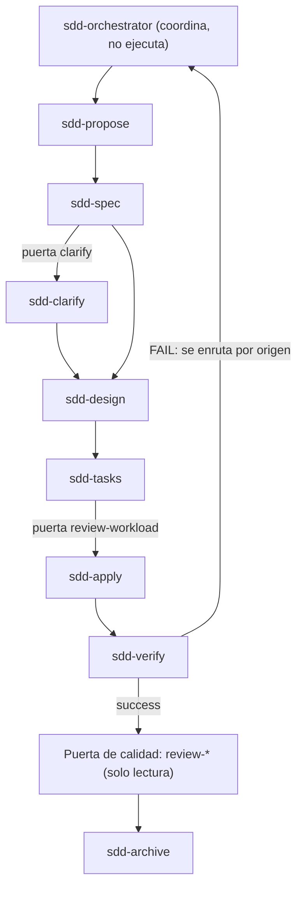

---
sidebar:
  order: 3
---

# Agentes de fase SDD (modo opcional)

> **En pocas palabras:** En SDD, un **orquestador** (`sdd-orchestrator`) coordina el cambio y delega cada fase del ciclo en un **agente de fase** (`sdd-spec`, `sdd-apply`, `sdd-verify`...) que solo hace esa fase. El orquestador no implementa: decide, pregunta y reparte el trabajo.

> **Modo SDD (opcional).** Esta página describe solo el modo SDD, que se instala con `--with-sdd`. La instalación por defecto es IDD: en ella no hay orquestador ni agentes `sdd-*`. Para el flujo por defecto, ve a [IDD](/openwiki/idd/flujo-idd.md).

---

## Cuándo se instala y cómo entra

- Se añade con `--with-sdd` a cualquier instalador, por ejemplo `npm run setup:claude -- --with-sdd` o `node scripts/configure/install-codex.js --with-sdd`.
- Una reinstalación sin el flag conserva SDD si la instalación anterior lo traía, y lo avisa. `--no-sdd` lo quita.
- El paquete incluye los agentes `sdd-*` y `foundation`, las skills `skills/sdd-*`, los comandos `/sdd-*` y las reglas `sdd-*`.
- Los agentes `review-*`, `skills/_shared/` y el runtime se quedan en cualquier instalación, porque IDD también los usa.
- Entra con un comando `/sdd-*` o con una petición explícita de trabajo guiado por especificación.

---

## Roles

| Rol | Responsabilidad |
|---|---|
| Humano | Decide el objetivo, valida los tradeoffs y acepta los riesgos. |
| `sdd-orchestrator` | Coordina las fases, aplica las guardas y delega en los agentes de fase. |
| Agentes de fase | Ejecutan una fase concreta del ciclo. |
| OpenSpec | Guarda el estado del cambio en `openspec/`: configuración, cambios activos, specs principales y archivo. |
| Skills | Inyectan reglas compactas según el contexto. |

Un orquestador que implementa se llena de contexto y pierde el control; un ejecutor que orquesta rompe el flujo. Por eso cada pieza hace una sola cosa.

---

## Orquestador: `sdd-orchestrator`

Es el único agente de SDD que el usuario invoca directamente (`user-invocable: true`). Mantiene un hilo de conversación fino, delega el trabajo real en sub-agentes y sintetiza los resultados. Toda pregunta al usuario pasa por él.

### Comandos

Todos los comandos `/sdd-*` se dirigen al orquestador, que delega en el agente de fase correspondiente. Ningún comando invoca un agente de fase directamente.

| Comando | Qué hace |
|---|---|
| `/sdd-new <petición>` | Clasifica el cambio, elige la ruta y arranca la primera fase. |
| `/sdd-ff <nombre>` | Planifica sin implementar: propuesta, specs, diseño y tareas. |
| `/sdd-lite <petición>` | Ruta reducida para cambios `trivial` o `small`. |
| `/sdd-continue` | Reanuda la siguiente fase pendiente leyendo `state.yaml`. |
| `/sdd-init`, `/sdd-explore`, `/sdd-propose`, `/sdd-spec`, `/sdd-clarify`, `/sdd-design`, `/sdd-tasks`, `/sdd-apply`, `/sdd-verify`, `/sdd-archive` | Ejecuta o continúa una fase concreta del cambio. |
| `/sdd-baseline`, `/sdd-workspace`, `/sdd-reconcile`, `/sdd-onboard`, `/sdd-document` | Fases de apoyo: specs base, federación multi-repo, conciliación de código ya enviado, guía y wiki. |

### Clasificación y ruta

- **Clasificación:** `trivial` y `small` van a `/sdd-lite`; `normal` y `high-risk` van al flujo estándar. Un cambio lite que crece durante la planificación o el apply se escala al estándar.
- **Ruta:** el orquestador evalúa la tabla `routing:` de `openspec/config.yaml` y activa la primera ruta que coincide. La ruta queda registrada en `state.yaml` antes de lanzar ninguna fase. Las rutas están en [Ciclo y rutas](/openwiki/sdd/ciclo-y-rutas.md).

### Puertas

| Puerta | Cuándo se ejecuta |
|---|---|
| Síntesis de intención | Antes de clasificar `/sdd-new`, `/sdd-ff` o `/sdd-lite`: el orquestador resume la petición en 2 a 4 líneas y pide confirmación. |
| `clarify` | Tras `sdd-spec`, antes de `sdd-design`. |
| `review-workload` | Tras `sdd-tasks`. Si el pronóstico indica que el cambio supera el presupuesto de revisión (400 líneas), aplica la estrategia de entrega. |
| `quality-review-gate` | Tras un `sdd-verify` con resultado `success`. La gobiernan los revisores `review-*`. |
| `impact` y `brownfield-advisory` | Solo en las rutas federada y brownfield, antes de sus fases. |

### Modo de ejecución y entrega

- **Ejecución:** `interactive` (por defecto) muestra el resultado de cada fase y pregunta si continuar; `auto` encadena las fases y muestra solo el final. La elección se cachea durante la sesión.
- **Entrega:** cuando el pronóstico de revisión lo exige, la estrategia `ask-on-risk` (por defecto) pregunta; `auto-chain` divide en PR encadenados; `single-pr` exige `size:exception` si se supera el presupuesto; `exception-ok` lo permite.

### Fallos de verify

Si `sdd-verify` devuelve `FAIL`, el orquestador no reenvía todo a `sdd-apply`. Enruta según el origen del fallo, con prioridad `spec-gap`, `design-gap`, `tasks-gap` y `code-bug`, de la fase más temprana a la más tardía. Un `code-bug` vuelve a `sdd-apply` solo con los IDs de hallazgo congelados.

### Persistencia y aprobaciones

- El estado vive en `openspec/changes/<cambio>/state.yaml`: la ruta (`route`), las aprobaciones (`approvals`) y los supuestos (`assumptions`).
- Una aprobación se registra solo cuando el usuario responde explícitamente a una pregunta. El orquestador nunca la infiere de la conversación.
- Antes de cualquier comando persistido, comprueba que existe `openspec/config.yaml`. Si no existe, pregunta una vez el perfil del equipo y prepara el contexto con `sdd-init`.

### Guarda de solapamiento

Antes de tocar ficheros, si una tarea no trivial solapa un cambio SDD activo o un dominio con specs, el orquestador pregunta si la quiere enrutar por SDD antes de seguir. "No trivial" significa que toca dos o más ficheros o introduce lógica nueva. Un cambio cosmético de un solo fichero no dispara la guarda.

---

## Agentes de fase

Cada agente de fase trabaja sobre el cambio que le asigna el orquestador. Las herramientas son las del campo `tools` de su definición.

| Agente | Fase | Qué hace | Herramientas |
|---|---|---|---|
| `sdd-init` | init | Detecta el proyecto, prepara la persistencia OpenSpec, las capacidades de testing y el registro de skills. | read, search, edit, execute |
| `foundation` | foundation | Delegado del orquestador en la ruta foundation: en un proyecto vacío, descubre objetivos y restricciones, escribe los documentos de producto y los ADR, y deja la configuración de IDD (`idd/config.yaml`). Solo se instala con `--with-sdd`. La skill `foundation` se instala en cualquier modo y es independiente de SDD. | read, search, edit |
| `sdd-workspace` | workspace | Gestiona el atlas de la federación multi-repo (init, enroll, explore, status, impact, general-baseline). Solo escribe en un miembro al enrolarlo. | read, search, edit, execute |
| `sdd-baseline` | baseline | En repos heredados, siembra `openspec/specs/` con specs del comportamiento existente, por dominio y de forma reanudable. | read, search, edit, execute |
| `sdd-explore` | explore | Investiga una idea: código actual, opciones, riesgos y un enfoque recomendado. | read, search, edit |
| `sdd-propose` | propose | Redacta la propuesta: intención, alcance, capacidades, enfoque, riesgos y plan de rollback. | read, search, edit |
| `sdd-spec` | spec | Escribe requisitos y escenarios como specs nuevas o delta de OpenSpec. | read, search, edit |
| `sdd-clarify` | clarify | Reduce las ambigüedades antes del diseño: hasta 5 preguntas, y las respuestas aceptadas se incorporan a las specs del cambio. | read, search, edit |
| `sdd-design` | design | Crea el diseño técnico: decisiones de arquitectura, flujo de datos, ficheros a cambiar y estrategia de testing. | read, search, edit |
| `sdd-tasks` | tasks | Divide el cambio en tareas concretas con un pronóstico de carga de revisión. | read, search, edit |
| `sdd-apply` | apply | Implementa las tareas asignadas siguiendo specs y diseño. Con Strict TDD activo, deja evidencia de TDD (test que falla, luego pasa). | read, search, edit, execute |
| `sdd-verify` | verify | Verifica la implementación contra specs, diseño, tareas y evidencia de tests ejecutados. | read, search, edit, execute |
| `sdd-archive` | archive | Archiva un cambio verificado emitiendo `archive-plan.json`. El commit lo hace el runtime, no el agente. | read, search, edit, execute |
| `sdd-reconcile` | reconcile | Incorpora a una spec base el código ya enviado y sin documentar, como delta retroactivo acotado por una ventana de diff. | read, search, edit, execute |
| `sdd-onboard` | onboard | Guía un ciclo SDD real sobre el código del repositorio actual. | read, search, edit, execute |
| `sdd-document` | document | Genera o actualiza las páginas de la wiki técnica del repositorio. | read, search, edit, execute |

### Revisores en la puerta de calidad

Tras un `sdd-verify` correcto, el orquestador lanza la puerta de calidad con los revisores de solo lectura `review-trust`, `review-runtime`, `review-evolution`, `review-efficiency`, `review-change` y `review-correction`. El catálogo completo y la diferencia con IDD están en [Agentes y Habilidades](/openwiki/agents-skills/agents-and-skills.md).

### Flujo del ciclo

El orden base es `proposal -> specs -> [clarify?] -> design -> tasks -> apply -> verify -> archive`. Las rutas alternativas (hotfix, bugfix, refactor, brownfield, federated, foundation) reducen o cambian el orden.

---

## Más información

- [Modo SDD](/openwiki/sdd/modo-sdd.md): qué es SDD y cuándo usarlo.
- [Ciclo y rutas](/openwiki/sdd/ciclo-y-rutas.md): fases, rutas y puertas.
- [Persistencia en OpenSpec](/openwiki/sdd/persistencia-openspec.md): `openspec/changes/` y `state.yaml`.
- [Verificación SDD](/openwiki/sdd/verificacion-sdd.md): `sdd-verify`, `apply-progress` y TDD en SDD.
- [Metodología SDD](https://github.com/snakeblack/ospec-workflow/blob/main/docs/sdd-metodologia.es.md) en el repositorio.
