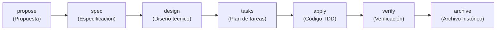

---
sidebar:
  order: 2
---

# Ciclo y rutas SDD: fases, comandos y gates

> **En pocas palabras:** Esta página describe **solo el modo SDD (opcional)**. Un cambio SDD recorre siete fases, cada una con su artefacto. El orquestador elige la ruta que corresponde al cambio según la tabla `routing:` de `openspec/config.yaml`, y se detiene en gates concretos para preguntar o revisar. IDD, el flujo por defecto, no tiene fases ni rutas: ver [Orquestación](/openwiki/orchestration/routing.md).

---

## El ciclo de siete fases



Cada fase la ejecuta un agente `sdd-*` y deja un artefacto en `openspec/changes/<cambio>/`:

| Fase | Artefacto | Qué resuelve |
|---|---|---|
| `propose` | `proposal.md` (o `proposal-lite.md` en cambios triviales o pequeños) | Qué problema se resuelve, qué entra y qué queda fuera, capacidades, riesgos, rollback y criterios de éxito. |
| `spec` | `specs/<dominio>/spec.md` | Comportamiento observable en Given/When/Then, con RFC 2119 (MUST, SHOULD…). Qué debe pasar, no cómo. |
| `clarify` | Sección `## Clarifications` dentro de los specs | Gate de ambigüedad entre `spec` y `design`. |
| `design` | `design.md` | Cómo se construye: decisiones, flujo de datos, contratos, archivos afectados, pruebas y migración. |
| `tasks` | `tasks.md` | Tareas pequeñas con archivo, acción y criterio, y el pronóstico de carga de revisión. |
| `apply` | Código, `tasks.md` y `apply-progress.md` | Implementa solo las tareas asignadas y, con Strict TDD, registra cada ciclo rojo-verde. |
| `verify` | `verify-report.md` | Veredicto con niveles de evidencia y el origen probable de cada problema. |
| `archive` | Specs principales, `archive-report.md` y carpeta archivada | Fusiona los specs del cambio en `openspec/specs/` y mueve el cambio a `openspec/changes/archive/`. |

Los comandos no invocan los agentes de fase directamente. El orquestador valida el estado y delega. `propose` escribe `proposal-lite.md` solo en el flujo reducido. El gate `clarify` corre tras `spec`, pero solo pregunta si detecta ambigüedades materiales.

---

## Comandos `/sdd-*`

| Necesidad | Comandos |
|---|---|
| Arrancar en un proyecto | `/sdd-init` (detecta stack, tests y estado de Strict TDD), `/sdd-onboard` (recorre un ciclo real pequeño en tu repo). |
| Empezar un cambio | `/sdd-new <nombre> <petición>`, `/sdd-lite <nombre>` (solo cambios triviales o pequeños), `/sdd-ff <nombre>` (propuesta, specs, diseño y tareas de una vez). |
| Planificar por partes | `/sdd-explore`, `/sdd-propose`, `/sdd-spec`, `/sdd-clarify`, `/sdd-design`, `/sdd-tasks`. |
| Continuar y cerrar | `/sdd-continue` (siguiente fase lista según el estado), `/sdd-apply`, `/sdd-verify`, `/sdd-archive`. |
| Proyectos existentes y varios repos | `/sdd-baseline` (línea base de specs en proyectos sin ellos), `/sdd-reconcile` (incorpora al spec de un dominio cambios ya enviados y sin documentar), `/sdd-workspace` (federación multi-repo), `/sdd-document` (páginas de arquitectura y estado). |

Un flujo típico en un proyecto con código:

```text
/sdd-init
/sdd-new add-user-session-timeout
/sdd-continue add-user-session-timeout
/sdd-apply add-user-session-timeout
/sdd-verify add-user-session-timeout
/sdd-archive add-user-session-timeout
```

---

## Modos de ejecución y entrega

El orquestador pregunta dos cosas la primera vez, y las cachea:

| Modo | Comportamiento |
|---|---|
| **Interactive** (por defecto) | Muestra el resumen tras cada fase y pregunta si continuar, parar o ajustar. |
| **Automatic** | Ejecuta las fases seguidas y muestra el resultado final, salvo que un gate bloquee. |

| Estrategia de entrega | Comportamiento |
|---|---|
| `ask-on-risk` (por defecto) | Pregunta solo si el cambio supera el presupuesto de revisión. |
| `auto-chain` | Divide el cambio en PRs encadenadas. |
| `single-pr` | Intenta una sola PR y exige `size:exception` si supera el presupuesto. |
| `exception-ok` | Acepta una PR grande con excepción explícita. |

Automático no significa sin guardas: si hay riesgo de revisión, el gate manda.

---

## Catálogo de rutas

El orquestador lee la tabla `routing:` de `openspec/config.yaml`. Las rutas contextuales (`foundation`, `federated` y `brownfield`) se evalúan primero; después, el resto en el orden declarado, y **gana la primera que cumple sus condiciones y su clasificación**. Una ruta fijada al empezar un cambio no cambia en mitad de camino: si aparece evidencia que la contradice, el orquestador se detiene y pregunta.

| Ruta | Cuándo | Fases | Gates | Coste |
|---|---|---|---|---|
| `foundation` | Proyecto vacío, sin arquitectura detectada. | `foundation` (para aquí; no encadena con `standard`) | — | medio |
| `federated` | Cambio coordinado en varios repos del workspace. | `sdd-workspace` → `propose` → `spec` → `design` → `tasks` → `apply` → `verify` → `archive` | `impact`, `clarify` | alto |
| `brownfield` | Proyecto con código pero sin specs, o con la línea base pendiente. | `sdd-baseline` (solo con consentimiento; luego reenruta al cambio) | `brownfield-advisory` | medio |
| `standard` | Funcionalidad normal o de alto riesgo en un proyecto activo. | `propose` → `spec` → `design` → `tasks` → `apply` → `verify` → `archive` | `clarify`, `quality-review-gate` | alto |
| `bugfix` | Corrección de un fallo, tras investigar su causa. Solo con intención explícita. | `explore` → `tasks` → `apply` → `verify` → `archive` | `quality-review-gate` | medio |
| `refactor` | Reestructuración sin cambiar el comportamiento externo. Solo con intención explícita. | `design` → `tasks` → `apply` → `verify` → `archive` | `quality-review-gate` | medio |
| `hotfix` | Parche urgente o cambio trivial que debe aplicarse ya. Solo con intención explícita. | `apply` → `verify` → `archive` | — | bajo |
| `lite` | Cambio pequeño y de bajo riesgo. | `propose` (genera `proposal-lite.md`) → `tasks` → `apply` → `verify` → `archive` | — | bajo |

Notas:

- `bugfix`, `refactor` y `hotfix` solo se eligen cuando el usuario marca la intención (`explicit_*_intent`). Nunca se infieren solo del tamaño del cambio.
- `lite` no tiene specs ni diseño formal, y no declara gates.
- Si el cambio toca autenticación o seguridad, o migra datos, las rutas `lite` y `hotfix` quedan descartadas por el suelo de riesgo.
- Una ruta es una intención distinta del usuario, no una variante de configuración. Un ajuste de una fase se resuelve con un gate o una opción de fase, no con una ruta nueva.

Fuente: `openspec/config.yaml` (`routing:`). Para el detalle de cada fase, ver [docs/sdd-fases.md](https://github.com/snakeblack/ospec-workflow/blob/main/docs/sdd-fases.md) y [docs/sdd-workflows.md](https://github.com/snakeblack/ospec-workflow/blob/main/docs/sdd-workflows.md).

---

## Gates del orquestador

Un gate es una comprobación que corre en un punto concreto de la ruta. No produce un artefacto principal; registra su resultado en `state.yaml`.

| Gate | Cuándo corre | Qué hace |
|---|---|---|
| `impact` | Antes de la propuesta (ruta `federated`). | Calcula el impacto de los cambios de contrato entre repos. Bloquea diseño e implementación si encuentra contratos rotos sin resolver. |
| `brownfield-advisory` | Antes de cualquier fase (ruta `brownfield`). | Explica la línea base y pide consentimiento para `sdd-baseline`. |
| `clarify` | Tras `spec`, antes de `design`. | Busca ambigüedades que cambiarían la arquitectura, los datos, las pruebas o el alcance. Hace como máximo 5 preguntas en una sola ronda. Si no hay ambigüedades, pasa sin preguntar. Si respondes `stop`, `done` o `skip`, termina con cobertura parcial. |
| `review-workload` | Tras `tasks`, antes de `apply`. | Si el cambio supera **400 líneas modificadas** (`additions + deletions`), pide dividirlo en PRs encadenadas o aceptar `size:exception`. |
| `quality-review-gate` | Tras un `verify` con éxito. | Clasifica el cambio y elige revisores de cuatro dimensiones: confianza, runtime, evolución y eficiencia. El riesgo alto activa las cuatro. Cada revisor actúa una sola vez, y las correcciones están acotadas. |

Dos reglas de cierre:

- **Revisión de calidad.** Es consultiva por defecto (`on_blocker: advisory`). Un hallazgo `BLOCKER` o `CRITICAL` se muestra al usuario antes de cerrar la ruta, pero no detiene la ejecución por sí solo.
- **Veredicto y archivo.** `sdd-verify` cierra en `PASS`, `PASS WITH WARNINGS` o `FAIL`. `sdd-archive` bloquea `FAIL` por completo, y con `PASS WITH WARNINGS` solo avanza si los riesgos quedan aceptados o convertidos en seguimiento. Ver [Verificación en SDD](/openwiki/sdd/verificacion-sdd.md).

El límite de 400 líneas existe para proteger la atención del revisor humano. Un cambio que lo supera se divide en PRs encadenadas (`stacked-to-main` si los trozos entran en `main` en orden, `feature-branch-chain` si necesitan integrarse antes) o se acepta con `size:exception`, que debe ser una decisión consciente.

Para el detalle de cómo el orquestador delega y pregunta, ver [Agentes de fase](/openwiki/sdd/agentes-de-fase.md). Para el estado y su recuperación, ver [Persistencia en OpenSpec](/openwiki/sdd/persistencia-openspec.md).
