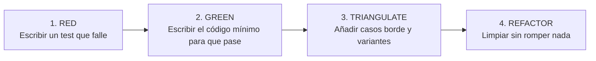

---
sidebar:
  order: 5
---

# Verificación en modo SDD (opcional)

> **Solo modo SDD (opcional).** Esta página describe cómo verifica el modo SDD: el ciclo Strict TDD de la fase `sdd-apply`, su tabla de evidencias en `apply-progress.md` y el agente `sdd-verify`. Estos artefactos no existen en IDD. IDD registra su evidencia con el CLI `ospec`; ver [Testing, calidad y Strict TDD](/openwiki/testing-quality/verification.md).

---

## Strict TDD en SDD

Strict TDD se activa cuando `openspec/config.yaml` establece `testing.tdd_mode: strict` y hay un test runner disponible. El modo sale del perfil `team:` de `openspec/config.yaml`: `solo` → `standard`, `small` → `focused` y `multi-team` → `strict`. Una escala heredada `scale` (por ejemplo `enterprise`) sigue decidiendo los defaults cuando no hay perfil.



Cuando está activo, `sdd-apply` sigue este ciclo por tarea:

```text
SAFETY NET -> RED -> GREEN -> TRIANGULATE -> REFACTOR
```

| Paso | Qué exige |
| --- | --- |
| Safety Net | Ejecutar los tests existentes relevantes antes de tocar código existente. |
| RED | Escribir primero un test que falle o que apunte a código aún inexistente. |
| GREEN | Implementar lo mínimo para que el test pase, y ejecutarlo. |
| TRIANGULATE | Añadir casos distintos que fuerzen lógica real, no un valor fijo. |
| REFACTOR | Mejorar el código manteniendo los tests en verde. |

TDD no es "hacer tests". Es diseñar desde el comportamiento. Escribir el código primero y un test que lo acompaña puede ser testing, pero no es TDD.

### Capa de test

La capa se elige por lo que hace la tarea, a partir de las capacidades de testing de `openspec/config.yaml` o de los ficheros del proyecto:

| Tipo de comportamiento | Capa |
| --- | --- |
| Lógica pura, utilidad, cálculo, transformación de datos | Unitaria |
| Render de componente, interacción, cambios de estado | Integración si hay herramientas; si no, unitaria con mocks |
| Flujo entre componentes, API, contexto o provider | Integración si hay herramientas; si no, unitaria con mocks |
| Flujo crítico de negocio, journey completo, navegación entre páginas | E2E si hay herramientas; si no, integración; si no, unitaria |
| Cualquier otro caso | Unitaria (por defecto) |

Regla clave: usar la capa más pequeña disponible que observe el contrato y sus caminos de fallo. Un test unitario con mocks no establece comportamiento real de integración o E2E: si falta la capa necesaria, se ejecutan comprobaciones más estrechas y se reporta la evidencia que falta para una verificación posterior. No se rediseñan las fronteras de producción solo para encajar una herramienta de test.

### Calidad de aserciones

Cada aserción debe verificar comportamiento real: llamar código de producción y comparar con un valor concreto derivado de la especificación. Un test que pasa sin ejercitar la lógica de producción es peor que no tener test, porque da confianza falsa.

| Patrón prohibido | Por qué no vale |
| --- | --- |
| `expect(true).toBe(true)`, `assert 1 == 1` | Tautología: no interviene código de producción. |
| `toEqual([])`, `toHaveLength(0)` sin preparar la condición de vacío | Solo es válido si el setup fuerza el vacío; si no, la aserción es trivial. |
| `toBeDefined()`, `not.toBeNull()`, `is not None` como única aserción | Prueba existencia, no el valor. |
| Aserción dentro de un bucle que puede iterar cero veces | La aserción nunca se ejecuta. Antes se comprueba que la colección no está vacía. |
| Solo `render` y comprobar que el contenedor existe | Es un smoke test: no cuenta como test unitario, de integración ni de TDD. |
| Aserciones de nombres de clases CSS | Acoplan a la implementación visual. Se verifica el resultado semántico (rol, texto visible, botón deshabilitado) o una comparación visual en E2E. |
| Llamadas a mocks o estado interno como único criterio | Se rompen con cualquier refactor. Se aserta lo observable. |

Un GREEN que pasa porque el setup no ejercita el camino de código tampoco cuenta: hay que añadir un caso (TRIANGULATE) donde sí se ejecute.

### Guardas de pre-commit

El repositorio incluye un hook de pre-commit que aplica las reglas de Strict TDD:

- Con `testing.tdd_mode: strict`, si el commit toca archivos de producción en rutas activas (por ejemplo `internal/`, `cmd/`, `scripts/hooks/`, `scripts/lib/`), exige que también vaya al menos un archivo de pruebas (`*_test.go`, `*.test.js`) o el `tasks.md` del cambio.
- Ejecuta `scripts/check.js` localmente para comprobar la paridad de los targets y evitar subir código con errores de sintaxis o tests rotos.
- Se instala con `npm run setup:git-hooks`. Se puede omitir de forma temporal con `DISABLE_OSPEC_PRECOMMIT=true` o con `git commit --no-verify`.

En IDD, el mismo hook sigue `strict_tdd` cuando el proyecto declara `idd/config.yaml`. Con `mode: sdd`, o sin ese fichero, sigue `testing.tdd_mode`. `ospec doctor` avisa si ambas fuentes no coinciden.

---

## Evidencia obligatoria en apply-progress.md

`sdd-apply` guarda una tabla de evidencia en `apply-progress.md`:

```markdown
| Task | Test File | Layer | Safety Net | RED | GREEN | TRIANGULATE | REFACTOR |
| --- | --- | --- | --- | --- | --- | --- | --- |
```

`sdd-verify` comprueba después esa tabla contra archivos y ejecuciones reales. Si la evidencia falta o no se puede probar, es `CRITICAL`.

`apply-progress.md` no es un snapshot descartable: `sdd-apply` lee el progreso previo y lo fusiona en modo append, para no perder evidencia histórica.

En paralelo, `tasks.md` refleja el estado real del trabajo:

- `[ ]` no empezado
- `[~]` implementado, con verificación local pendiente
- `[x]` implementado y verificado localmente

---

## Niveles de evidencia en verify

`sdd-verify` clasifica cada escenario con la evidencia más fuerte que puede probar:

| Nivel | Qué demuestra |
| --- | --- |
| `runtime-test` | Un test automatizado se ejecutó y pasó. |
| `static-proof` | Build, typecheck, validación de schema u otra comprobación equivalente prueba el comportamiento. |
| `inspection-proof` | La inspección del código vincula el escenario con rutas concretas y una justificación técnica. |
| `manual-proof` | Hubo una verificación manual registrada. |
| `no-proof` | No hay evidencia creíble. |

Regla dura:

- Un MUST necesita `runtime-test` o un `static-proof` aceptado.
- Un SHOULD puede pasar con `inspection-proof`, pero deja un WARNING.
- Un MAY puede vivir con evidencia más débil si la limitación queda documentada.
- `no-proof` es `CRITICAL` para un MUST y `WARNING` para un SHOULD o un MAY.

---

## Veredictos y routing

| Veredicto | Uso |
| --- | --- |
| `PASS` | No hay hallazgos que bloqueen y la evidencia cumple el nivel exigido. |
| `PASS WITH WARNINGS` | El cambio es aceptable, pero quedan riesgos o pruebas más débiles de lo ideal. |
| `FAIL` | Hay `CRITICAL`, tareas core incompletas o falta evidencia obligatoria. |

Cada `CRITICAL` o `WARNING` sale con una pista de origen: `code-bug`, `tasks-gap`, `design-gap` o `spec-gap`. Así se evita arreglar cualquier cosa sin tocar la fuente real del problema.

`sdd-archive` solo cierra cambios con `PASS` o con `PASS WITH WARNINGS` cuyos riesgos queden aceptados o convertidos en follow-up. Un `FAIL` bloquea el archivo.

---

## Verificación independiente (sdd-verify)

Cuando el programador termina, `sdd-verify`:

- Vuelve a ejecutar los tests y comprueba la evidencia de `apply-progress.md` contra archivos y ejecuciones reales.
- Busca tests vacíos, falsos positivos o pruebas que nunca ejerciten el código real.
- Re-presenta cada supuesto sin resolver del Assumption Ledger para confirmarlo, corregirlo o promoverlo a aclaración (la última solo marca `status: promoted`; no dispara `sdd-clarify`).

---

## Presupuesto y estrategia de entrega

`sdd-tasks` incluye cerca del principio un bloque de decisión:

```text
Decision needed before apply: Yes|No
Chained PRs recommended: Yes|No
Chain strategy: stacked-to-main|feature-branch-chain|size-exception|pending
400-line budget risk: Low|Medium|High
```

El presupuesto base de 400 líneas cambiadas es el mismo que en IDD (ver [Testing, calidad y Strict TDD](/openwiki/testing-quality/verification.md)).

| Estrategia | Uso |
| --- | --- |
| `ask-on-risk` | Valor seguro por defecto: si hay riesgo alto, pregunta antes de aplicar. |
| `auto-chain` | Divide automáticamente en slices revisables. |
| `single-pr` | Obliga a aceptar `size:exception` si se supera el presupuesto. |
| `exception-ok` | Continúa porque la excepción ya está aceptada. |

| Tipo de cadena | Cómo funciona |
| --- | --- |
| `stacked-to-main` | PRs pequeñas que entran a `main` en orden. |
| `feature-branch-chain` | Una rama tracker acumula la feature; cada PR hija apunta a la anterior. |
| `size:exception` | Una sola PR grande con aprobación consciente. |

Si los slices son independientes, `stacked-to-main` suele ser más simple. Si hay que integrar antes de tocar `main`, `feature-branch-chain` da más control. Si el diff es generado o indivisible, `size:exception` puede ser razonable.

Referencia técnica completa: [docs/tdd-y-revision.md](https://github.com/snakeblack/ospec-workflow/blob/main/docs/tdd-y-revision.md).
