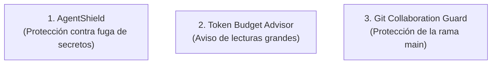

# Guardrails de Seguridad, Secretos y Presupuestos

> **En pocas palabras:** Es fácil que una IA cometa un descuido, como escribir una clave privada en un fichero o leer un archivo enorme sin que nadie lo note. Los **Guardrails** son los escudos protectores del harness: unos bloquean la acción directamente y otros te piden confirmación antes de que ocurra.

---

## Los 3 Escudos Protectores

---

## 1. AgentShield: Detección y Bloqueo de Secretos
- **¿Qué hace?** Revisa en tiempo real, antes de que la herramienta actúe, los ficheros que la IA lee o escribe, el texto que escribe o modifica en un fichero, y los ficheros que un comando de shell lee (como `cat`, `grep` o `cp`). No busca secretos en el texto de los comandos.
- **¿Qué detecta?**
  - Por nombre de fichero: claves privadas SSH y ficheros `*.key` (bloqueo); `.npmrc` y el `.git/config` del repositorio (bloqueo); `.env*`, `secrets.json` y `credentials` (confirmación).
  - Por contenido, en ficheros de menos de 1 MB y en el texto escrito: tokens conocidos de GitHub, AWS, OpenAI, Anthropic, Google, Slack, Stripe, npm, GitLab, Hugging Face y SendGrid; cabeceras de clave privada; JWT; y asignaciones como `password = "..."` o `token: "..."` (confirmación).
- **Acción:** Hay dos niveles:
  - **Bloqueo:** la operación no se ejecuta. Cubre las claves privadas, `.npmrc`, `.git/config` y escribir un marcador `[REDACTED:…]` sobre un fichero que todavía guarda secretos reales.
  - **Confirmación:** la herramienta pregunta antes de seguir y solo continúa si la apruebas.
  - Con `bypassPermissions`, las confirmaciones pasan a ser avisos y la acción continúa; los bloqueos se mantienen.
- **Bypass:** `DISABLE_AGENT_SHIELD=true` desactiva este escudo.

---

## 2. Token Budget Advisor: Aviso de Lecturas Grandes
- **¿Qué hace?** Antes de cada herramienta, estima cuántos tokens ocupan los ficheros que la herramienta va a leer, a partir de su tamaño en disco, y pide confirmación si el total es demasiado grande. No mide las respuestas del modelo ni los prompts, no detecta bucles y nunca bloquea.
- **Cómo estima:** bytes / 4 en ficheros de código (`.js`, `.go`, `.json`, `.yaml`, `.md`, `.ts`, `.py`, `.html`, `.css` y similares) y (bytes / 6) × 1,3 en el resto. Es una aproximación, no un recuento real.
- **Límite por petición:** si los ficheros de una misma petición suman más de **50.000 tokens** estimados (unos 200 KB de código o unos 230 KB de otros formatos), pide confirmación. Funciona aunque no haya ningún cambio SDD.
- **Límite acumulado:** solo funciona con un cambio SDD activo (`status: active` en su `state.yaml`). Cada petición que pasa los controles se suma en `.ospec/session/<cambio>/token-events.jsonl`. Si el total supera **150.000 tokens**, cada llamada a herramienta pide confirmación y recomienda compactar, incluidas las que no leen ficheros. El registro no se reinicia solo: se libera borrando ese fichero o cambiando el cambio activo. Fuera de SDD (por ejemplo, en IDD) no se acumula nada.
- **Bypass:** `DISABLE_TOKEN_ADVISOR=true` desactiva este aviso.

---

## 3. Git Collaboration Guard: Protección del Historial
- **¿Qué hace?** Antes de un `git commit`, pide confirmación si estás en la rama principal (`main`) o si hay cambios sin confirmar.
- **Alcance:** Solo actúa sobre `git commit`. No comprueba `push` ni impone nombres de rama.
