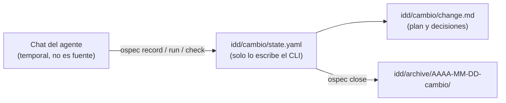

# Persistencia y Estado: el disco como fuente de verdad

> **En pocas palabras:** Las ventanas de chat de los asistentes de IA son temporales y se borran. En `ospec-workflow`, **el chat nunca es la fuente de la verdad**. En el flujo por defecto, IDD, el estado de cada cambio vive en `idd/<cambio>/`: `state.yaml` lo escribe solo el CLI `ospec` y `change.md` guarda el plan y las decisiones. Al cerrar el cambio con `ospec close`, su carpeta pasa a `idd/archive/`.

---

## Dónde vive el estado de un cambio IDD

```text
idd/
├── config.yaml                 # Configuración IDD: checks, impact, contracts, team, strict_tdd, mode
├── <cambio>/                   # Cambio abierto
│   ├── state.yaml              # Estado del CLI: intención, señales, obligaciones, gates y evidencia
│   └── change.md               # Plan y decisiones vivas (solo si el cambio tiene living-doc)
└── archive/
    └── AAAA-MM-DD-<cambio>/    # Cambio cerrado con `ospec close`, con los ficheros que tenía
```



---

## state.yaml: solo lo escribe el CLI

- Es JSON válido (YAML 1.2) con `schema: idd-state/v1`. El modelo no lo edita nunca.
- Guarda `change`, `mode`, `status` (`open` o `closed`), `intent` (tipo, resumen y criterio de aceptación), `facts` (preguntas abiertas), `assumptions`, `signals`, `obligations`, `gates`, `evidence` y, cuando aplica, `base`, `plan`, `runs`, `reviews`, `impacts` y `closed_at`.
- `base` es el commit `HEAD` en el momento de abrir el cambio. No se mueve después.
- Cada escritura va bajo un lock y reemplaza el fichero de forma atómica. Un `record` repetido que no cambia nada deja el fichero byte a byte igual.
- Si una escritura se interrumpe, el último estado válido sigue legible. Si solo queda `state.yaml.bak`, `ospec doctor` lo señala y recomienda `ospec status`.
- La evidencia no se escribe a mano: `ospec record` no acepta evidencia, y solo los comandos que observan una ejecución (`ospec run`, `ospec check`, `ospec review`) la registran.

## change.md: plan y decisiones

- Tiene cuatro secciones en orden: `Intent and acceptance`, `Plan`, `Decisions` y `Evidence`.
- El modelo escribe las tres primeras. La sección `Evidence` la reescribe solo el CLI, entre los marcadores `<!-- ospec:evidence:start -->` y `<!-- ospec:evidence:end -->`.
- Solo existe cuando la obligación `living-doc` está activa. Un cambio trivial, cuya única obligación es `checks-pass`, no tiene `change.md`.
- La obligación `living-doc` se satisface al cerrar, y solo si `Plan` y `Decisions` no están vacíos.
- Una decisión de desarrollo se queda en `change.md`. Nunca se convierte en ADR.

## idd/config.yaml: configuración, no estado

- Claves permitidas: `mode`, `strict_tdd`, `team`, `checks`, `impact`, `contracts`. Cualquier otra clave se rechaza con `config-invalid`.
- Es opcional, pero sin al menos un `checks:` ningún cambio IDD puede cerrarse. `ospec next` propone el paso `configure-checks` y el agente pide aprobación antes de escribir el comando. Ni `record`, `next`, `check` ni `doctor` crean este fichero.
- Ejemplo real de este repositorio:

```yaml
checks:
  test: node scripts/check.js
```

## Conocimiento del proyecto fuera de idd/

- `idd/` guarda configuración y estado del cambio. Nunca guarda specs canónicas ni conocimiento del proyecto.
- Las decisiones de arquitectura viven como ADR en `docs/architecture/decisions/`. Si un cambio enmienda o sustituye uno, se escribe un ADR nuevo con la plantilla de la skill `foundation`; un ADR aceptado no se reescribe.
- Los documentos de contrato se declaran en `contracts:` de `idd/config.yaml`.
- Al cerrar, `ospec close` devuelve `records` con el conocimiento del cambio para una memoria entre sesiones, si el agente tiene una. El CLI no lee ni escribe esa memoria.

## Recuperación y cierre

- Si se pierde el chat, no se pierde el estado. En una sesión nueva, `ospec next --change <id>` lee el disco y devuelve el siguiente paso. Es de solo lectura.
- `ospec close` es transaccional. Si falta evidencia, rechaza el cierre y deja el cambio abierto donde estaba. Si el movimiento a `idd/archive/` se interrumpe, volver a ejecutarlo lo termina.
- `idd/` se versiona con el resto del repositorio. La confirmación y los commits los decide el usuario.

## Por qué el estado vive en disco

- **Resistente a cierres:** un editor cerrado, una batería agotada o un cambio de equipo no borran el estado de un cambio.
- **Historial de Git:** el plan, las decisiones y el archivo quedan en el historial del repositorio cuando el usuario confirma los commits.
- **Auditoría:** un cambio cerrado queda en `idd/archive/` para consulta futura.

---

## Modo SDD (opcional)

El modo SDD guarda sus cambios, specs y configuración en `openspec/`, con otra estructura y otro ciclo de fases. Esa estructura es exclusiva del modo SDD, que solo entra con un comando `/sdd-*` o una petición explícita. Se describe en [Persistencia en modo SDD (openspec)](/openwiki/sdd/persistencia-openspec.md). IDD no lee ni escribe nada bajo `openspec/`.
