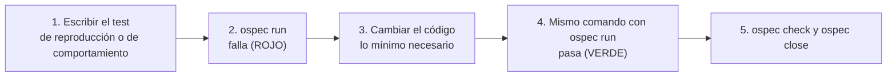

# Testing, Calidad y Strict TDD

> **En pocas palabras:** La calidad no se comprueba al final: se exige desde el primer cambio. En IDD, **la evidencia solo cuenta si el CLI `ospec` la observa ejecutarse** sobre el árbol actual. Decir "los tests pasan" no satisface ninguna obligación. Un cambio está hecho solo cuando `ospec close` tiene éxito.

---

## Evidencia observada, no declarada

Cada obligación se satisface con un registro que hace el CLI al ejecutar el comando, no con lo que el agente afirma:

| Obligación | Qué la satisface | Comando que la registra |
| --- | --- | --- |
| `checks-pass` | Todos los `checks:` de `idd/config.yaml` pasan sobre el mismo árbol | `ospec check` |
| `boundary-tests` | Un check que pasa sobre el árbol actual, reporta más de cero tests y falla en la base con los tests del diff | `ospec check` |
| `repro-test` | Un test de reproducción del diff que falla antes del arreglo, pasa después y falla en la base | `ospec run --obligation repro-test --command "<test>"` |
| `tdd-red-green` | El mismo par rojo-verde, por unidad de trabajo | `ospec run --obligation tdd-red-green --command "<test>"`, con `--unit` si aplica |
| `migration-compat-and-test` | Plan de compatibilidad o rollback y un test de migración que pasa | `ospec run --obligation migration-compat-and-test --command "<test>" --plan "<plan>"` |
| `contract-spec-and-test` | Un documento de contrato y un test tocados por el cambio, con los checks en verde | `ospec check` |
| `trust-review` | Revisión independiente aprobada | `ospec review start`, `record`, `correct` y `validate` |
| `adr-impact-declaration` | Impacto declarado por cada ADR y sus fitness functions en verde | `ospec record impact`; `ospec record fitness` para lo manual |

Reglas que se aplican siempre:

- Un run cuyo resultado dice `tests 0`, "could not find" test files o "no tests ran" no cuenta como pasado y no satisface `boundary-tests`.
- Un comando que no arranca o termina por señal no cuenta como pasado.
- La evidencia de `checks-pass` está ligada a un árbol. Si editas después, hay que volver a ejecutar `ospec check`; mientras tanto, `ospec close` rechaza el cierre con `evidence-stale`.
- Sin al menos un check declarado en `idd/config.yaml`, ningún cambio cierra. `ospec next` propone `configure-checks`, y el agente pide aprobación antes de escribir el comando en el fichero.

---

## Rojo y verde registrados

- **`repro-test` (bugs):** antes del arreglo, el test de reproducción se ejecuta con `ospec run` y debe fallar. Después del arreglo, el mismo comando debe pasar. El CLI registra el par solo si el run verde corre sobre un árbol distinto del rojo: un run verde sobre el mismo árbol no cuenta.
- **`tdd-red-green` (Strict TDD):** el mismo par, por unidad de trabajo. Ambos runs deben compartir propósito, comando y unidad.
- **Contraprueba en la base:** demuestra que el test detecta el cambio.
  - Cuándo corre: al registrar el verde de una pareja, y antes de dar por cumplida `boundary-tests`.
  - Qué monta: un worktree temporal de la base del cambio con los tests del diff encima, y con lo que haya bajo `testdata/`, `__snapshots__/`, `fixtures/` o `__fixtures__/`. Enlaza los `node_modules`, `.venv`, `venv` y `vendor` ignorados, y nada más de lo ignorado.
  - Qué es un test: un fichero bajo `test/`, `tests/`, `__tests__/` o `spec/`, o con nombre de test: `*.test.*` y `*.spec.*` en JS y TS, el sufijo `_test` o `_spec` en cualquier lenguaje (`_test.go`, `_test.py`, `_spec.rb`…), un módulo `tests` (`tests.py` de Django, `tests.rs` de Rust), `test_*.py`, `*Test.java` y `*Tests.cs`.
  - Qué exige: el mismo comando, o los checks declarados, tiene que fallar ahí. Si pasa, la obligación sigue pendiente. La pareja exige además que el diff añada código a un test, así que `test -f marker` no cierra.
  - Límites: corre con 10 minutos de timeout, y agotarlo cuenta como fallo. Se reutiliza mientras no cambien la base, el comando y los tests.
  - Se omite con un aviso en `run`, `check` y `close` cuando no hay commit base, cuando la base no se puede montar, y cuando el diff añade código a un test inline de Rust (dentro de un `mod` bajo `#[cfg(test)]`), porque comparte fichero con el producto y la base no lo puede correr sin el cambio.

---

## Cuándo aplica Strict TDD

- La señal `strict-tdd` se deriva de `strict_tdd: true` en `idd/config.yaml`, salvo para intenciones `docs` o `refactor`. Una prueba roja describe comportamiento nuevo; un refactor conserva el comportamiento que ya prueban las pruebas existentes.
- Si `strict_tdd` no está declarado, decide el perfil de equipo `team:` de `idd/config.yaml`:

| `team.size` | Strict TDD por defecto |
| --- | --- |
| `solo` | No |
| `small` | Sí |
| `multi-team` | Sí |

- Con `team.experience: junior`, Strict TDD queda activo sea cual sea el tamaño. Sin perfil, el valor es `false`. Una clave explícita siempre gana al perfil. `ospec team` muestra el perfil y sus defaults.
- Un refactor no escribe test nuevo. Antes de la primera edición se ejecuta `ospec check`, para que el run registrado muestre qué comportamiento se conserva y que ya estaba probado.
- `ospec doctor` avisa (`strict-tdd-hook`) si el hook de pre-commit (`npm run setup:git-hooks`) y `strict_tdd` no coinciden.

---

## Tests por riesgo

Se testea lo que costaría si se rompiera: reglas de negocio, validaciones, transformaciones y mappers no triviales, algoritmos, contratos, y sus caminos de error, borde y regresión. Un accesor simple, el cableado sin lógica o una declaración no necesitan test propio. Ningún porcentaje de cobertura sustituye esta elección.

- Un test debe fallar cuando el comportamiento es incorrecto: aserta resultados observables, no las llamadas internas del código. En la ejecución roja hay que comprobar que falla por la razón esperada.
- Los tests unitarios son deterministas y offline: los dobles sustituyen bases de datos, APIs externas e infraestructura en la frontera, y el tiempo y la aleatoriedad se inyectan. Las pruebas de integración van aparte y prueban el cableado.

---

## Revisión de confianza acotada

La revisión de confianza (`trust-review`) se activa cuando el cambio toca una frontera de seguridad, según los patrones `impact:` de `idd/config.yaml` (en este repositorio, `scripts/hooks/**`). Un cambio solo de documentación cierra sin revisión.

1. `ospec review start` congela los candidatos (las rutas que el diff cambia frente a `base`) y devuelve la petición para el revisor de solo lectura `review-trust`.
2. El revisor devuelve sus hallazgos, que se registran sin modificar con `ospec review record --result @<fichero>`.
3. Sin hallazgos `BLOCKER` ni `CRITICAL`, la revisión queda aprobada y se registra la evidencia `frozen-review`.
4. Si los hay, se permite **una** corrección: `ospec review correct` acepta solo cambios dentro de las rutas congeladas y dentro del presupuesto de líneas. El validador de solo lectura `review-correction` resuelve esos IDs con `ospec review validate`. Si la validación falla, el ciclo termina.

Reglas de la revisión:

- Una revisión aprobada prueba solo su candidato. Si las rutas revisadas cambian, `trust-review` vuelve a `pending`. Si vuelven al contenido aprobado, se satisface otra vez sin nueva revisión.
- Si una corrección no cabe en el presupuesto o toca una ruta no congelada, `ospec review correct` lo rechaza y `ospec review start` cierra la revisión como `escalated` y abre la siguiente, que hereda los hallazgos bloqueantes como `predecessor_findings`.
- Un cambio tiene como máximo 3 revisiones, más una por cada gate `review-limit` que el usuario resuelva. Las sucesoras no necesitan aprobación nueva.

---

## Presupuesto de revisión

El presupuesto base es de **400 líneas cambiadas** (adiciones más eliminaciones). No es una ley física: es una barrera contra revisiones imposibles. Todas las estrategias de entrega la mantienen. El perfil de equipo decide la estrategia por defecto: `solo` usa `single-pr`, `small` usa `ask-on-risk` y `multi-team` usa `auto-chain`. `ospec next` propone la que corresponde. Si el diff supera el presupuesto, la skill `chained-pr` divide el cambio en PRs encadenadas.

---

## Verificación en modo SDD (opcional)

En el modo SDD, la verificación es otra: la tabla de evidencias de `apply-progress.md`, el ciclo Strict TDD de la fase `sdd-apply` y el agente `sdd-verify`. Esos artefactos existen solo en SDD y se describen en [Verificación en modo SDD (opcional)](/openwiki/sdd/verificacion-sdd.md).
