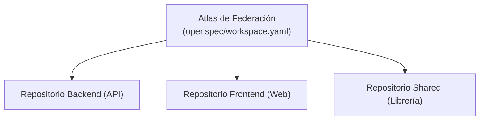

# Federación de Workspaces Multi-Repositorio

> **En pocas palabras:** En organizaciones grandes, un cambio de software suele involucrar varios repositorios a la vez (por ejemplo, el backend, el frontend y la librería de componentes). En IDD, el flujo por defecto, cada repositorio tiene **su propio cambio**, cerrado con su propia evidencia. La **Federación de Workspaces** pertenece al **modo SDD (opcional)**: coordina esos repositorios con un atlas para que el ciclo SDD aplique y verifique cambios cruzados de forma unificada y segura.

---

## Cambios entre repositorios en IDD

`ospec` trabaja sobre una única raíz de repositorio. Un cambio que atraviesa varios repositorios es **un cambio IDD por repositorio**, y cada uno se cierra con su propia evidencia (`ospec close` solo tiene éxito cuando se cumplen sus obligaciones).

- Mantén compatible un contrato compartido hasta que todos los consumidores migren: primero amplía el proveedor, después migra los consumidores y elimina la forma antigua al final.
- En un monorepo cuyos servicios tienen sus manifiestos bajo la raíz, propón al usuario las entradas `impact:` de `idd/config.yaml` (el `stack` y las rutas de contrato, datos y seguridad de cada servicio).

Para el flujo completo, ver [el flujo IDD](/openwiki/idd/flujo-idd.md).

---

## Modo SDD (opcional): atlas de federación

> Esta sección describe el **modo SDD (opcional)**, que se instala con `--with-sdd`. Ver [el modo SDD](/openwiki/sdd/modo-sdd.md).

### Cómo Funciona el Atlas de Federación

1. **Marcador de Miembro:** Cada repositorio participante contiene un archivo marcador (`openspec/federation.member.yaml`) que define su rol e identidad.
2. **Atlas Central:** El orquestador federado (`sdd-workspace`) lee los marcadores y genera un mapa coordinado de dependencias.
3. **Análisis de Impacto:** Antes de aplicar un cambio, evalúa si una modificación en un repositorio afectará a los contratos o APIs de los repositorios hermanos.
